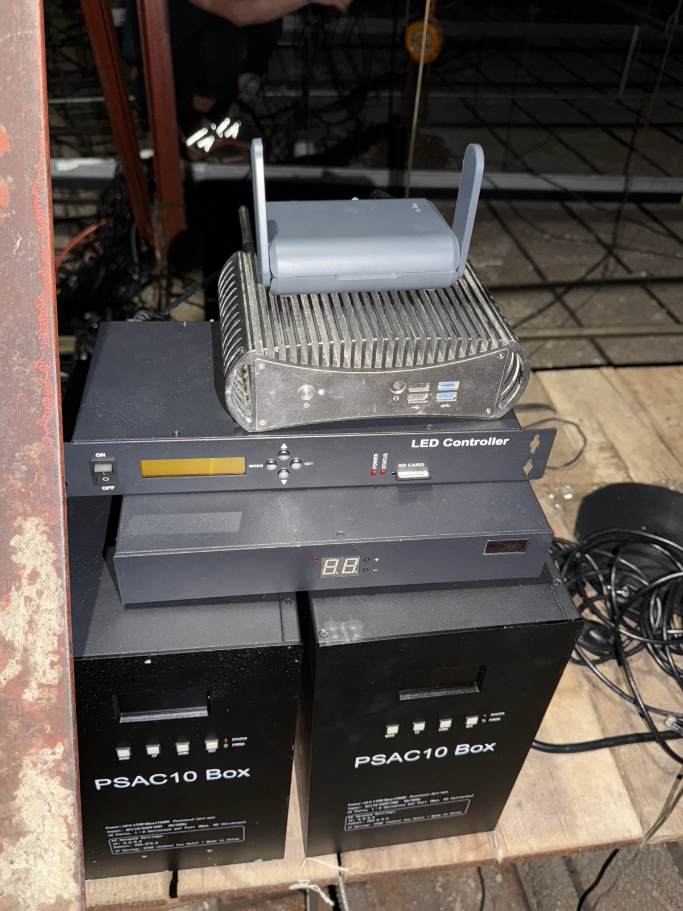
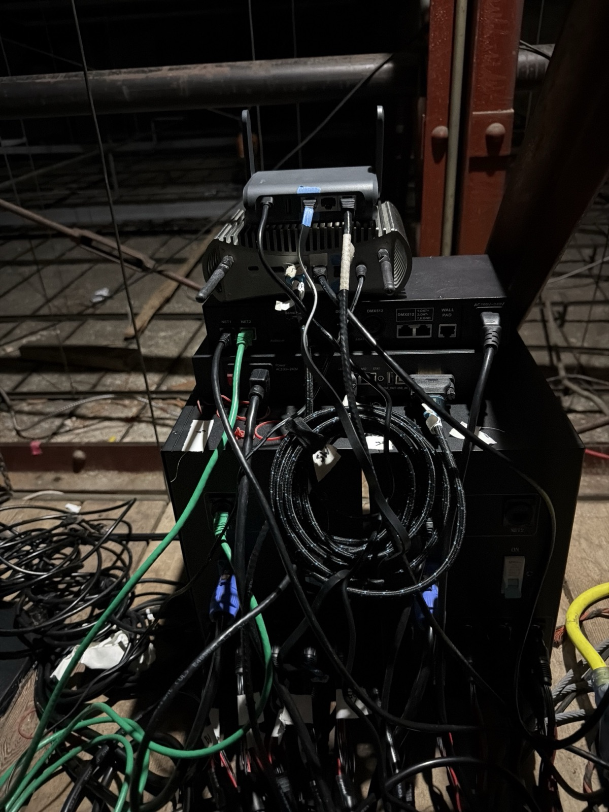
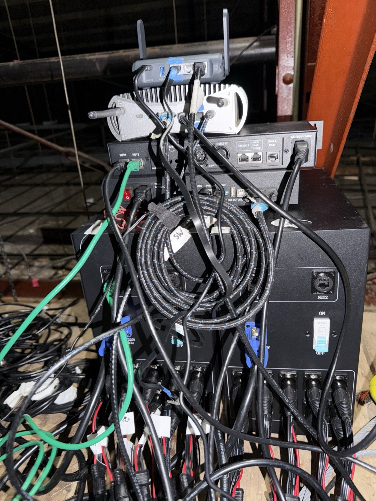
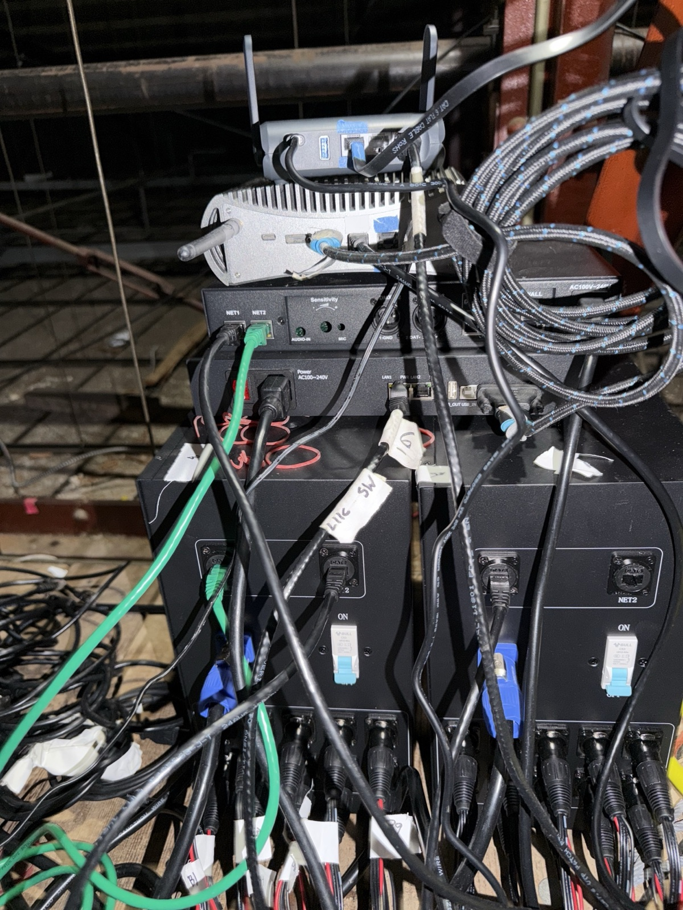

# Putting bitcube and the router in the ceiling

Once they're up there, nobody can reach a screen or a power button. So everything has to come back by itself after a power cut, and we have to be able to fix things remotely (VNC, SSH) whatever got plugged in. (Session N, 22 Oct 2026. Steps are in the [execution plan](execution-plan.html#before-the-lift-22-oct-night-everything-still-to-resolve): S20–S30.)

## As built (Gavin's photos, 23 Oct, in the ceiling)
**The stack, top to bottom:** our router (GL.iNet Slate AX) · bitcube · the rack LED controller (AoShow, "LED Controller") · the Colorlight sender (two-digit display on the front) · the two PSAC10 rope boxes side by side.

| Front | Back | Back, left side | Back, close-up |
|---|---|---|---|
|  |  |  |  |

**Live check 23 Oct 11:23:** bitcube rebooted by itself at 11:14:25 and TouchDesigner opened the seasons file 34 s later (60 fps, panel window open); Wi-Fi, internet, the gallery cam (`.76`) and the Modal link all work; **every wired link is down** (rows 1, 2, 4–6, 8). **Recheck 11:35, after reseating: every wired link is up except the WAN drop** (row 1); TouchDesigner had stalled and was restarted on the seasons file at 11:32 (ropes sending, panels window on the LED display). Rows 9–11 still need eyes on the panels and ropes: the gallery cam is lying on the floor.

**Connections as cabled** (read from the photos; "live" is filled in once bitcube and the router are back online and Claude has checked each link from the Mac mini):

| # | From | To | Cable | Live |
|---|---|---|---|---|
| 1 | Gray Area's drop | router **WAN** (rightmost port) | black flat Cat 6 | ❌ 11:35: still no link on WAN; router on the staff Wi-Fi (repeater), internet OK |
| 2 | bitcube **ROUTER** port (blue tape) | router port taped **blue** (LAN2) | blue-taped black cable | ✅ 11:35: 1 Gbps both ends; bitcube `Ethernet 2` = `192.168.9.79`, Wi-Fi on standby |
| 3 | router **LAN1** (middle) | nothing | | correct: LAN1 is off (the old camera cable) |
| 4 | bitcube **LIGHTS** port (white) | rack controller **NET1** | black (white tape at bitcube) | ✅ 11:35: up at 100 Mbps, `2.0.0.8` |
| 5 | rack controller **NET2** | PSAC10 **left** box **NET1** | green | ✅ 11:35: left box `2.0.0.10` answers |
| 6 | PSAC10 left box **NET2** | PSAC10 **right** box **NET1** | black | ✅ 11:35: right box `2.0.0.11` answers; rope sender open, no error, ~80 packets a frame |
| 7 | PSAC10 right box **NET2** | nothing | | end of the chain |
| 8 | bitcube **HDMI** | Colorlight sender **DVI** | HDMI-to-DVI (blue band) | ✅ 11:35: display "LED 1920X1080"; TD's panels window covers it, panel output shows the river |
| 9 | Colorlight sender **LAN1** | the receive card at point 2 (panels) | long black Ethernet | to confirm (panels show the river) |
| 10 | ropes (male round plugs) | PSAC10 OUT1–OUT10 on both boxes, via the XLR adapters | rope leads (labelled B1, B3…) | to confirm by camera at the re-map (S4) |
| 11 | mains | router, bitcube, rack controller (IEC), Colorlight sender (IEC, red switch), each PSAC10 (blue powerCON, breaker ON) | | to confirm |

*Left and right are as seen from the back. Which PSAC10 is box 001 (`2.0.0.10`, ropes 1–10) and which is 002 shows on each box's front display (`ID:001` / `ID:002`); the rope labels B1… suggest the left box is box 1. The gallery camera has no cable (Wi-Fi only).*

## The setup
```
Gray Area wired drop (if there is one) ──► router WAN
router LAN1 or LAN2 ──► bitcube ROUTER port            internet, 192.168.9.79
router Wi-Fi "gray-river" ◄── gallery cam (192.168.9.76), bitcube's Wi-Fi as backup (192.168.9.80), phones
bitcube LIGHTS port (2.0.0.8) ──► rack controller NET1, NET2 ──► PSAC10 box 1 ──► box 2 ──► 20 ropes
   (or, with a lighting switch: LIGHTS ──► switch ──► rack NET1 + both PSAC10s)
bitcube HDMI ──► Colorlight sender ──(its own cable)──► receive card ──► HUB75 panels
bitcube DisplayPort ◄── dummy display plug (recommended: a desktop VNC can use)
```

**Tape colours on the kit:** blue = the bitcube ↔ router cable and both its ports; white = bitcube's LIGHTS port.

**The lights go into bitcube's LIGHTS port, not the router** (D25): the show then keeps running if the router restarts or the Wi-Fi has trouble. If that's ever impossible, the lighting switch can go into a spare router port and Claude moves the lighting address over remotely.

**Never plug in:**
- the lighting switch to the router;
- the Colorlight sender's cable to the router or the lighting switch.

**Step-by-step for the person on the lift:** [install guide](install.html).

## Addresses (router `192.168.9.1`, Wi-Fi `gray-river`)
| Device | Connection | MAC | Address |
|---|---|---|---|
| gallery (camera) | Wi-Fi | `EC:71:DB:EB:EB:23` | `192.168.9.76` (reserved) |
| gallery (camera) | Ethernet | `EC:71:DB:B5:45:FD` | `192.168.9.76` (same reservation as its Wi-Fi, since 22 Oct) |
| bitcube | Ethernet, ROUTER port | `00:E7:43:0E:5F:C4` | `192.168.9.79` (reserved) |
| bitcube | Wi-Fi | `70:D8:23:16:A1:5C` | `192.168.9.80` (reserved) |
| bitcube | Ethernet, LIGHTS port | `00:E7:43:0E:5F:C3` | `2.0.0.8` (fixed; lighting only) |

## How it copes when something is missing
| If… | then… |
|---|---|
| Gray Area's drop isn't connected or fails | the router uses Gray Area's staff Wi-Fi (Repeater), by itself |
| bitcube's router cable is missing or fails | bitcube uses its Wi-Fi (`gray-river`), by itself |
| the power goes off and on | the router and bitcube start by themselves (bitcube's BIOS *Auto Power On* is on) |
| the ROUTER and LIGHTS cables are swapped | bitcube stays online over Wi-Fi, but the lights stay dark: swap the cables (or Claude swaps the port settings remotely) |
| the gallery cam moves between Wi-Fi and a cable | it keeps `192.168.9.76` **once both its MACs share one reservation (S22)** |
| something on the router needs fixing (leases, Wi-Fi, a reboot) | Claude does it remotely **once the router has its own Tailscale and SSH key (S28)** |
| the internet is down | the show keeps running from bitcube's disk; the team on site reaches it on `gray-river` |

## Status before the lift (Fri 23 Oct, 00:20)
**Tested and passing** (bitcube, router and cam; no lights, switch or HDMI connected):
- ✅ **Power cut** of all three at once: bitcube powered on by itself, TD reopened its show file, online about 80 s after power.
- ✅ **bitcube's cable pulled with its Wi-Fi idle:** back over Wi-Fi (`.80`) in 3 s.
- ✅ **VNC with no monitor:** a normal desktop. No dummy plug needed.
- ✅ Restarts; BIOS *Auto Power On*; Tailscale routes to the cam and router; cam posting clips; cam rebooted remotely through its API.

**Not working as hoped:**
- ⚠️ **The cam on a cable didn't ask for an address after power cycles.** On Wi-Fi it comes back on `.76` every time: **keep it on Wi-Fi, cable unplugged.**

**Still to do before lifting:**
1. **S20:** lights on the ground (switch into the white LIGHTS port, Colorlight on HDMI), ropes and HUB75 lit from TD.
2. **S26:** one more power cut with everything plugged in as in the ceiling, ideally after the seasons file is deployed (S1).
3. **S28:** the router visible from the Mac mini (the share into Gavin's tailnet). Until then it's reachable only through bitcube.
4. **During S20:** check VNC with the Colorlight sender as the only display (TD's panels window covers it in black).
5. **S29:** the 5 GHz radar wait after a power cut (needs the wired drop and a fixed channel).

Details and order: [execution plan](execution-plan.html#before-the-lift-22-oct-night-everything-still-to-resolve).

## Before lifting (on the ground, with a monitor and keyboard)
1. **BIOS: power on after a power cut.** Already set (checked 22 Oct): Advanced → Customer Exclusive Functions → **Auto Power On = Enabled**, and Wake On LAN is Enabled. To check again, press **Del** as bitcube starts.
2. **Label bitcube's two network ports (S25).** ✅ Done 22 Oct with coloured tape (no writing): **blue** marks the router link (bitcube's ROUTER port, both ends of the cable, and the router port); **white** marks bitcube's LIGHTS port. Plug blue to blue; the lighting switch goes into white. Originally: The lights only work in **LIGHTS**. To tell them apart, plug the router cable into one port and ask Claude which one came up:
   - **ROUTER** = `Ethernet 2` (MAC `00:E7:43:0E:5F:C4`); it gets `192.168.9.79` from the router.
   - **LIGHTS** = `Ethernet` (MAC `00:E7:43:0E:5F:C3`); it holds the fixed lighting address `2.0.0.8`.
3. **Pull-the-plug test** (✅ passed 22 Oct without the lights; repeat once with everything plugged in): switch off bitcube's and the router's power at the wall, wait 10 s, switch back on, touch nothing. Within about 2 minutes:
   - the router's Clients page shows BITCUBE at 192.168.9.79;
   - bitcube is online on Tailscale;
   - VNC shows its desktop.
4. **Fallback tests:**
   - ✅ Unplug bitcube's router cable: bitcube stays on Tailscale and VNC over Wi-Fi (3 s gap, 23 Oct). Plug it back in.
   - If the wired drop is connected, unplug it from WAN: the router's Internet page switches to Repeater. Plug it back in.
5. **Dummy display plug:** not needed. VNC showed a normal desktop with no display attached. Still check VNC once the Colorlight sender is the only display.

## Remote access to the router (S28, D24)
Gives the router a way in that doesn't depend on bitcube. Claude can then fix addresses, read Clients, change Wi-Fi and restart the router remotely. It goes on **Will's tailnet**, with the other river devices.
1. Router admin (`http://192.168.9.1`) → **Applications → Tailscale** → turn it on, then open the bind link.
2. Log in to **Will's tailnet** (the account the river devices use) and connect.
3. Leave **Allow Remote Access LAN**, **Allow Remote Access WAN** and **Custom Exit Nodes** **off**.
4. In Will's Tailscale admin console:
   - rename the new machine (done: **`router-gray-area-gl-axt1800`**; the river one is now `router-river-gl-axt1800`);
   - **disable key expiry**;
   - **approve no subnet routes** for it;
   - **Share** it to `gav.aiken@gmail.com`, and accept the invite on Gavin's account, so the Mac mini reaches it.
5. Router admin → **System → Advanced Settings** → open LuCI (install it if asked).
6. In LuCI: **System → Administration → SSH-Keys** → paste the Mac mini's public key (Claude has it) → Add → Save & Apply.

**If anyone ever ticks "Allow Remote Access LAN":** nothing happens until an admin approves the route. If it does get approved, bitcube starts sending its camera traffic through Tailscale. Fix: Will's admin console → Machines → `router-gray-area-gl-axt1800` → Edit route settings → un-approve the route. bitcube recovers at once.

## In the ceiling
- **bitcube has no fan.** Keep air around its fins, and don't put the router or anything else on top of it.
- **Router:** use its own USB-C adapter (5 V 4 A). Antennas up, in range of the gallery cam and of Gray Area's staff Wi-Fi.
- **Cables:**
  - Use good Ethernet cables. The flat white cable failed on 22 Oct.
  - Leave slack and strain relief, so a tug doesn't unplug HDMI or Ethernet.
- **Power:** bitcube and the router go on the normal outlet (under 200 W). The rope boxes and the HUB75 power board need their own circuits ([Gray Area page](gray-area.html)).

## After it's up
1. Check, in this order:
   - the router's Clients page shows BITCUBE (wired .79) and the camera (`gallery`, .76);
   - bitcube is online on Tailscale;
   - VNC works.
2. Connect HDMI and the lights, then tell Claude. Claude checks:
   - that the lighting port has `2.0.0.8` and both PSAC10s answer (`2.0.0.10`, `2.0.0.11`);
   - that TouchDesigner finds the LED display;
   - and does it by camera.

## Already set on bitcube (checked 22 Oct)
- The BIOS powers bitcube on after a power cut (*Auto Power On*).
- Windows starts first.
- It logs in by itself.
- Sleep and hibernate are off.
- Windows Update is paused until 15 Nov.
- These start without anyone logging in, and run automatically:
  - SSH
  - Tailscale (unattended)
  - TightVNC
- The `gray-river` Wi-Fi connects automatically for all users.
- The router port gets its address by DHCP (reserved .79, and .80 for Wi-Fi).
- The lighting port holds `2.0.0.8/8`. TouchDesigner's Art-Net sender binds to that address, so it uses whichever port has it.
