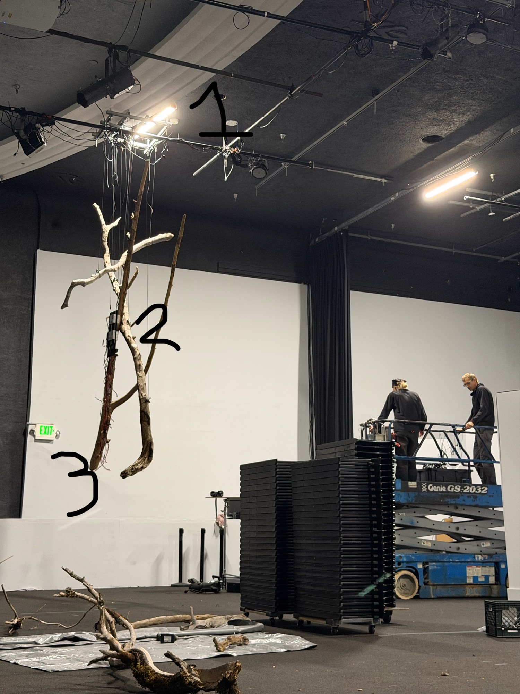

# Execution plan: A River Becoming at Gray Area

**Updated Thu 22 Oct 2026 by session A (coordinator, Mac mini); install network, pre-lift tests and the before-the-lift list by session N (Mac mini), Fri 00:05 ([summary](sessions/N.md)).** This is the working plan: steps to work through in order, the decisions behind them, and the requirements they must meet. **Add to it freely:** new steps go in the table with the next free number, new requirements get the next R-number, and anything decided gets a D-number with the date and who decided. Terms are defined in [`GLOSSARY.md`](https://github.com/gavaiken/river-bitcube/blob/main/GLOSSARY.md). Phase 1 (the Agape build, 17–21 Oct) is further down as history.

**How to work it:** any Claude session (on the mini or on bitcube) starts with `git pull`, takes the first ➡️ step it can do, marks it ✅ / ⏳ / ❌ here after each step with a line in `docs/sessions/<letter>.md`, and pushes. The [coordination contract](#coordination-contract-every-bitcube-session-follows-this) below still applies, and only one Claude works on bitcube at a time. Gavin says **"sync"** to session A for a report.

## Where we are (22 Oct)
- Everything works end to end at Agape: TouchDesigner (TD) on bitcube drives 18 of 20 ropes and HUB75 quad 1 from the camera pixel map; the live river cam, Dave's Modal agent (cameras up, scene down) and his canvas all feed the **online show file**.
- **At Gray Area since Thu 22 Oct** (install led by Lily). Colin, Justine and Gavin tune visuals Fri and Mon; Lily covers the weekend.
- **Install network up (22:30, session N):** our router (Wi-Fi `gray-river`, 192.168.9.x) gets internet from Gray Area's staff Wi-Fi until the wired drop is connected. bitcube is online on `gray-river` and came back by itself from a restart; the gallery cam is on `gray-river`. **Lights not connected yet.** [Next steps](#next-steps-22-oct-night).
- The new **local-only seasons show file** is written and tested off the machine and waits for step S1 to deploy it.
- **The river site is down** (solar panel giving 0 W, Starlink set to switch off at 22:00, battery dead). We have one 64 s river clip; the hourly recorder catches more whenever the site comes back.

## Before the lift (22 Oct night): everything still to resolve
Once bitcube, the router and the switch are in the ceiling we can't get back to them. **Step-by-step for the lift: [install guide](install.md).** Background: [ceiling page](ceiling.md).

**Done (session N + Gavin, 22–23 Oct; [summary](sessions/N.md)):** our router and Wi-Fi `gray-river`, reservations, bitcube online by cable at 1 Gbps (`.79`) with Wi-Fi fallback (`.80`), Tailscale routes approved, VNC from the mini, BIOS powers on after a power cut, restarts, a power cut of bitcube + router + cam together (no lights, switch or HDMI connected; bitcube back by itself, TD reopened `river-local-oct-18.toe`), bitcube's cable pulled with Wi-Fi idle (back over Wi-Fi in 3 s), VNC with no monitor, cam reachable and posting clips, the cam rebooted remotely through its own API, stale settings removed (S2, S3, S17–S19, S21).

**Still to resolve, in order:**
1. ⚠️ **The gallery cam's link: diagnosed remotely 23 Oct 01:50–02:00 (session A, router over SSH): a physical fault on the cable path.** The cam *is* on the cable (router port `eth1`, link up), but every frame it sends arrives corrupted (`rx_pktbadbyte` 839 → 876, `rx_frag` 61 → 65, zero good packets), at 100 Mbps and even forced to 10 Mbps; the router's chip had also downshifted to advertising 10 Mbps only, a classic bad-pair sign (same symptom as the flat white cable in S17). Not a setting: the cam is DHCP on both links (API `GetLocalLink`), the lease has both MACs. While the cable has link the cam turns its Wi-Fi off, so it went dark. **Remote recovery that works:** `ip link set eth1 down` on the router → the cam is back on Wi-Fi at `.76` within 10 s (done, 01:58; eth1 stays down until the router reboots, **so before S26 or any router reboot unplug the cam's cable, or it goes dark again**). **To fix the wire:** swap that cable for a known-good one (or try the cam's cable in router LAN2 to rule out the port), then `ip link set eth1 up` and watch for `DHCPACK … ec:71:db:b5:45:fd`. Earlier note:  one static lease covers both its MACs (`.76`), but **on a cable it didn't request an address after power cycles**; on Wi-Fi it comes back on `.76`. **Recommended: cam on Wi-Fi only, cable unplugged** (or debug the wired port on the ground). Then its position (S23).
2. ✅ **S28, remote access to the router** (*23 Oct 02:20: `router-gray-area-gl-axt1800` shared into Gavin's tailnet; the mini reaches it directly, `ssh root@100.127.193.8`, via the DERP relay*): on Will's tailnet as `router-gray-area-gl-axt1800` with the mini's SSH key; SSH works through bitcube. **Still to do:** the share into Gavin's tailnet isn't visible from the mini yet. No other SSH keys (Gavin). After this, Claude can do 1 and S29 remotely.
3. ✅ **S25, bitcube's ports marked** (blue = router link, white = LIGHTS): ROUTER (`Ethernet 2`) and LIGHTS (`Ethernet`), checked live 23:27.
4. **S20 is not done on the ground** (Gavin, 23 Oct): the lights are connected after the lift, in the ceiling, and checked remotely then (TD, the probe, the gallery cam).
5. **S26: no further power-cut test** (Gavin, 23 Oct). Accepted evidence: the 23:53 power cut of bitcube + router + cam (bitcube back by itself, TD running, online in ~80 s) and, after S1, a TD restart through mission control's *Switch now* path that reopened the seasons file by itself in under 75 s (00:26). Untested until the lights are in: a power cut with the lights and Colorlight attached. Later, once the drop exists: pull the router's WAN (S16).
6. **VNC with the Colorlight sender as the only display:** VNC works with no display at all, but with the LED sender attached, TD's panels window covers that display in black. Check once the lights are in (after the lift); hide the window via the TD bridge if needed.
7. **S29:** no radar wait for 5 GHz after a power cut (wired drop + fixed channel, or repeat Gray Area's 2.4 GHz).
8. **In the ceiling:**
   - airflow around bitcube's fins, with nothing on top of it;
   - outlets for bitcube, the router, the rack, the Colorlight sender and both rope boxes (three circuits, S8);
   - good cables with slack.
9. Keep a small HDMI monitor and a USB keyboard with the kit.

**After the lift (remote):**
- S16, the wired drop;
- S4, re-map;
- S7, tune;
- S24, update the system map.

### Learned on install night (22 Oct)
- **No monitor came with the kit:** when bitcube didn't appear online we couldn't tell a stuck boot from a network problem. It was the network. Keep a small HDMI monitor and a USB keyboard with bitcube.
- **bitcube's spare port (`Ethernet 2`) had DHCP turned off with no address,** so a cable to any router never got it online. Now DHCP. Its saved Wi-Fi was only `Agape WiFi`; `gray-river` was added from the console (WPA2).
- **The range clash is real (R15):** on 192.168.8.x, bitcube routed the camera's address into Tailscale towards the river router (offline a day), and couldn't reach it. Moving our LAN to 192.168.9.x fixed it.
- **The gallery cam has an Ethernet port and works on 5 GHz,** including the DFS channel. While the router repeats a venue Wi-Fi on 5 GHz, its own 5 GHz Wi-Fi shares that channel (124 tonight).
- Using the venue Wi-Fi as the router's uplink (Repeater) works as a stopgap and doesn't rebroadcast the venue's network; Multi-WAN switches to Ethernet when the drop is plugged in.
- A restart brings bitcube back by itself in about a minute (Windows, auto-login, Tailscale, then TD, Claude and the Modal link).
- **The gallery cam has two MACs:** Wi-Fi `EC:71:DB:EB:EB:23`, wired `EC:71:DB:B5:45:FD`. A reservation for one doesn't cover the other. (bitcube's ARP table briefly showed the Wi-Fi MAC at the wired address; the cam's own API is the source of truth.)
- **Windows doesn't join Wi-Fi while the cable works,** so the fallback Wi-Fi sits idle until the cable drops; when the cable was pulled it joined by itself and bitcube was back in 3 s (00:00, 23 Oct).
- **After a power cut the cam didn't use its cable:** it never asked for an address over Ethernet, and came back on Wi-Fi (`.76`) minutes later. Keep it on Wi-Fi.
- **We can reboot and reconfigure the cam remotely** through its HTTPS API from bitcube (Login → Reboot, GetLocalLink, SetWifi). The cam can't run Tailscale; bitcube's `/32` route is the way in.
- **The router needs its own way in** (S28): fixing DHCP, Clients or Wi-Fi otherwise needs someone at its admin page on site.

## Rigging layout (Gavin, 22 Oct night)

- **1, the ceiling grid:** bitcube, our router (GL.iNet), both PSAC10 rope boxes and their supplies, the Art-Net rack controller ("the driver") and the lighting switch: everything hidden in the roof. bitcube sits next to the Colorlight send card, so its HDMI stays short; the send card reaches the receive card over Ethernet.
- **2, on the driftwood:** the HUB75 panel power board (four 5 V supplies) and the panels.
- **3:** the lowest point the ropes hang to, woven through the river logs.
- **Cabling:** Gray Area's wired drop → router **WAN**; router → bitcube's spare port (`Ethernet 2`, `.79`) with a good cable (S17). Gallery cam: position not decided; it must see the artwork and the visitors (maybe rigged up top too), on Wi-Fi or Ethernet (S22).
- **What it means:** once it's up there, nobody can reach bitcube or the router by hand. Everything has to recover by itself after a power cut (S21), and we work through VNC, mission control and SSH. The VNC view will be the LED display, covered by the panels window (black), so working in TouchDesigner means hiding that window first. A small HDMI monitor and a USB keyboard should still stay with the kit for the day the network is down.

## Steps
✅ done · ➡️ next · ⏳ waiting on someone · 🅿️ parked

| | Step | What | Needs | Owner | Done when |
|---|---|---|---|---|---|
| ✅ | S1 | **Deploy the seasons show file** (S1.1–S1.5 below) | bitcube online at Gray Area | Claude | Seasons file is the boot file, comes up by itself after a TD restart, 60 fps, control page answers |
| ✅ | S1.1 | Rename the online file: `td_save.ps1 -Target river-online-oct-20.toe`, `git rm river-local-oct-18.toe`, update `Start-River.cmd` | S1 | Claude | Only `river-online-oct-20.toe` in the repo |
| ✅ | S1.2 | `python tools\seasons\prerender.py` (three speeds of the river library) | S1 | Claude | `recordings\river\seasons\river-{slow,normal,fast}.mp4` exist |
| ✅ | S1.3 | `td_save.ps1 -Target river-local-oct-22-seasons.toe`, then `td.ps1 -File td\build\build_seasons_local.py` (save first: new network) | S1.1, S1.2 | Claude | No TD errors; screenshots of `field_out`, `quad1..4_out`, `rope_canvas` look right. *`Start-River.cmd` boots the seasons file as soon as it exists: if the build fails, write `river-online-oct-20.toe` into `River\boot-file.txt` until it's fixed.* |
| ✅ | S1.4 | Windows Firewall: allow TD inbound on port 9981 for Private and Tailscale; open `http://bitcube.tail03bc1a.ts.net:9981` from the mini | S1.3 | Claude | Control page shows the year turning |
| ✅ | S1.5 | Save, toeexpand secret check, commit; `Start-River.cmd` → seasons file; restart TD via the one-off interactive task | S1.4 | Claude | TD reopens the seasons file by itself |
| ✅ | S2 | **Install network** (D18–D23; [progress](sessions/N.md)): our second GL-AXT1800 behind Gray Area's wired drop; bitcube and gallery cam behind it | Router at the venue | Gavin + Claude (session N) | bitcube online via the router, gallery cam reachable from bitcube |
| ✅ | S2.1 | Router configured: admin password, LAN **192.168.9.1**, Wi-Fi **`gray-river`** on 5 GHz (2.4 GHz temporarily `Agape WiFi`, see S19), Multi-WAN failover Ethernet → Repeater → Tethering → Cellular, Tailscale off. Uplink for now: Repeater on Gray Area's staff Wi-Fi (S16) | On site | Gavin | Done 22:25: phone, laptop, bitcube and cam online through it |
| ✅ | S2.2 | Devices on the router: gallery cam on Wi-Fi `gray-river` (no cable reaches its spot) at **192.168.9.76**; bitcube wired (`Ethernet 2`, 1 Gbps) at **192.168.9.79**, its preferred route, plus Wi-Fi `gray-river` (reserved .80, still on .194 until it next reconnects). Reservations: cam `EC:71:DB:EB:EB:23` → .76, bitcube Wi-Fi `70:D8:23:16:A1:5C` → .80, bitcube wired `00:E7:43:0E:5F:C4` → .79 | S2.1 | Gavin | Done 22:35 |
| ✅ | S2.3 | bitcube network: `gray-river` → Private profile; stale `192.168.1.99` + gateway removed from the lighting NIC; **`Ethernet 2` had DHCP off with no address** (why it never got online by cable), now DHCP; restart test passed 22:17 (on Wi-Fi) | S2.2 | Claude (session N) | Done 22:20 |
| ✅ | S3 | bitcube advertises `192.168.9.76/32` + `192.168.9.1/32` (approved by Gavin); cam `192.168.9.76` in `secrets.local.json`; `cam_snap.ps1 gallery` works; Modal link restarted, gallery clips posting again (first at 22:39) | S2.2 | Claude (session N) + Gavin | Done 22:40 |
| ⏳ | S4 | **Re-map at Gray Area** after the hang (Thu night or Fri morning): structured-light capture, new `pixelmap-<date>.json`, rebuild | Ropes hung and powered, camera fixed in its final spot, room dark; S1 | Claude (+ someone on site) | All lit ropes mapped; ropes 9/17 found if they now light |
| ➡️ | S5 | Extend `tools/pixelmap/hub75.py` to locate HUB75 quads 2–4 (today only quad 1), so the seasons file samples each quad at its real position | — (code now), S4 (to use) | Claude | Pixel map JSON has `hub75_quad1..4` |
| ⏳ | S6 | Confirm the receive-card layout of the 4 quads with Andi; change `QUAD_X` in `build_panels.py` if it isn't 4 in a row | Andi | Gavin → Andi | Each quad shows its own picture |
| ⏳ | S7 | **Tune on the real lights** (Fri morning): palettes, overlays, natural-colour mix, HUB75 gain; judge the 4-minute year | S1, S4 | Gavin, Colin, Justine + Claude | Artists happy; changes written to the file's page |
| ⏳ | S8 | **Power:** confirm separate circuits (Seabrook); then raise the rope cap from 600 W to 1,200 W per box (`Boxwatts`) | Seabrook | Gavin | Cap matches the circuits (D13) |
| ⏳ | S9 | Gallery card on the iPad (`docs/card/seasons.html`); Colin and Justine edit the words | iPad from Gray Area | Justine, Colin | Card on the iPad by opening |
| ➡️ | S10 | **People counter** ([plan](presence-plan.md)): local person detector → `River\presence.json`; turns on dynamic mode | S1 (to test) | Claude | Control page shows live counts; dynamic warms and cools the river |
| ⏳ | S11 | River site back up (solar, Starlink schedule); recorder fills the library; rerun S1.2 with the new footage | Colin / Maria at the river | Colin | More than a few minutes of river in the library |
| ⏳ | S12 | MacBook Air as the on-site fallback console: Tailscale, its SSH key on bitcube, VNC password, Claude Code + this repo (D-open 6) | Gavin | Gavin + Claude | The Air reaches bitcube with the internet down |
| ⏳ | S13 | Dave merges [river-agent#7](https://github.com/drocamor/river-agent/pull/7) (hide camera logins in capture logs) | Dave | Dave | Merged |
| ✅ | M1 | **Mission control + studio chat** ([plan](mission-plan.md)): plan written | — | Claude | Plan in the repo |
| ✅ | M2 | `mission/` server: password login (bitcube password from a file, scrypt hash, cookie sessions, slow-down), page shells; tests | — | Claude | Tests pass; login works locally |
| ✅ | M3 | Studio chat: queue, Agent SDK runner (resume one session, Stop), live events, history; chat page; tests with a fake agent | M2 | Claude | Messages queue and run in order locally |
| ✅ | M4 | Mission control: status (seasons state, bitcube probe, Modal, river cam, snapshot), whitelisted controls, system map; page | M2 | Claude | Page shows live status; controls reach bitcube once it's online |
| ✅ | M5 | Studio agent policy: `mission/STUDIO.md` system prompt, deny-list settings, no connectors | M3 | Claude | Agent refuses out-of-scope asks in a test |
| ✅ | M6 | `mission/setup/` scripts for the `river` user (create hidden standard user, lock `/Users/gav` to 700, secrets, clone with deploy key, LaunchDaemon); river's SSH key on bitcube | M2–M5 | Claude wrote it (22 Oct); **Gavin runs `sudo bash mission/setup/setup-river.sh`** ([install steps](mission-plan.md#install-m6m8-what-gavin-does)) | Service runs as `river` and survives a restart |
| ✅ | M7 | Gavin: `claude setup-token`, save the token into `/Users/river/.secrets/claude-token` | M6 | Gavin | Studio agent answers |
| ✅ | M8 | Tailscale Funnel on 443 → `127.0.0.1:8790` (OK'd, MD9) | M6 | Gavin (or Claude with his OK) | `https://gav-m1-mini.tailddc624.ts.net` shows the login page from outside |
| ➡️ | M9 | End-to-end check from a phone off the tailnet (login page confirmed reachable from the internet 22 Oct; agent answered as `river` and was denied `/Users/gav`); river's key on bitcube when it's online; docs (show-files page link, CLAUDE.md, runbook) | M7, M8 | Claude | Team can log in, chat, see status, steer the seasons |
| ✅ | S21 | **Recover from a power cut by itself** (bitcube is going in the ceiling): BIOS *Auto Power On* is **Enabled** (Advanced → Customer Exclusive Functions; Wake On LAN also on, checked by Gavin 22:58). Tested 23:02 by pulling bitcube's and the router's power at the wall: bitcube powered on and logged in by itself; online over the wire 1.5 min after the router had power. Repeated 23:53 with the router properly plugged in (bitcube, router and cam together): Windows 23:53:41, TD reopened `river-local-oct-18.toe` at 23:54:14, online 23:54:52. | Before the rig goes up | Gavin + Claude (session N) | Done 23:07 |
| 🅿️ | S22 | **Gallery cam on Ethernet keeps its address** (*23 Oct: Gavin: no Ethernet for the cam in the final setup, Wi-Fi only. Lease fine; the cable path corrupts every frame, see Before the lift item 1; port eth1 off*): today `192.168.9.76` is reserved for its Wi-Fi MAC (`EC:71:DB:EB:EB:23`); its wired port has another MAC and would get a different address, breaking snapshots, the Modal clips, the people counter and the Tailscale route (this is why it "crapped out" on Ethernet before). Before rigging: plug it into the router once by cable, read its wired MAC in the router's client list, then reserve `.76` for **both** MACs (one host with two MACs in the router's advanced LuCI DHCP settings) or, if that isn't possible, reserve the wired MAC as `.77` and update `secrets.local.json` and bitcube's advertised route | The camera and the router, on the ground **Found 23:18 (session N): its wired MAC is `EC:71:DB:B5:45:FD`** (on a cable it got `.103`). So: one static lease with **both MACs → `.76`** (LuCI → Network → DHCP and DNS → Static Leases), done by Gavin in LuCI or by Claude once S28 gives router access | Gavin (plug in, router UI) + Claude (secrets, route, check) | Lease done 23:50 (both MACs → `.76`, set over SSH, backup `dhcp.bak-20261022`). **Tested 23:53–00:03: on a cable the cam didn't request an address after power cycles; on Wi-Fi it returned on `.76`. Keep it on Wi-Fi** unless debugged |
| ➡️ | S23 | **Gallery cam position:** sees the artwork and the people in front of it (the people counter's "near the piece" size threshold depends on it; ceiling-high and wide changes what counts as foreground); fixed before the re-map (S4) | Rigging | Colin, Lilian | Mounted; still from it on mission control shows the piece and the floor in front |
| ⏳ | S24 | Update the system map for the rigging (devices in the ceiling, cable runs, the cam's final link) | S20, S22 | Claude | `docs/system/system.json` matches the rig; tests pass |
| 🅿️ | S14 | Gallery card and page for the online version (when we run Dave's agent in the show) | Decision to run it | Claude | — |
| 🅿️ | S15 | AI-enhanced river footage via Modal (upscaling, smoother slow motion, longer clips) | — | — | — |
| ✅ | S16 | Gray Area's wired drop into the router's **WAN** port (Ethernet then takes over from the staff Wi-Fi by itself) | Gray Area cable | Gavin / Lilian | Router's Internet page shows Ethernet active. **23 Oct 11:41: WAN up at 1 Gbps, `10.1.0.90`, default route over the cable (staff Wi-Fi repeater kept as backup, metric 20)** |
| ✅ | S17 | A good Ethernet cable from bitcube's spare port to the router (the flat white one linked at 10 Mbps and passed nothing) | A cable | Gavin | Done 22:35: `Ethernet 2` 192.168.9.79 at 1 Gbps |
| ✅ | S18 | loopMIDI (virtual MIDI cable from the 2023 BitCube setup) no longer opens at login: removed its HKCU `Run` value (to restore: `Run` → `loopMIDI` = `C:\Program Files (x86)\Tobias Erichsen\loopMIDI\loopMIDI.exe`); still installed | Gavin's OK | Claude (session N) | Done 22:38 |
| ✅ | S19 | Router 2.4 GHz back to `gray-river`; `Agape WiFi` no longer broadcasts | — | Gavin | Done 22:35 |
| ⏳ | S20 | **Connect the lights** (Fri): bitcube lighting NIC → switch → rack controller + both PSAC10s; HDMI → Colorlight sender; then S4 | Ropes and panels hung | Gavin + Lilian | Ropes and HUB75 lit from TD |
| ✅ | S25 | **Label bitcube's two Ethernet ports** **ROUTER** (`Ethernet 2`, MAC `…5F:C4`, DHCP) and **LIGHTS** (`Ethernet`, MAC `…5F:C3`, fixed `2.0.0.8`): the lights only work in LIGHTS. Identify them live (plug the router cable into one port; Claude says which came up). *Optional, not recommended:* a watcher that swaps the roles automatically | — | Gavin + Claude | Done 23:27: **blue tape** on the bitcube ↔ router cable (both ends) and both ports; **white tape** on bitcube's LIGHTS port (marked, not written); ROUTER checked live (1 Gbps, `.79`) |
| ➡️ | S26 | **Pull-the-plug and fallback tests** before lifting. Done: power cut (S21), bitcube's cable pulled with its Wi-Fi already joined (stayed online, 23:11). To do: the same with Wi-Fi idle (Windows only joins Wi-Fi once the cable drops); a full power cut with everything plugged in properly, ending with TD on the show file; the router's WAN pulled once the drop exists (S16) | **Pull-the-plug and fallback tests.** ✅ Power cut of bitcube + router (23:02) and of bitcube + router + cam (23:53; no lights, switch or HDMI): bitcube back by itself, TD reopened its show file, online in ~80 s. ✅ Cable pulled with Wi-Fi already joined (23:11) and **with Wi-Fi idle (00:00: back over Wi-Fi in 3 s)**. ✅ VNC with no monitor. **Remaining:** one power cut with everything plugged in as in the ceiling (with S20, ideally after S1); the router's WAN pulled once the drop exists (S16) | Gavin + Claude | bitcube back on Tailscale and VNC each time, untouched |
| 🅿️ | S27 | **Dummy display plug** in bitcube's DisplayPort: a desktop VNC can use that isn't the LED output (otherwise VNC shows TD's black panels window) | A plug | Gavin | Not needed: VNC showed a normal desktop with no display attached (23:56) |
| ✅ | S28 | **Remote access to the router itself** (so DHCP, clients, Wi-Fi and reboots never need someone on a ladder): turn on the router's **Tailscale on Gavin's tailnet with "Allow Remote Access LAN" off** (D24), and add the mini's SSH key (LuCI → System → Administration → SSH-Keys). Then Claude can fix leases, read Clients and reboot it remotely | **Remote access to the router itself** (so DHCP, clients, Wi-Fi and reboots never need someone on a ladder): turn on the router's **Tailscale on Will's tailnet with "Allow Remote Access LAN" off** (D24), name it `gray-router`, disable key expiry, approve no routes, share it to Gavin; add the mini's SSH key (LuCI → System → Administration → SSH-Keys) | Gavin (router + Will's admin console) | Router on Will's tailnet as `router-gray-area-gl-axt1800` (100.127.193.8); river router renamed `router-river-gl-axt1800`; mini's SSH key in. SSH works through bitcube (`ssh -J bitcube root@192.168.9.1`). Still to do: the share into Gavin's tailnet isn't visible from the mini yet, so there's no way in without bitcube |
| ⏳ | S29 | **No radar wait after a power cut:** while the router repeats Gray Area's 5 GHz DFS channel, its own 5 GHz `gray-river` shares that channel and can stay silent 1–10 min after power-up. Fix: the wired drop on WAN (S16), then pin 5 GHz to a non-DFS channel (36 or 149); or repeat Gray Area's 2.4 GHz instead | S16 | Gavin / Claude (with S28) | 5 GHz `gray-river` is up within 2 min of power-on |
| ⏳ | S30 | *Optional:* smart plugs with a local API (e.g. Shelly) on the camera and bitcube, for a remote hard power cycle | Plugs | Gavin | Claude can power-cycle each from bitcube |
| ✅ | S31 | **Keep D25's fallback ready** (Gavin wants to be able to adapt): a prepared, tested remote switch-over for the lights through the router: `2.0.0.8` added to the ROUTER port (DHCP and a fixed address together) or moved back, in one command | Gavin's OK | Claude | Tested both ways without the lights; TD's sender binds after each switch ; **23 Oct 11:46 live, both cables in:** router mode → `2.0.0.8` on ROUTER (skip-as-source), TD sender open with no error, internet and tailnet up, real connections still from `.79`; back to direct → both boxes answer. (Boxes on the router LAN not tried: that needs re-cabling.) |

## Requirements
Every step must keep these true. Add new ones at the end.

| | Requirement | Source |
|---|---|---|
| R1 | The seasons show file runs with **no network at all** (no internet, Modal or live river feed). | Gavin, 22 Oct |
| R2 | The river is **always moving**, and is **recognisably a river** on the ropes and on the panels. | Gavin, 22 Oct |
| R3 | **The year only turns forward** (winter → spring → summer → autumn → winter), in every mode. | Gavin, 22 Oct |
| R4 | Automatic mode: one season a minute (a 4-minute year). | Gavin, 22 Oct |
| R5 | Dynamic mode adapts to the size of the night: it reacts to **relative presence**, not the raw count. An empty room is winter; a busier-than-usual room becomes a summer torrent. | Gavin, 22 Oct |
| R6 | Manual mode reaches any **target** in under a minute, travelling forward. | Gavin, 22 Oct |
| R7 | The control page shows the year, intensity and presence read-only, and switches modes, sets targets and **rules**. Private networks and the tailnet only. | Gavin, 22 Oct |
| R8 | After a restart the piece is never left in manual. | Gavin, 22 Oct |
| R9 | Every show file has a page (visitors + team) and its version has a gallery card; **changing a show file updates its page in the same commit**. | Gavin, 22 Oct |
| R10 | Rope power stays within what the circuits can carry (D13). | Gavin, 22 Oct |
| R11 | No secrets (passwords, tokens, camera logins) in the public repo, the `.toe` files or logs. | Gavin, 17 Oct |
| R12 | TD keeps 60 fps on bitcube. | standing |
| R13 | Mission control and the studio chat are **team only, behind the shared password**; the studio agent can never reach Gavin's files, connectors or history (separate `river` user). | Gavin, 22 Oct |
| R14 | Every step of the mission work is committed and recorded in `docs/mission-plan.md` (progress log) **as it happens**, so another session can pick it up at any point. | Gavin, 22 Oct |
| R15 | The install LAN never overlaps a range bitcube accepts over Tailscale (today the river router's `192.168.8.0/24`): bitcube sends routed ranges into Tailscale even when the same range is local. | Session N, 22 Oct (seen live) |
| R16 | **Hands-off recovery in the ceiling:** after a power cut, a missing cable or swapped cables, bitcube comes back by itself to a state we can reach by Tailscale, SSH and VNC (Wi-Fi fallback for bitcube, Repeater fallback for the router). | Gavin, 22 Oct |

## Decisions
Newest last. Add with the date and who decided.

| | Decision | Why | Who, when |
|---|---|---|---|
| D1 | Bring our **second GL.iNet** as the install router: our devices behind it, it behind Gray Area's wired drop. | Venue Wi-Fi isolation, logins and address changes stop mattering; only the router's uplink changes on site. | Gavin, 21 Oct |
| D2 | A **phone hotspot** is the backup uplink. | Internet outage on install day. | Gavin, 21 Oct |
| D3 | **No dress rehearsal** of the move at Agape. | Not worth the time. | Gavin, 21 Oct |
| D4 | Gavin on site **Fri morning** with the MacBook Air; install Thu 7 pm (Lily leads); visuals Fri and Mon. | Team schedule (Colin, 20 Oct). | Team, 20–21 Oct |
| D5 | **Re-map late Thursday** after the hang (or first thing Friday). | The pixel map depends on where everything hangs. | Gavin, 21 Oct |
| D6 | **Offline is an acceptable fallback:** the show must run from bitcube's disk if the internet fails. | The river site and the internet are unreliable. | Gavin, 21 Oct |
| D7 | A separate **local-only seasons show file**, `river-local-oct-22-seasons.toe`, becomes **the boot file** once it works; the online file is renamed `river-online-oct-20.toe` and kept as the fallback. Show files are named for their kind and the date of their last real change. | The live river may be down for the show; the local file always works. | Gavin, 22 Oct |
| D8 | **Seasons behaviour:** 4-minute automatic year; forward-only; dynamic = relative presence (now = 30 s median, usual = 10 min median, floor 0.75; warmer above 1.3×, cooler below 0.7×, hold between; full torrent at 2×; nobody for 60 s = winter; warming ~1 min, cooling ~3 min); manual targets in under a minute; rules editable with Apply; restart → dynamic if the counter runs, else automatic. | Adapts whether the night brings 4 people or 100; numbers are starting points to tune on site. | Gavin, 22 Oct |
| D9 | **Seasons look:** the recorded river is always the base; seasons grade it (winter white/blue, spring green/teal, summer gold, autumn ochre/rust/mud); intensity crossfades 3 pre-rendered speeds (slow with generated frames) plus a torrent overlay; glints, leaves and rain per season. Panels are windows on the same canvas (4 quads in a row until the re-map). | Slowing 16 fps footage stutters; overlays make the torrent read. | Gavin, 22 Oct |
| D10 | **Control page** on bitcube (TD, port 9981), private networks and tailnet only, no password. | Works without internet; only the team can reach it. | Gavin, 22 Oct |
| D11 | **People counting is local-only**: a small person detector on the gallery cam's low-res stream, counting people big enough to be near the piece, no tracking, motion as fallback. | R1; no dependence on Modal or the internet. | Gavin, 22 Oct |
| D12 | **Pages:** a parent page for Colin and Justine ([show files](show-files.md)), one page per show file, and a museum-style **gallery card** per version (the seasons card now; the online one later). | Explain the piece to visitors and let the artists steer it. | Gavin, 22 Oct |
| D13 | Rope power cap **600 W per box** (our own software limit, set for the shared Agape circuit) until Gray Area confirms separate circuits, then **1,200 W** (80% of 15 A). | Safety. | Gavin, 22 Oct |
| D14 | Changes to Dave's repo go in as **PRs**, never direct pushes (main deploys to Modal). | His production system. | Gavin, 21 Oct |
| D15 | Remote UI control of bitcube from the mini over **VNC** (`~/claude/local/bitcube-vnc/vnc.py`), with `tools/screenshot.ps1` as the fallback. | More robust than scheduled-task input; reaches UAC and the lock screen. | Gavin, 20 Oct |
| D17 | **Mission control and the studio chat** on the Mac mini, online via Tailscale Funnel, as a hidden `river` user service; details and their reasons in [mission-plan.md](mission-plan.md) (MD1–MD10). | Team access to the agent and the controls from anywhere. | Gavin, 22 Oct |
| D16 | **Asks to Gray Area** ([page](gray-area.html)): wired drop, connections only started by us (no ports, forwarding or fixed IP), UDP 41641/3478 if easy, three separate circuits (two rope boxes, one HUB75 power board). | Seabrook's questions, 21–22 Oct. | Gavin, 22 Oct |
| D18 | **Install router:** the second GL-AXT1800 (Slate AX, MAC `94:83:C4:96:62:83`) on its own range **192.168.9.0/24** (router `192.168.9.1`), with DHCP reservations: gallery cam `.76`, bitcube wired `.79`, bitcube Wi-Fi `.80`. | The default 192.168.8.x clashes with the river router's range, which bitcube reaches over Tailscale (river cam `192.168.8.217`). | Gavin, 22 Oct (was open decision 1) |
| D19 | **Wi-Fi name `gray-river`** (5 GHz) with its own password, not a copy of Agape WiFi. **Gallery cam on Wi-Fi** (no cable reaches its spot, 22 Oct): moved by cabling it to the router briefly, renaming 2.4 GHz to `gray-river` and switching it in the Reolink app. Without a cable, the router broadcasts `Agape WiFi` on 2.4 GHz for ~15 min so the cam comes online, the cam is switched to `gray-river` (Reolink `SetWifi` from bitcube, or the Reolink app), then 2.4 GHz takes our own name. | Many visitors know the Agape password. Resetting the cam would wipe its login and settings. | Gavin, 22 Oct (replaces open decision 2) |
| D20 | **One wired drop, into the router's WAN** (no second drop to bitcube). Failover: Ethernet → repeater (venue Wi-Fi or phone hotspot). bitcube's spare port (`Ethernet 2`) is cabled to the router; its lighting NIC stays on the switch; HDMI to the Colorlight sender. bitcube needs no Wi-Fi. | bitcube has two Ethernet ports, so nothing has to share. | Gavin, 22 Oct (was open decision 3) |
| D21 | Remove the stale `192.168.1.99/24` and gateway `192.168.1.1` from bitcube's lighting NIC. | It can steal bitcube's internet route. | Gavin, 22 Oct (was open decision 4) |
| D22 | **No Tailscale on the install router.** bitcube is the door: it advertises `192.168.9.76/32` (cam) and `192.168.9.1/32` (router admin) on Will's tailnet, replacing `10.0.7.76/32`; Gavin approves them. Never advertise `192.168.9.0/24` into a tailnet bitcube is on. | bitcube accepts routes: a /24 from the router would send its own camera traffic through Tailscale, so the local people counter (D11, R1) would lose the cam when the internet drops (the 18 Oct failure). | Gavin, 22 Oct (was open decision 5) |
| D23 | bitcube's network steps (S2.3, S3) are done by **session N from the Mac mini over `ssh bitcube`**; the Claude on bitcube stays idle meanwhile. | Only one Claude on bitcube at a time. | Gavin, 22 Oct |
| D24 | **The router joins Tailscale for its own management, on Will's tailnet** with the other river devices, with **"Allow Remote Access LAN" off**, and is **shared into Gavin's tailnet** so the mini reaches it. Amends D22: bitcube stays the only subnet router. Safeguard: a route the router advertises does nothing until an admin approves it in the console; if one is ever approved by mistake, un-approve it (Machines → gray-router → Edit route settings) and bitcube recovers at once (as on 18 Oct). | Everything lives in one place; in the ceiling we need a way to the router that doesn't depend on bitcube, for remote DHCP, Wi-Fi and reboots. | Gavin, 22 Oct |
| D25 | **Plan: the lights go straight into bitcube's LIGHTS port** (*Gavin, 23 Oct: that's the plan, but the router option stays open: we must be able to adapt; keep S31 ready*) (lighting switch → rack controller + both PSAC10s), never through the router: a separate lighting network, as is standard for Art-Net. **Fallback, if ever needed:** the lighting switch into a spare router LAN port, and Claude moves `2.0.0.8` onto bitcube's ROUTER port remotely (S31). | The show then never depends on the router: a router reboot, radar wait or Wi-Fi trouble can't freeze the ropes (which fall back to their own colour cycle when Art-Net stops), and lighting traffic stays off the Wi-Fi the cam and bitcube's fallback use. The router has only two LAN ports anyway. | Session N recommendation, 22 Oct (Gavin to confirm) |

### Open decisions (Gavin)
My recommendation is in brackets; say yes or change it, then move it into the table above.
1–5. *Decided 22 Oct: D18–D22 (Wi-Fi is `gray-river`, not a copy of Agape WiFi).*
6. Prepare the MacBook Air as the fallback console (S12). *(Yes.)*
7. Who on site can power the ropes and say "go" for the Thursday-night re-map? *(Name one person; otherwise re-map Friday morning.)*
8. TouchDesigner licence: stay on Non-Commercial unless the show is ticketed or commercial. *(Yes; one-line check with Colin.)*

## Open questions (others)
| Question | Ask | Status |
|---|---|---|
| Receive-card layout of the 4 HUB75 quads (S6) | Andi | open |
| Separate circuits near the rack? (S8) | Seabrook (via Lilian) | asked 22 Oct |
| River site power and the Starlink 22:00 shutoff (S11) | Colin / Maria | in progress |
| Merge river-agent#7 (S13) | Dave | open |
| Reply to Colin: ropes 9/17 work; the show file sent them black because the 18 Oct map missed them; fixed 23 Oct (they borrow a neighbour's map until the re-map) | Gavin → Colin | to send |
| Who records the river: Will's Modal copy or bitcube's recorder, not both (several viewers degrade a Starlink stream) | Gavin → Will | to send |

---

# Phase 1: the Agape build (17–21 Oct, history)

## Phase 1 status
✅ done · ➡️ next (in order) · ❌ blocked

| | Step | What | Session (machine · model) | Owner |
|---|---|---|---|---|
| ✅ | A1 | Public repo and status page, `plan.md`, coordination rules | A (Mac mini · Opus 5.5) | Claude |
| ✅ | A2 | Rope identification by camera (18/20 located, colour order RGB) and HUB75 quad 1 test pattern verified | A (Mac mini · Opus 5.5) | Claude |
| ✅ | A3 | Status page opens in Chrome at login (plan item F) | A (Mac mini · Opus 5.5) | Claude |
| ✅ | A4 | This execution plan | A (Mac mini · Opus 5.5) | Claude |
| ✅ | A5 | Recheck ropes 9 and 17 after cables were tightened: **still dark** (14:33 run) | A (Mac mini · Opus 5.5) | Claude |
| ✅ | A6 | Login autostart now opens the rain checkpoint `river-local-oct-18.toe`. Verified with a restart at 16:54: back in 50 s, rain on the ropes and HUB75 by itself | A (Mac mini · Opus 5.5) | Claude |
| ✅ | A7 | Live river cam on HUB75 quad 1 (relay process + shared memory, 10 fps, falls back to rain); rope sender retries when the lights are off | A (Mac mini · Opus 5.5) | Claude |
| ✅ | P1 | Swap test for ropes 9 and 17. *Deferred by Gavin (18 Oct): carry on with 18 ropes.* **Not needed (23 Oct):** at Gray Area they light under the hardware's own program; TD sent them black because the pixel map missed them; fixed | Gavin, in person | Gavin |
| ✅ | B1 | **Checkpoint** ([plan](sessions/B-plan.md), [progress](sessions/B.md)): structured-light capture of all ropes with the gallery cam | B (bitcube · Opus 5.5) | Claude |
| ✅ | B2 | Decoder + pixel map `tools/pixelmap/pixelmap-2026-10-18.json` (TDD) | B (bitcube · Opus 5.5) | Claude |
| ✅ | B3 | HUB75 quad 1 corners in camera space | B (bitcube · Opus 5.5) | Claude |
| ✅ | B4 | Rain/river field in camera space (built-in TOPs) | B (bitcube · Opus 5.5) | Claude |
| ✅ | B5 | Sampling onto the ropes and HUB75 quad 1 | B (bitcube · Opus 5.5) | Claude |
| ✅ | B6 | `river-local-oct-18.toe` + `build_river_local.py` + `td_save.ps1 -Target` | B (bitcube · Opus 5.5) | Claude |
| ✅ | B7 | Verify by camera, tune, watts and fps | B (bitcube · Opus 5.5) | Claude |
| ✅ | B8 | Checkpoint still on the status page, tick L, summary | B (bitcube · Opus 5.5) | Claude |
| ✅ | C1 | Gallery-cam snapshot every 15 min (08:00–02:00), force-pushed to orphan branch `snapshot` | C (bitcube · Opus 5.5) | Claude |
| ✅ | C2 | Status page never shows a broken image; live snapshot confirmed | C (bitcube · Opus 5.5) | Claude |
| ✅ | C3 | Panels window covers the whole LED display in black (both show files) | C (bitcube · Opus 5.5) | Claude |
| ✅ | I1 | **Interactive system documentation** ([progress](sessions/I.md)): every fact into `docs/system/system.json` | I (Mac mini · Opus 5.5) | Claude |
| ✅ | I2 | Validator with secret scanning (TDD) | I (Mac mini · Opus 5.5) | Claude |
| ✅ | I3 | Interactive page `docs/system/` (clickable diagram, API tab) | I (Mac mini · Opus 5.5) | Claude |
| ✅ | I4 | Generated `system.md` + `llms.txt` for agents | I (Mac mini · Opus 5.5) | Claude |
| ✅ | I5 | Verify in headless Chrome and on the published URLs | I (Mac mini · Opus 5.5) | Claude |
| ✅ | I6 | Remove the password hint, links, code review, Signal draft, summary | I (Mac mini · Opus 5.5) | Claude |
| ✅ | D1–D4 | Dave's Modal visuals on the ropes and HUB75. *Done by A, 20 Oct: mirror running (no `SITE_TOKEN`); the agent's scene drives river_local's look and palette, and his `canvas.html` plays as a layer (plan item O)* | D (bitcube · Opus 5.5) | Claude |
| ✅ | E1–E3 | Cameras pushing clips to Dave's agent. *Done by A, 20 Oct 10:05: `tools/modal/modal_link.py`, both cams, `gallery/video` and `river/video`* | E (bitcube · Opus 5.5) | Claude |
| ❌ | P2 | Panel quad 2 connected. *Blocked: Andi (receive-card layout)* | Andi + Gavin, in person | Andi |
| ❌ | G1–G3 | Remap the hung installation at Gray Area. *Blocked: install starts Wed 22 Oct* | G (bitcube · Opus 5.5) | Claude |

Bitcube sessions update this table themselves, as they finish each step. Session A reads it on **sync**.

## How we work
- **Session A is the coordinator:** the Mac mini conversation Gavin keeps open. It tracks this plan, docs, GitHub and Signal, and doesn't touch devices while another session is working.
- **Sessions B–G each run in a fresh Claude Code conversation on bitcube:** the terminal opened at login in `C:\Users\user\River`, or PowerShell → `cd C:\Users\user\River\river-bitcube` → `claude`. In an existing terminal, `/clear` first. Set the model with `/model`. Start in **plan mode** (Shift+Tab) where marked, approve, then let it run in auto mode.
- **Only one Claude works at a time.** Every session starts with `git pull` and ends by ticking `docs/plan.md`, updating `docs/index.md` + the log, and pushing.
- **Coordination happens through the repo:** see the contract below. Gavin says **"sync"** to session A, which runs `git pull` and reports from the files. No copy-pasting needed.

## Coordination contract (every bitcube session follows this)
1. **Start:** `git pull`. Create or append `docs/sessions/<letter>.md` with a header line `## <date time> start: <machine> · <model>` and the steps you plan to do.
2. **After each step:**
   - Append a line to `docs/sessions/<letter>.md`: `- <time> <step id> ✅ <one line> (commit <hash>)`, or `❌ <why>` if blocked.
   - Set that step's mark in the Status table above (✅ done, ➡️ next, ❌ blocked). When a session has several steps, split its row (e.g. `B1`, `B2`…) as you go.
   - Commit and **push**.
3. **Keep the shared pages current:** tick `docs/plan.md`; refresh `docs/index.md` (the public status page; keep it to one screen and update its "Status as of" line); add a log entry for anything notable.
4. **Need a decision?** Write it under `### Waiting on Gavin` in your session file, push, and stop asking in the terminal only. Session A sees it on sync.
5. **End:** append the summary below to `docs/sessions/<letter>.md` and push. Also print it in the terminal.

```
### SESSION <letter> SUMMARY — <date, time>
Done: <step id> <one line each>
Not done / blocked: <step id> <why>
Evidence: <commit hashes, files, images>
Hardware state now: <ropes/panels showing what; anything left running>
Decisions or answers needed from Gavin/team: <list or "none">
Suggested next step: <step id>
```

## Step P1 (Gavin, deferred)
**P1.** Swap test for ropes 9 and 17:
1. Plug a rope that works into **box 1 OUT9**, and the rope from OUT9 into a working port. Same for **box 2 OUT7**.
2. Tell session A what changed.
3. Session A re-runs `tools\rope_capture.ps1 -Cam gallery` + `tools/rope_identify.py`. If the good rope lights on the "dead" port, the rope or its adapter is the fault; if not, the port or box is.

Don't move the gallery cam before session B. Its view changed between 14:11 and 14:33 (it was bumped), and B's pixel map depends on it staying put.

## Session B: local rain checkpoint (bitcube · Opus 5.5 · plan mode)
**Skills:** `mattpocock-skills:tdd` for the pure Python in `tools/pixelmap/`, `mattpocock-skills:diagnosing-bugs` if output misbehaves, `code-review` at the end. Optional: `mattpocock-skills:prototype` for a quick look-and-feel pass.

**Steps:**
- **B1:** structured-light capture.
- **B2:** decoder and pixel map (TDD).
- **B3:** HUB75 corners in camera space.
- **B4:** rain/river field.
- **B5:** sampling onto the ropes and HUB75.
- **B6:** build and save `river-local-oct-18.toe`.
- **B7:** verify with the camera and tune the look.
- **B8:** docs, push, summary.

**Prompt to paste:**
```
You are session B (bitcube · Opus 5.5). Read CLAUDE.md, docs/plan.md, docs/execution-plan.md and the end of docs/a-river-becoming-log.md, then git pull. Goal: steps B1–B8, a CHECKPOINT — a new, self-contained TouchDesigner file C:\Users\user\River\river-bitcube\river-local-oct-18.toe that makes a beautiful, coherent rain/river appear across ALL working hardware (the lit ropes over Art-Net — ropes 9 and 17 may still be dark — and HUB75 quad 1 over HDMI), mapped by where the pixels physically are right now. No Modal, no web, no outside input. Gavin will not move the ropes, HUB75 or gallery camera during this session. Ropes 9 and 17 are dark; ignore them (Gavin deferred the fix). Start in plan mode and show me the plan first. Put the approved plan's step list into docs/sessions/B.md and push before executing.

B1 Structured-light capture with the gallery cam (secrets.local.json 'gallery'; it sees all coils + the HUB75; don't re-aim it). New tools/pixelmap/: a capture script that drives /project1/ropes (add a test source to td/ropes/artnet_out.py if needed) through Gray-code patterns encoding rope index (5 bits) and pixel index (9 bits), each bit plus its inverse, plus black/white references; one camera frame per pattern (keep one ffmpeg RTSP reader open if per-frame connects are too slow). Brightness ≤ the 0.4 cap. People walk through the room: take each pattern twice and reject frames that disagree.
B2 Decoder (Python 3.13 + numpy/pillow in a gitignored venv under river-bitcube), pure functions under TDD with pytest: per camera pixel → (rope, px) with confidence; per (rope, px) → median camera (u,v). Fill pixels hidden inside coils by interpolating along the rope between visible neighbours; ropes with no samples are left out. Write tools/pixelmap/pixelmap-<date>.json (rope, px, u, v, visible) and an annotated overlay in frames/.
B3 Find the HUB75's 4 corners in camera space from the panels test pattern (panels Source='test').
B4 In a new TD network, a rain/river field in camera space — NO custom GLSL (Intel Iris Xe hangs; see CLAUDE.md gotchas). Built-in TOPs only: Noise/Ramp/Feedback/Transform/Level/Composite. It should read as rain (streaks falling) over a slow river flow (horizontal drift, brightness breathing between blue/teal and white highlights), on black, high contrast, calm, with visible drops travelling down through the coil piles.
B5 Sampling: TOP to CHOP with UV input from the pixel map → CHOP to TOP shaped 20×400 (column per rope, row 0 = plug end, as /project1/ropes/rope_tex expects) → the ropes COMP's Canvas parameter (Source='canvas', crops 0..1). For the HUB75, perspective-correct the field's quad-1 region from the B3 corners to 256×128 → panels Quad1 (Source='canvas').
B6 Make river-local-oct-18.toe from a copy of river.toe (keeps the bridge, ropes, panels COMPs); build the new network with an idempotent td/build/build_river_local.py. Save only via tools\td_save.ps1 (add a -Target parameter). Do NOT change the login autostart unless I say so.
B7 Verify with the camera (tools\cam_snap.ps1 gallery and a short ffmpeg clip): coherent motion across piles and the HUB75. Tune the look. Report Art-Net watts (artnet_out status) and fps.
B8 Add a docs/img checkpoint still (no people in it) to docs/index.md and tick plan item L. Ask before anything outside TD and the repo.
Follow the Coordination contract in docs/execution-plan.md throughout: docs/sessions/B.md progress lines and the Status table updated and pushed after EVERY step, the summary at the end.
```
**Done when:** the ropes and HUB75 show one continuous rain/river that moves coherently from the camera's viewpoint, the checkpoint photo is on the status page, and the pixel-map tools plus `pixelmap-<date>.json` are in the repo.

## Session C: housekeeping (bitcube · Sonnet 5)
**Skills:** `mattpocock-skills:tdd`, `code-review`.

**Steps:**
- **C1:** snapshot task.
- **C2:** status page image placeholder until C1 is live.
- **C3:** full black LED-display window.

**Prompt to paste:**
```
You are session C (bitcube · Sonnet 5). Read CLAUDE.md, docs/plan.md and docs/execution-plan.md, git pull. Do:
C1 A scheduled task (every 15 min, 08:00–02:00) that grabs a gallery-cam still (~640 px wide JPEG) and force-pushes it as gallery.jpg to an orphan branch `snapshot` of this repo via the deploy key (one commit, amended each time, no history growth). Test the pure parts with Pester or pytest.
C2 docs/index.md embeds raw.githubusercontent.com/gavaiken/river-bitcube/snapshot/gallery.jpg, which is broken until C1's first push. Make sure the page never shows a broken image (placeholder or latest calibration image until the branch exists), then confirm the live snapshot shows.
C3 In td/build/build_panels.py, make the panels window cover the whole LED display (1920×1080) in black with the panel atlas at its top-left, so nothing else can ever appear on the HUB75. Rebuild and save in BOTH show files: td_save.ps1 saves whichever file is open, so open river-local-oct-18.toe, rebuild, save; then open river.toe, rebuild, save; then reopen whichever file the login autostart uses (see Start-River.cmd). Verify with a gallery-cam frame that only the panel atlas shows on the HUB75.
Tick plan items G and B. Follow the Coordination contract in docs/execution-plan.md throughout (docs/sessions/C.md, Status table, push after every step, summary at the end).
```

## Session I: interactive system documentation (Mac mini · Opus 5.5 · plan mode)
For Will, Andi, Dave and their agents: one public page that shows how everything connects.
- **Skills:** `artifact-diagramming` and `artifact-design` (design guidance for the page), `mattpocock-skills:tdd` (the validator), `code-review`.
- **Output:**
  - `docs/system/system.json`: the single source of truth.
  - `docs/system/index.html`: the interactive diagram. It's self-contained, and every node and link can be clicked.
  - `docs/system/system.md` + `docs/llms.txt`: for agents.
- **Rule (Gavin):** show everything except secrets. Names, hostnames, IPs, ports, usernames and account emails go in; passwords and token values never.

**Steps:**
- **I1:** facts → `system.json`.
- **I2:** validator, including secret scanning (TDD).
- **I3:** interactive page.
- **I4:** generated `system.md` + `llms.txt`.
- **I5:** verify in headless Chrome and on the published URLs.
- **I6:** remove the password hint, link from the status page and README, code review, summary, and a Signal message to the team.

**Prompt to paste:** (on the **Mac mini**, in a fresh `claude` conversation in `~/claude/Source/river-bitcube`)
```
You are session I (Mac mini · Opus 5.5). cd ~/claude/Source/river-bitcube && git pull; also git -C ~/claude/Source/river-agent pull. Read CLAUDE.md, docs/plan.md, docs/execution-plan.md (including the Coordination contract), docs/a-river-becoming-hardware.md and the log. Start in plan mode and show me the plan first; put the approved step list in docs/sessions/I.md and push before executing. Docs only: you may read bitcube over `ssh bitcube` but must not change anything there.
Goal (plan item M): clear, interactive web documentation of the whole system for Will, Andi, Dave and their agents, on the public GitHub Pages site. Gavin's call: show everything except secrets — names, hostnames, LAN and Tailscale IPs, ports, device usernames and account emails yes; passwords and token values never.
I1 Gather every fact (repo docs; river-agent's modal_deploy/app.py, gallery/sync.py, capture/capture.py, tools/site.py, web/canvas.js; bitcube read-only over ssh: NICs, monitors, C:\Users\user\RopeLights\config.local.json; tailscale status) into docs/system/system.json: places (The River, Agape now, Gray Area show, Modal cloud, Internet/Tailscale, GitHub), nodes (all machines, cameras, router, Starlink, PSAC10s, rack controller, 20 ropes with box/OUT/universe, Colorlight sender, receive card, HUB75 quads, M14, Modal app and its endpoints, repos, Gavin's mini) with ids, specs, IPs, hostnames, usernames, accounts, ports, access, owner, status; links (Art-Net, HDMI, RTSP, PTZ API, SSH/VNC/RDP/SMB over Tailscale, HTTPS to Modal, Starlink, GitHub pushes) with medium, protocol/port, direction, payload, auth by token NAME, rate, status; scenarios `now` (Agape) and `show` (Gray Area: gallery cam on the gallery Wi-Fi and added to bitcube's tailnet — planned, with open questions); api: the Modal↔bitcube contract (bitcube pulls /data/state.json, reflex.json, status.json every 3 s via the gallery/sync.py mirror on :8770; bitcube pushes camera clips to POST /ingest/{location}/{channel} with Bearer INGEST_TOKEN; schemas and examples), each item marked confirmed or awaiting Dave; secrets: where each lives, never values. Mark anything you couldn't verify as "unverified".
I2 TDD a validator (pytest, tools/tests/test_system_json.py): link endpoints exist, every node placed per scenario, unique ids, valid statuses, NO secrets (regex for password/token-like strings, rtsp://user:pass@, Bearer values, and the real values from bitcube's secrets.local.json read over ssh at test time — never print them), system.md in sync.
I3 docs/system/index.html — self-contained HTML/CSS/vanilla JS (no external scripts) that loads system.json and draws an SVG diagram: each place a labelled region, nodes inside, links coloured by medium; click any node or link for a side panel with all its fields; URL hash deep links (#node=bitcube, #link=artnet-box1); hover highlights connections; search by name/IP/hostname; legend; scenario toggle now/show; an API tab with the Modal↔bitcube contract and example JSON; light and dark themes; works on a phone; keyboard accessible. Load the artifact-diagramming and artifact-design skills for diagram/page design guidance.
I4 tools/system_docs.py generates docs/system/system.md (full text + a Mermaid diagram) from system.json; add docs/llms.txt at the site root pointing agents to system.json, system.md, CLAUDE.md, plan.md and the log.
I5 Verify: pytest green; headless Chrome renders the page with no console errors; every node and link opens a panel; scenario toggle and hash links work; check the published URLs after the Pages build.
I6 Remove the public hint that the camera password equals bitcube's (CLAUDE.md, hardware doc). Link the page from docs/index.md's link bar and README.md. Tick plan item M, run code-review and fix findings, and draft a short Signal message asking Will, Andi and Dave to check the page and correct anything wrong.
Follow the Coordination contract throughout (docs/sessions/I.md, Status table, push after every step, SESSION I SUMMARY at the end).
```

## Session D: Dave's visuals on the hardware (bitcube · Opus 5.5 · plan mode)
*Blocked until Dave answers the open questions in `docs/plan.md`.* **Skills:** `mattpocock-skills:diagnosing-bugs`, `code-review`.

**Steps:**
- **D1:** local mirror of Dave's site on port 8770.
- **D2:** Web Render TOP → the same camera-space sampling as B.
- **D3:** switchable source, with fallback to local rain.
- **D4:** verify with a forced scene change, and check performance.

**Prompt to paste:**
```
You are session D (bitcube · Opus 5.5). Read CLAUDE.md, docs/plan.md (item C and Dave's answers), docs/execution-plan.md, and ..\river-agent\CLAUDE.md, docs/gallery-kit.md, gallery/sync.py, tools/site.py, web/canvas.html. git pull both repos (river-agent may need pulling via the Mac mini; bitcube has no credentials for it). Start in plan mode.
D1 Run river-agent's gallery/sync.py + site.py serve on bitcube on port 8770 (8765 is RopeLights) as a login task; venv under river-agent (gitignored); any SITE_TOKEN in river-bitcube\secrets.local.json.
D2 In river.toe: Web Render TOP of http://127.0.0.1:8770/canvas.html?w=..&h=.. (design size suited to the camera-space field), feeding the same pixel-map sampling to ropes and HUB75 as river-local-oct-18 (reuse td/build/build_river_local.py).
D3 Make the source switchable (local rain / Dave's canvas). If the canvas stalls (no new frames for N s), crossfade to local rain; never let the ropes fall back to the hardware's own colour cycle.
D4 Force a scene change (edit the local mirror's state.json) and capture camera clips as evidence. Measure fps/CPU on the Iris Xe; if the Web Render TOP is too heavy, write up Dave's documented fallback (native animations from state.json + reflex.json) as a plan item instead.
Tick plan item C. Follow the Coordination contract in docs/execution-plan.md throughout (docs/sessions/D.md, Status table, push after every step, summary at the end).
```

## Session E: cameras into Dave's agent (bitcube · Opus 5.5)
*Blocked until Dave provides `INGEST_TOKEN` and channel names.*

**Steps:**
- **E1:** token into `secrets.local.json`.
- **E2:** capture task for the gallery cam.
- **E3:** verify on Modal.

**Prompt to paste:**
```
You are session E (bitcube · Opus 5.5). Read CLAUDE.md, docs/plan.md item D, docs/execution-plan.md, ..\river-agent\capture\capture.py and modal_deploy/app.py (/ingest).
E1 Put INGEST_TOKEN in secrets.local.json (never in git).
E2 Run capture.py on bitcube for the gallery cam (location/channel names and cadence from Dave's answers in plan.md) as a resilient scheduled task with logging and backoff. Leave the river cam for when it's at the river (check with Will how its Starlink kit pushes).
E3 Verify on Modal: /data/status.json sensor freshness updates and reflex.json reacts.
Tick plan item D. Follow the Coordination contract in docs/execution-plan.md throughout (docs/sessions/E.md, Status table, push after every step, summary at the end).
```

## Session H: "the spring" (parked)
*Parked by Gavin 18 Oct.* Idea: the HUB75 as the river's source, with waves visibly flowing out across the ropes, optimised for a viewer standing about 6 ft right of the gallery cam (Gavin's reference photo). Mapping options: the phone as the viewer's eye (a video during the pattern run), or 3D by triangulating the two Reolinks. Revisit after D/E.

## Session G: install at Gray Area (bitcube · Opus 5.5 · plan mode)
*From Wed 22 Oct.*

**Steps:**
- **G1:** re-run B1–B5 on the hung ropes and HUB75. This is plan item J, real hang paths.
- **G2:** re-aim the gallery cam to a visitor's eye height.
- **G3:** gallery network: bitcube's dual NIC, and the cameras' network (open questions to Will).

The prompt will be written by session A once the hang is done.

## Verification of the whole path
- **Checkpoint (B):** a camera clip of coherent rain across all piles and the HUB75, and the photo on the status page.
- **End to end (D/E):**
  - A Modal scene change visibly changes the ropes and HUB75 within a tick.
  - Cutting bitcube's internet: the last scene keeps playing, then crossfades to local rain.
  - A reboot brings everything back by itself.
