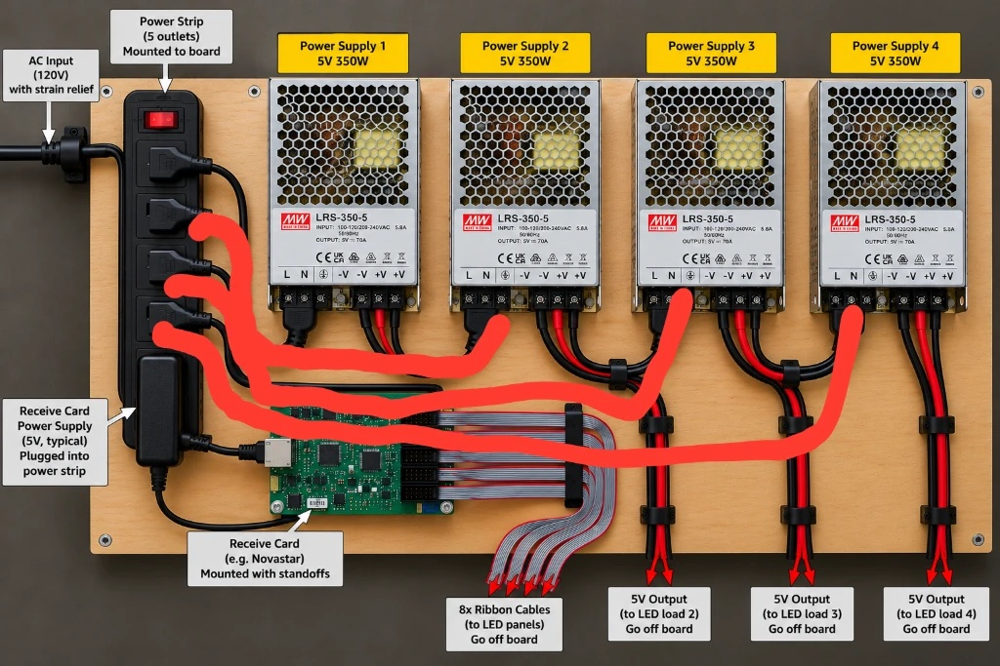

# A River Becoming at Gray Area: network and power

For Seabrook and the Gray Area team. What we plug in, what it needs from the building, and how it connects. (Updated 22 Oct 2026, 21:38.)

**Detailed map of every device, address and connection:** [system map](system/) (interactive; tap any box or line).

## What we need from Gray Area
- **Network:**
  - **One wired Ethernet drop** near the rack that gives a normal internet connection (DHCP). We put our own small router behind it, so nothing of ours goes on your Wi-Fi, and whether devices on your Wi-Fi can see each other doesn't matter to us.
  - **Protocols:** normal web traffic (HTTPS), plus UDP ports 41641 and 3478 if you can. Those two are for remote maintenance (Tailscale); it works without them, just slower.
  - **Nothing needs to reach in from outside.** Our computer starts every connection itself: it fetches the AI's updates, sends camera clips and keeps its own maintenance link open, and the replies come back over those same connections. So you don't need to open any ports, forward anything to us or give us a fixed IP address.
  - **Bandwidth:** about 1–3 Mbps up and 1–2 Mbps down, steady (roughly 10–30 GB a day). Upload matters most.
- **Power:**
  - **Three separate 15–20 A circuits near the rack:** one for each LED rope box (each up to ~600 W as we cap it in software, ~1.5 kW at full white), and one for the HUB75 panel power board (four 5 V 350 W supplies, up to ~1.4 kW rated; the real draw is lower, and we cap brightness too).
  - **Plus a normal outlet** for the computer and router (well under 200 W).

### The HUB75 panel power board
One AC input to a power strip on a board, feeding four 5 V 350 W supplies (one per panel group, ~6 ft runs of 14-gauge wire to the panels) and the receive card, which drives the panels over 8 ribbon cables.

*Planned layout (illustration). Our receive card is a Colorlight 5A-75B.*

## How it connects

<svg viewBox="0 0 760 560" width="100%" style="max-width:760px;font-family:system-ui,sans-serif;font-size:14px" role="img" aria-label="Network diagram">
  <defs><marker id="a" viewBox="0 0 10 10" refX="9" refY="5" markerWidth="7" markerHeight="7" orient="auto"><path d="M0,0 L10,5 L0,10 z" fill="#555"/></marker></defs>
  
  <rect class="c" x="215" y="10" width="330" height="56" rx="8"/>
  <text class="t" x="380" y="34" text-anchor="middle">Internet</text>
  <text class="s" x="380" y="53" text-anchor="middle">AI on Modal (HTTPS) · Tailscale · river camera</text>
  <rect class="b" x="250" y="100" width="260" height="50" rx="8"/>
  <text class="t" x="380" y="122" text-anchor="middle">Gray Area wired drop</text>
  <text class="s" x="380" y="140" text-anchor="middle">normal internet connection (DHCP)</text>
  <path class="w" d="M380,100 V66" marker-end="url(#a)"/>
  <rect class="g" x="250" y="185" width="260" height="56" rx="8"/>
  <text class="t" x="380" y="208" text-anchor="middle">Our router (GL.iNet)</text>
  <text class="s" x="380" y="227" text-anchor="middle">our own network (Wi-Fi “gray-river”)</text>
  <path class="w" d="M380,185 V150" marker-end="url(#a)"/>
  <rect class="g" x="60" y="290" width="230" height="56" rx="8"/>
  <text class="t" x="175" y="313" text-anchor="middle">Gallery camera</text>
  <text class="s" x="175" y="332" text-anchor="middle">cable to our router</text>
  <path class="w" d="M250,228 L175,290"/>
  <rect class="g" x="440" y="290" width="260" height="56" rx="8"/>
  <text class="t" x="570" y="313" text-anchor="middle">Show computer "bitcube"</text>
  <text class="s" x="570" y="332" text-anchor="middle">TouchDesigner; cable to our router</text>
  <path class="w" d="M510,228 L570,290"/>
  <rect class="l" x="300" y="395" width="215" height="62" rx="8"/>
  <text class="t" x="407" y="418" text-anchor="middle">Switch → LED controller</text>
  <text class="s" x="407" y="437" text-anchor="middle">+ 2 LED power boxes → 20 ropes</text>
  <text class="s" x="407" y="451" text-anchor="middle">separate cable, no internet</text>
  <path class="w" d="M520,346 L450,395"/>
  <rect class="l" x="545" y="395" width="200" height="62" rx="8"/>
  <text class="t" x="645" y="418" text-anchor="middle">HUB75 sender</text>
  <text class="s" x="645" y="437" text-anchor="middle">HDMI from bitcube</text>
  <text class="s" x="645" y="451" text-anchor="middle">→ Ethernet → receive card</text>
  <path class="w" d="M620,346 L645,395"/>
  <rect class="l" x="480" y="485" width="270" height="62" rx="8"/>
  <text class="t" x="615" y="508" text-anchor="middle">8 ribbon cables → 4 panel groups</text>
  <text class="s" x="615" y="527" text-anchor="middle">power board: strip → 4 × 5 V 350 W supplies</text>
  <text class="s" x="615" y="541" text-anchor="middle">(one per group) + receive card</text>
  <path class="w" d="M645,457 L630,485"/>
</svg>

- **Blue** devices are on our own router, behind your wired drop. **Orange** is the lighting, cabled straight from the show computer and never on your network.
- The show keeps running if the internet drops: everything it needs to draw is on the computer. The internet brings in the AI's scene changes, the live river camera and remote maintenance.

Full map of every device and connection (all locations): [system map](system/). Project status: [status page](./). Live camera view: [live page](live.html).
