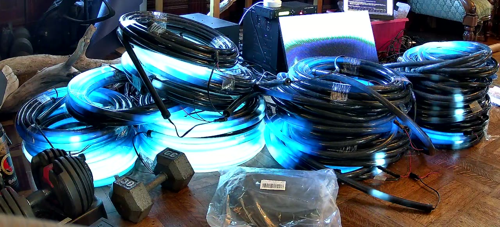

# A River Becoming: live

The gallery camera's view of the ropes and HUB75, a new still **every minute** (08:00–02:00 Pacific). This page refreshes itself. People in the room may appear.

 

## What TouchDesigner sends

The same minute from inside the show: the 20 ropes (left, one column each) and the four screens as you'd see them standing in front of each (1 to 4). Useful when the camera can't see something.

 

<a href="./">Status page</a> · Dave's agent's own page: <a href="https://to-be-a-river--river.modal.run/">to-be-a-river--river.modal.run</a>
