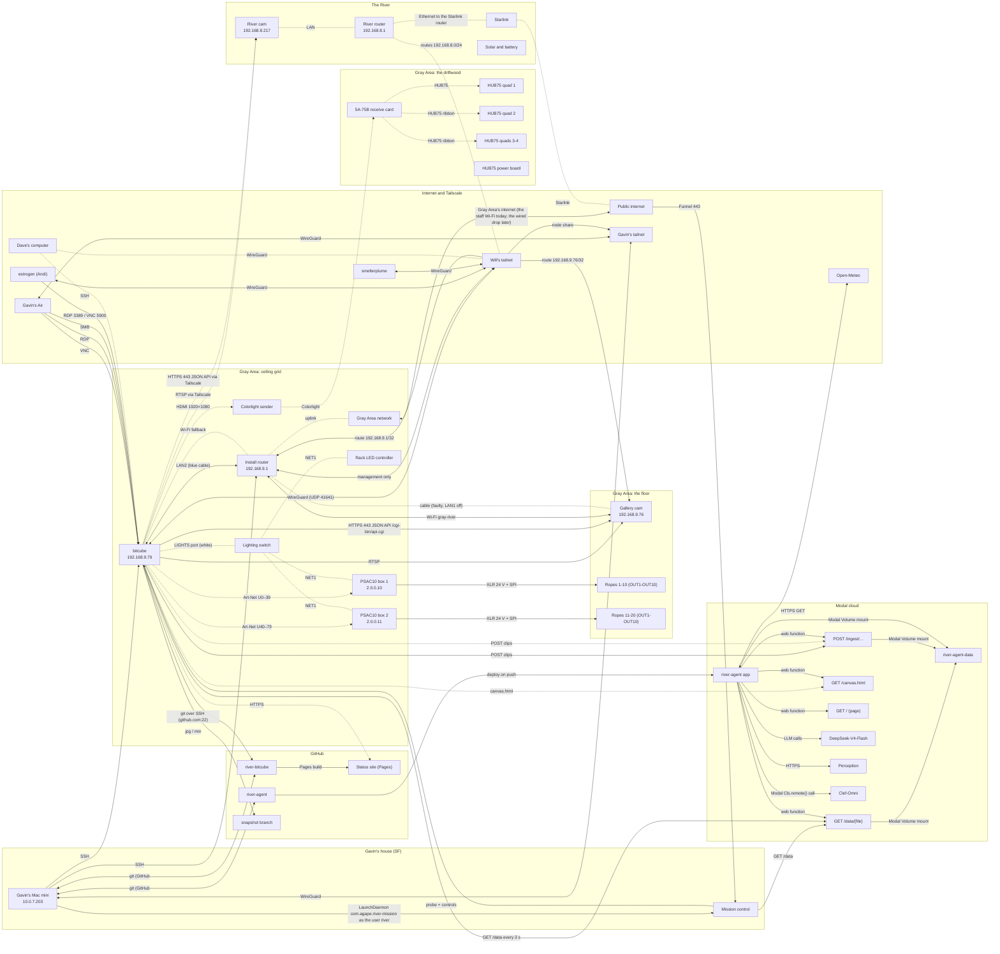

# A River Becoming: system map

> Generated from [system.json](https://gavaiken.github.io/river-bitcube/system/system.json) by `tools/system_docs.py`; don't edit by hand. Interactive version: https://gavaiken.github.io/river-bitcube/system/

Every machine, device, service and connection of A River Becoming at Gray Area, for people and agents. Source of truth for docs/system/index.html (interactive) and docs/system/system.md (generated by tools/system_docs.py). Validated by tools/tests/test_system_json.py. One scenario, 'now' (the page shows a Now/Show switch again only if a second scenario is added). The Agape prototype map (17-21 Oct 2026, scenarios 'now' = Agape and 'show' = Gray Area as planned) is in git history up to commit bdfe5b6. Optional display fields: node.short (diagram name) and link.label (text on the arrow).

Updated 2026-10-26T20:00:00-07:00.

**Rules**

- Everything except secrets: names, hostnames, LAN and Tailscale IPs, ports, usernames and account emails are in; passwords and token values never (Gavin, 18 Oct).
- Secrets appear only by name and where they live.
- The river site is given as an area only.
- Never advertise a site's own LAN as a Tailscale subnet from another device: it hijacks bitcube's local traffic (18 Oct, when the river router's 10.0.7.0/24 route took the gallery cam away from bitcube). Never advertise 192.168.9.0/24 into a tailnet bitcube is on (D22).
- The install LAN never overlaps a range bitcube accepts over Tailscale (today the river router's 192.168.8.0/24): bitcube sends routed ranges into Tailscale even when the same range is local (R15, seen 22 Oct).
- The lights never go through the install router (D25): the lighting switch hangs off bitcube's LIGHTS port, so a router reboot or Wi-Fi trouble can't freeze the ropes. S31 (the lighting address moved to the ROUTER port by one command) is the prepared fallback.
- verified: confirmed = checked on the device, in code, or by the team; unverified = believed but not checked; awaiting:<Name> = needs that person's answer.

## Scenario

### Now: Gray Area (`now`, since Wed 22 Oct 2026; show to Mon 27 Oct)

The installation is at Gray Area. The network is done and tested for the ceiling (22-23 Oct, session N): our GL-AXT1800 router (192.168.9.1, Wi-Fi gray-river) gets internet by repeating Gray Area's staff Wi-Fi until the wired drop is connected; bitcube is on the router's LAN2 by the blue cable (192.168.9.79) with Wi-Fi as a 3 s fallback (.80); the gallery cam is on Wi-Fi only (.76: its cable path corrupts every frame, so router port LAN1 is off). bitcube advertises the cam (192.168.9.76/32) and the router (192.168.9.1/32) on Will's tailnet; the router is on Will's tailnet for management (router-gray-area-gl-axt1800) and shared into Gavin's. TouchDesigner boots the local-only seasons show file (river-local-oct-22-seasons.toe, 23 Oct); the Modal link mirrors Dave's scene and posts gallery clips. Not connected until after the lift (S20), so dashed lines and grey dots: the lights (LIGHTS port -> switch -> rack + both PSAC10s -> 20 ropes) and the panels (HDMI -> Colorlight sender -> receive card on the driftwood). The river site is down (no power, S11). Mission control (https://gav-m1-mini.tailddc624.ts.net) shows this map with live status.

Open questions: Where does the gallery cam mount so it sees the artwork and the people in front of it (S23)? The people counter's near-the-piece threshold depends on it.; When is Gray Area's wired drop connected to the router's WAN (S16)? Until then the uplink is the staff Wi-Fi, and 5 GHz gray-river can wait 1-10 min after a power cut (S29).; Three separate circuits near the rack (one per rope box, one for the HUB75 power board; S8, D16)? Then the rope cap goes from 600 W to 1,200 W per box (D13).; When does the river site get power and Starlink back (solar 0 W, battery dead; S11)?; Receive-card layout of the four HUB75 quads (S6): 4 in a row, or something else? Thread size for the panel mounts?; What should the gallery show if bitcube goes down? (Today: the rack controller's SD-card colour cycle.); Does the show need a TouchDesigner Commercial licence? (bitcube has Non-Commercial.)



Solid arrows are working; dotted arrows are planned, stopped, blocked or unknown. An arrow points away from the side that starts the connection.

## Places

| Place | Scenarios | Status | Summary |
|---|---|---|---|
| Gray Area: ceiling grid (`ceiling`) | now | partial | Point 1 of the rig, hidden in the roof above the piece: bitcube, our router, the lighting switch, the rack controller, both PSAC10 rope boxes and the Colorlight sender. Nobody can reach them once they're up, so everything recovers by itself after a power cut (R16) and is worked remotely (VNC, SSH, mission control). Address: Gray Area, 2665 Mission St, San Francisco. Network: lan: 192.168.9.0/24; gateway: 192.168.9.1 (our GL-AXT1800); wifi: gray-river; uplink: Gray Area's staff Wi-Fi (router in Repeater mode) until the wired drop is connected (S16); Multi-WAN failover Ethernet -> Repeater -> Tethering -> Cellular. |
| Gray Area: the driftwood (`driftwood`) | now | planned | Point 2 of the rig: the HUB75 panels, their receive card and the panel power board (a power strip feeding four 5 V 350 W supplies and the receive card; 8 ribbon cables to 4 panel groups), on its own circuit (C). Connected after the lift (S20); the receive-card layout is to confirm with Andi (S6). |
| Gray Area: the floor (`floor`) | now | partial | Point 3 of the rig is the lowest point the ropes hang to, woven through the river logs. The gallery cam sits on the floor among the cables until its spot is decided (S23). The ropes are re-mapped by camera after the hang (S4). |
| The River (`river`) | now | broken | The real river the agent watches: the river router (GL.iNet), the Reolink E1 Outdoor Pro, Starlink and solar/battery power, placed by Colin on 18 Oct. Down since about 20 Oct 18:11: the solar panel gives 0 W, the battery is dead and Starlink is set to switch off at 22:00 (S11, Colin and Maria). One 64 s river clip is in the library; the hourly recorder catches more whenever the site comes back. Area: near Dobbins, California. |
| Modal cloud (`modal`) | now | working | Dave's agent: one Modal app (tick, watch, web) plus model apps, in workspace to-be-a-river. |
| Internet and Tailscale (`internet`) | now | working | The public internet, the two tailnets, and the team's own machines (Gavin's Air, Andi's PC, smelterplume, Dave's computer). |
| GitHub (`github`) | now | working | The two repos, the public status site (GitHub Pages) and the camera snapshot branch. |
| Gavin's house (SF) (`gavin-home`) | now | working | Gavin's always-on Mac mini, in the Mission: session A (the coordinator), docs sessions, and mission control for the team (as the hidden user river, online through Tailscale Funnel). Where the piece was prototyped 17-21 Oct. Area: the Mission, San Francisco. Network: lan: 10.0.7.0/24; note: the mini is 10.0.7.203 and the subnet router for this LAN on Gavin's tailnet. |

## Nodes

## In Gray Area: ceiling grid

### bitcube (`bitcube`)

*computer · working · confirmed · owner Will Gardiner · Gray Area: ceiling grid*

The show machine, going into the ceiling grid: a Windows mini PC that runs TouchDesigner, drives the ropes (Art-Net from its LIGHTS port) and the HUB75 (HDMI), reads both cameras, mirrors Modal's scene and posts camera clips. Online at Gray Area since 22 Oct 22:12; recovers by itself after a power cut (tested 22-23 Oct).

- **Specs:**
  - os: Windows 11 Pro 10.0.22621
  - cpu: Intel Core i7-1185G7 (11th gen)
  - ram: 15.8 GB
  - gpu: Intel Iris Xe (driver 32.0.101.7088)
  - bios: American Megatrends MU05P V0.14
  - computer name: BITCUBE
  - boot: BIOS Auto Power On enabled (checked 22 Oct), so it powers on after a power cut; Windows Boot Manager first (Ubuntu still installed); auto-login via Sysinternals Autologon; Tailscale, SSH and TightVNC start before login; no sleep or hibernate; Windows Update paused to 15 Nov; back online about 80 s after power and on its show file within about a minute more
  - tailscale routes: advertises 192.168.9.76/32 (gallery cam) + 192.168.9.1/32 (install router admin) on Will's tailnet, approved 22 Oct 22:35; accepts other nodes' routes (RouteAll), so the install LAN must never overlap a routed range (R15)
  - show file: Start-River.cmd opens the file named in River\boot-file.txt: river-local-oct-22-seasons.toe (the river's year, local-only, the boot file since 23 Oct 00:26); river-online-oct-23.toe (live river + Dave's Modal agent) is the other show file; retired ones are renamed old-… and never opened (D27). Mission control's Switch now restarts TD on either
  - ports taped: ROUTER = Ethernet 2 (blue tape, to the router's LAN2); LIGHTS = Ethernet (white tape, 2.0.0.8, to the lighting switch). Swapped cables: bitcube stays online over Wi-Fi but the lights stay dark
- **Interfaces:**
  - name: Ethernet 2 (ROUTER, blue); hw: Realtek PCIe GbE #2; mac: 00-E7-43-0E-5F-C4; ip: 192.168.9.79/24; how: DHCP from the install router (reserved .79) over the blue cable to its LAN2, 1 Gbps; bitcube's preferred route. It had DHCP off with no address until 22 Oct. The blue cable was still out after the 23 Oct tests: plug it back in; gateway: 192.168.9.1; link: 1 Gbps
  - name: Wi-Fi; hw: Intel Wi-Fi 6 AX200; mac: 70-D8-23-16-A1-5C; ip: 192.168.9.80/24; how: gray-river (5 GHz), reserved .80, profile Private, saved for all users; Windows leaves it idle while the cable works and joins within about 3 s when the cable drops (tested 23 Oct 00:00); gateway: 192.168.9.1
  - name: Ethernet (LIGHTS, white); hw: Realtek PCIe GbE; mac: 00-E7-43-0E-5F-C3; ip: 2.0.0.8/8; how: static; the lighting (Art-Net) network, to the lighting switch after the lift (S20). TD's Art-Net sender binds to 2.0.0.8, so it follows whichever port holds that address (the S31 fallback moves it to the ROUTER port). The stale 192.168.1.99/24 and gateway 192.168.1.1 were removed on 22 Oct; link: unplugged until the lift (100 Mbps at Agape)
  - name: Tailscale; ip: 100.73.68.60; ipv6: fd7a:115c:a1e0::3c3b:443d; how: Will's tailnet tail03bc1a; node-shared into Gavin's tailnet. Advertises 192.168.9.76/32 and 192.168.9.1/32 (approved 22 Oct) and accepts routes (RouteAll).
- **Hostnames:** bitcube; bitcube.local; bitcube.tail03bc1a.ts.net
- **Access:**
  - method: SSH; address: 100.73.68.60 or bitcube.tail03bc1a.ts.net; port: 22; user: user; auth: SSH key in C:\ProgramData\ssh\administrators_authorized_keys (Gavin's mini, Dave, river@gav-m1-mini for mission control); note: Full admin rights, no UAC. From the mini: `ssh bitcube`.
  - method: VNC; address: vnc://bitcube.tail03bc1a.ts.net (100.73.68.60); port: 5900; auth: TightVNC password; note: Shows the real console and HDMI output; works with no display attached (tested 22 Oct). Prefer this over RDP.
  - method: RDP; address: 100.73.68.60; port: 3389; user: user; auth: Windows password; note: Takes over the console: the HUB75 output disappears while connected. Hand back with `tscon <id> /dest:console`.
  - method: SMB; address: \\bitcube\River, smb://100.73.68.60/River, smb://bitcube.local/River; port: 445; user: user; auth: Windows password; note: Share River = C:\Users\user\River
  - method: TeamViewer; port: 5938; note: Service running (2023 leftover); account unverified
- **Accounts:**
  - service: Windows; user: user; note: Local administrator, auto-logs in. Password held by Will (never written down here).
  - service: GitHub; user: deploy key; note: Read-write deploy key for gavaiken/river-bitcube only; no personal GitHub login on bitcube
- **Ports:**
  - port: 22; proto: tcp; service: OpenSSH sshd; bind: 0.0.0.0
  - port: 3389; proto: tcp; service: Remote Desktop; bind: 0.0.0.0
  - port: 5900; proto: tcp; service: TightVNC server; bind: 0.0.0.0; note: Firewall rule allows all profiles (team's choice, 17 Oct)
  - port: 5800; proto: tcp; service: TightVNC HTTP viewer; bind: 0.0.0.0
  - port: 445; proto: tcp; service: SMB file share River
  - port: 139; proto: tcp; service: NetBIOS; bind: 100.73.68.60
  - port: 5938; proto: tcp; service: TeamViewer service; bind: 0.0.0.0
  - port: 9980; proto: tcp; service: Claude to TouchDesigner bridge (WebServer DAT); bind: 0.0.0.0; note: Answers localhost only (403 to anyone else)
  - port: 6454; proto: udp; service: Art-Net out (TouchDesigner); bind: 2.0.0.8
  - port: 8765; proto: tcp; service: RopeLights web UI (Will); bind: 100.73.68.60; note: Only while RopeLights runs (stopped now); firewall opens it on Tailscale only
  - port: 8770; proto: tcp; service: gallery/sync.py local mirror of Modal; bind: 127.0.0.1; status: working; note: Dave's gallery/sync.py, started by the Modal link (20 Oct); bind address unverified
  - port: 41641; proto: udp; service: Tailscale (WireGuard)
  - port: 9981; proto: tcp; service: Seasons control page (TouchDesigner WebServer DAT); note: Firewall rule allows LocalSubnet, 100.64.0.0/10 and 192.168.9.0/24 (23 Oct)
- **Services:**
  - name: TouchDesigner 2025.33230; status: working; detail: Non-Commercial licence (TOPs max 1280x1280). Login autostart Start-River.cmd opens the boot file (River\boot-file.txt): river-local-oct-22-seasons.toe since 23 Oct 00:26 (60 fps, four HUB75 quads). river-online-oct-23.toe is the online show file (live river cam + Dave's Modal scene and canvas); retired files are renamed old-… (D27).
  - name: Art-Net sender; status: working; detail: td/ropes/artnet_out.py inside TD: 40 fps target (about 35 sent), brightness 0.4 cap, 600 W per box limiter. Byte-identical to Will's RopeLights. Keeps sending black to keep the ropes dark. The cap stays at 600 W per box until Gray Area confirms separate circuits (D13, S8).
  - name: HUB75 window; status: working; detail: /project1/panels: a black 1920x1080 window on the LED display (found by EDID name), panel atlas pinned at its top-left: four quads in a row at x 0, 256, 512, 768 in the seasons file, until the re-map places them (S4, S5).
  - name: Seasons control page; status: working; detail: td/seasons/seasons_td.py in TD serves control.html and /state on port 9981 (private networks and the tailnet, no password, D10). Mission control reads /state every 5 s and sends the mode, target and rules.
  - name: Claude bridge; status: working; detail: td/bridge: WebServer DAT on :9980, POST /exec, GET /errors, GET /screenshot. `tools\td.ps1` uses it.
  - name: Modal link (tools/modal/modal_link.py); status: working; detail: Start-Modal.cmd at Startup: runs Dave's capture.py for both cams (sub-stream, RTSP over TCP, 10 s clips to POST /ingest) and sync.py (mirror of /data in River\gallery_state, served on 8770). Restarted at Gray Area 22 Oct 22:40: gallery clips post; river clips fail while the river site is down. Logs River\logs\modal-*.log (camera logins masked).
  - name: Mission control probe (tools/mission/probe.ps1); status: working; detail: Run over SSH by mission control on the mini about every 60 s: one line of JSON (TD status, lights route, router, gallery cam, river cam, rope boxes, LED display and internet as seen from bitcube) and the whitelisted actions (ropes dark/on, HUB75 brightness, boot file, switch now, lights route). Camera stills via tools/mission/snap.ps1.
  - name: Lights route switch (tools/lights_route.ps1); status: standby; detail: Moves the lighting address 2.0.0.8 between the LIGHTS port (direct, the plan, D25) and the ROUTER port (the fallback: the lighting switch into a spare router LAN port); tested both ways 23 Oct without the lights; mission control has the button.
  - name: RopeLights (Will); status: stopped; detail: Scheduled task RopeLights, no trigger. Never run it while TD sends Art-Net.
  - name: RiverSnapshot; status: working; detail: Scheduled task: every minute, 08:00 to 02:00, a 640x360 gallery-cam still force-pushed to branch snapshot (gallery.jpg plus the last 15 per-minute stills); the status page and the live page show it.
  - name: Status page at login; status: working; detail: Start-Status.cmd (40 s): Chrome with the public status page (local docs if offline). With no monitor at Gray Area it has nowhere visible to show; not checked whether it still runs.
  - name: Claude Code at login; status: working; detail: Start-Claude.cmd (20 s): Windows Terminal in C:\Users\user\River running Claude.
  - name: Tailscale; status: working; detail: Unattended (connects before login); node key expires 2027-04-11.
- **Paths:**
  - repo: C:\Users\user\River\river-bitcube
  - dave repo: C:\Users\user\River\river-agent (copy; no GitHub credentials for it on bitcube)
  - share: C:\Users\user\River
  - td: C:\Program Files\Derivative\TouchDesigner\bin\TouchDesigner.exe
  - ropelights: C:\Users\user\RopeLights
  - secrets: C:\Users\user\River\river-bitcube\secrets.local.json (untracked)
  - boot file: C:\Users\user\River\boot-file.txt
  - logs: C:\Users\user\River\logs
  - combined settings: C:\Users\user\River\combined-v0.json (overlay strength and river framing, separate from show files)
- **Displays:** LED 1920X1080 (HDMI, the Colorlight sender): the only display at Gray Area, connected after the lift; TD's panels window covers it in black. No monitor: VNC shows a normal desktop with nothing attached (tested 22 Oct). A small HDMI monitor and USB keyboard stay with the kit on the ground.
- **Notes:** 22 Oct: loopMIDI (virtual MIDI cable from the 2023 BitCube setup) no longer opens at login (HKCU Run value removed; still installed).; 22 Oct: Ethernet 2 had DHCP turned off with no address, which is why a cable to any router never got it online; the lighting NIC's stale 192.168.1.99 was removed; gray-river set to Private.; 23 Oct: a power cut of bitcube, router and cam together: Windows up in about 50 s, TD on its show file, online over the cable 70 s later; its cable pulled with Wi-Fi idle: back over Wi-Fi in 3 s.; 26 Oct: Will's combined-v0 show uses the baseline's camera relay and pinned calibration, fixed summer effects and Dave's canvas from the existing local Modal mirror on 8770. Overlay strength and reversible Channel/Pool framing profiles persist in combined-v0.json; no new service or port.
- **Sources:** Read-only PowerShell over `ssh bitcube`: OS, NICs, IPs, routes, monitors, listening ports, services, scheduled tasks, SMB shares, firewall rules, ping of cameras and PSAC10s; `tailscale status` and `tailscale status --json` on bitcube (Will's tailnet view); docs/a-river-becoming-log.md (session history); CLAUDE.md (facts and gotchas for bitcube); Session A notes (docs/sessions/A.md), 18-23 Oct: the river router to the river, routes, the Modal link (20 Oct), the seasons deploy (S1), the cam's cable diagnosis, the router share and the install guide (23 Oct); Session N notes (docs/sessions/N.md), 22-23 Oct: the install network at Gray Area, reservations, bitcube's ports, Tailscale routes, the power-cut and fallback tests; docs/ceiling.md: bitcube and the router in the ceiling (addresses, MACs, tape colours, fallbacks, router access)

### Colorlight sender (`colorlight-sender`)

*led-controller · stopped · confirmed · owner Andi Doud · Gray Area: ceiling grid*

LED video sender, in the ceiling grid within HDMI reach of bitcube. Looks like a 1920x1080 HDMI display to bitcube (EDID name LED 1920X1080) and sends the top-left region over its own long Ethernet cable to the receive card on the driftwood. HDMI and the long cable are connected after the lift (S20); never into the router or the lighting switch.

- **Specs:**
  - edid name: LED 1920X1080
  - input: HDMI 1920x1080
  - used region: top-left; the seasons file draws four quads at x 0, 256, 512, 768 (1024x128); what the sender samples per quad is Andi's config (S6)
  - config: Andi's LEDVision/LEDSetting from their Windows PC
  - model: unverified
- **Sources:** docs/a-river-becoming-hardware.md (verified hardware); Read-only PowerShell over `ssh bitcube`: OS, NICs, IPs, routes, monitors, listening ports, services, scheduled tasks, SMB shares, firewall rules, ping of cameras and PSAC10s; docs/install.md: the ceiling install step by step (kit, mounting, cabling order, power, checks)

### PSAC10 box 1 (`psac10-1`)

*led-controller · stopped · confirmed · owner Colin · Gray Area: ceiling grid*

AoShow AS_PSAC10 Art-Net node and 1,750 W PSU, in the ceiling grid on its own circuit (A). Ropes 1-10 on OUT1-OUT10; NET1 from the lighting switch after the lift (S20).

- **Specs:**
  - model: AoShow AS_PSAC10 BOX_SPI_60U_1750W
  - oled: AS_832M-16P, ID:001
  - outputs: 10 x 4-pin XLR (24 V + SPI data), 175 W each
  - universes: 0-39 (4 per rope, 3 used)
  - mains: voltage selector must be on 110 V (on 220 V the ropes look dim and flicker)
  - power note: 10 ropes full white = 1,500 W; TD caps at 600 W per box
- **Interfaces:**
  - name: NET1/NET2 (Ethercon); ip: 2.0.0.10/8; mac: 0E-FE-65-FF-02-00; how: fixed by the box
- **Notes:** When Art-Net stops, the box (or the rack's SD card) plays its own colour cycle. TD keeps sending black to keep it dark.; Don't change the boxes' settings (MODE button).
- **Owner verified:** unverified
- **Sources:** docs/a-river-becoming-hardware.md (verified hardware); Will's C:\Users\user\RopeLights\config.local.json on bitcube (contains no secrets); Read-only PowerShell over `ssh bitcube`: OS, NICs, IPs, routes, monitors, listening ports, services, scheduled tasks, SMB shares, firewall rules, ping of cameras and PSAC10s; docs/a-river-becoming-log.md (session history); docs/install.md: the ceiling install step by step (kit, mounting, cabling order, power, checks)

### PSAC10 box 2 (`psac10-2`)

*led-controller · stopped · confirmed · owner Colin · Gray Area: ceiling grid*

AoShow AS_PSAC10 Art-Net node and 1,750 W PSU, in the ceiling grid on its own circuit (B). Ropes 11-20 on OUT1-OUT10; NET1 from the lighting switch after the lift (S20).

- **Specs:**
  - model: AoShow AS_PSAC10 BOX_SPI_60U_1750W
  - oled: ID:002
  - outputs: 10 x 4-pin XLR (24 V + SPI data)
  - universes: 40-79
  - mains: voltage selector must be on 110 V (on 220 V the ropes look dim and flicker)
- **Interfaces:**
  - name: NET1/NET2 (Ethercon); ip: 2.0.0.11/8; mac: 0E-FE-65-E2-02-00; how: fixed by the box
- **Owner verified:** unverified
- **Sources:** docs/a-river-becoming-hardware.md (verified hardware); Will's C:\Users\user\RopeLights\config.local.json on bitcube (contains no secrets); Read-only PowerShell over `ssh bitcube`: OS, NICs, IPs, routes, monitors, listening ports, services, scheduled tasks, SMB shares, firewall rules, ping of cameras and PSAC10s; docs/install.md: the ceiling install step by step (kit, mounting, cabling order, power, checks)

### Rack LED controller (`rack-controller`)

*led-controller · stopped · confirmed · owner Colin · Gray Area: ceiling grid*

AoShow 1U master player (AS_MSDMX), in the ceiling grid, fed from the lighting switch (NET1) after the lift. Plays its SD-card program (program 2 lights the ropes) only when no Art-Net arrives, so the ropes colour-cycle by themselves if bitcube ever stops sending.

- **Specs:**
  - model: AoShow AS_MSDMX 1U LED Controller
  - lcd: P:002/005 S:07, IC:UCS1903_UCS1909_UCS1912
  - rear: NET1/NET2, DMX512 (XLR and RJ45), audio in, mic, wall pad RJ45, IEC 100-240 V
  - ip: unknown
- **Notes:** Don't change its program (install guide).
- **Owner verified:** unverified
- **Sources:** docs/a-river-becoming-hardware.md (verified hardware); docs/plan.md (the Agape-phase checklist, decisions, open questions); docs/install.md: the ceiling install step by step (kit, mounting, cabling order, power, checks)

### Gray Area's network (`gallery-net`)

*network · partial · confirmed · owner Lilian (Lily) · Gray Area: ceiling grid*

The venue's internet, on the WAN side of our router only. Today the router repeats Gray Area's staff Wi-Fi (5 GHz DFS channel; router WAN 10.30.0.101, gateway 10.30.0.1). The one wired Ethernet drop near the rack (DHCP, D16, D20) goes into the router's WAN port when it is connected (S16); then Ethernet takes over from the Wi-Fi by itself. Nothing of ours needs an inbound port, forwarding or a fixed IP.

- **Notes:** Asked of Gray Area (D16): outbound HTTPS, UDP 41641/3478 if possible, no inbound ports, no fixed IP; about 1-3 Mbps up, 1-2 Mbps down.; Until the drop is connected the 5 GHz gray-river shares the repeater's DFS channel (S29).
- **Owner verified:** unverified
- **Sources:** Session N notes (docs/sessions/N.md), 22-23 Oct: the install network at Gray Area, reservations, bitcube's ports, Tailscale routes, the power-cut and fallback tests; docs/gray-area.md: network and power at Gray Area, for the venue (the HUB75 power board); docs/execution-plan.md: the Gray Area steps (S1-S31), requirements (R1-R16) and decisions (D1-D25)

### Install router (Slate AX) (`router-gallery`)

*router · working · confirmed · owner Gavin Aiken · Gray Area: ceiling grid*

Our second GL.iNet GL-AXT1800 (Slate AX): the installation's own network at Gray Area, going into the ceiling grid next to bitcube. Set up by Gavin on 22 Oct: LAN 192.168.9.1/24, Wi-Fi gray-river on 2.4 and 5 GHz, Multi-WAN failover. Internet by repeating Gray Area's staff Wi-Fi until the wired drop is connected (S16). On Will's tailnet for management (D24) and shared into Gavin's, so the mini reaches it without bitcube.

- **Specs:**
  - model: GL.iNet GL-AXT1800 (Slate AX)
  - mac: 94:83:C4:96:62:83
  - power: USB-C 5 V 4 A (its own adapter)
  - ports: WAN (eth0); LAN1 (eth1): the cam's faulty cable, switched off 23 Oct 01:58 (ip link set eth1 down; it comes back up on a router reboot, so unplug the cam's cable before any reboot); LAN2 (eth2, blue tape): bitcube
  - reservations: gallery cam .76 (one lease with both its MACs, set over SSH 22 Oct 23:50, backup /etc/config/dhcp.bak-20261022), bitcube wired .79, bitcube Wi-Fi .80
  - tailscale: router-gray-area-gl-axt1800 on Will's tailnet (100.127.193.8, node owner gav.aiken@), management only: Allow Remote Access LAN/WAN and exit nodes off, no routes approved (D24); shared into Gavin's tailnet 23 Oct 02:20
  - ssh: root with key auth: the mini's key (LuCI -> SSH-Keys) and river's key (dropbear). From the mini: ssh root@100.127.193.8, or ssh -J bitcube root@192.168.9.1
  - factory: 192.168.8.1, Wi-Fi GL-AXT1800-283 (moved to 192.168.9.1 and gray-river on 22 Oct)
  - fallbacks: S29: while it repeats Gray Area's 5 GHz DFS channel (124), its own 5 GHz gray-river shares that channel and can stay silent 1-10 min after a power cut (radar check); fix with the wired drop and a fixed non-DFS channel. S31: if the lighting switch ever has to go into a router LAN port, Claude moves 2.0.0.8 onto bitcube's ROUTER port remotely
- **Interfaces:**
  - name: WAN (eth0); ip: none; how: For now: Repeater on Gray Area's staff Wi-Fi (5 GHz DFS; address 10.30.0.101, gateway 10.30.0.1). Then the wired drop on the WAN port (S16); Multi-WAN failover Ethernet -> Repeater -> Tethering -> Cellular; verified: confirmed
  - name: LAN (eth1 + eth2); ip: 192.168.9.1/24; how: DHCP for our devices with the reservations above; LAN1 off (the cam's faulty cable), LAN2 = bitcube (blue); verified: confirmed
  - name: Wi-Fi; ssid: gray-river; how: gray-river on 2.4 GHz (channel 6, 20 MHz) and 5 GHz (channel 36, 40 MHz), one name and password so the cam can fall back to 2.4; 5 GHz moves to the repeater's channel only while river-wan-watch has the repeater on (drop down). WPA2. The 2.4 GHz radio broadcast 'Agape' until 23 Oct 13:17. Not 'Agape WiFi': many visitors know that password; verified: confirmed
  - name: Tailscale; ip: 100.127.193.8; how: Will's tailnet (router-gray-area-gl-axt1800.tail03bc1a.ts.net), management only, no routes; shared into Gavin's tailnet
- **Hostnames:** router-gray-area-gl-axt1800; router-gray-area-gl-axt1800.tail03bc1a.ts.net
- **Accounts:**
  - service: GL.iNet admin; auth: router admin password (set by Gavin on 22 Oct)
  - service: Wi-Fi 'gray-river'; auth: Wi-Fi password (Gavin)
  - service: Tailscale; user: gav.aiken@gmail.com; note: the node's owner on Will's tailnet
  - service: SSH; user: root; auth: keys: Gavin's mini, river@gav-m1-mini
- **Notes:** Never advertise 192.168.9.0/24 into a tailnet bitcube is on: bitcube accepts routes, so its own camera traffic would go through Tailscale and fail when the internet drops (D22). If 'Allow Remote Access LAN' is ever ticked and approved, un-approve the route in Will's admin console (Machines -> router-gray-area-gl-axt1800 -> Edit route settings); bitcube recovers at once.; Never plug the lighting switch or the Colorlight sender's cable into it (the S31 fallback for the switch is a deliberate, remote switch-over).; GL.iNet stores each reservation's description as dnsmasq tags (harmless).
- **Sources:** Session N notes (docs/sessions/N.md), 22-23 Oct: the install network at Gray Area, reservations, bitcube's ports, Tailscale routes, the power-cut and fallback tests; Session A notes (docs/sessions/A.md), 18-23 Oct: the river router to the river, routes, the Modal link (20 Oct), the seasons deploy (S1), the cam's cable diagnosis, the router share and the install guide (23 Oct); docs/ceiling.md: bitcube and the router in the ceiling (addresses, MACs, tape colours, fallbacks, router access); docs/execution-plan.md: the Gray Area steps (S1-S31), requirements (R1-R16) and decisions (D1-D25)

### Lighting switch (`gallery-switch`)

*network · stopped · unverified · owner Colin · Gray Area: ceiling grid*

A small dumb Ethernet switch for the lighting network only (2.0.0.0/8), in the ceiling grid: bitcube's white LIGHTS port in, the rack controller's NET1 and both PSAC10s' NET1 out (D25). Cabled after the lift (S20). Never into the router; the Colorlight sender's cable never into it.

- **Notes:** Colin offered the switch (16 Oct). Fallback if no cable can reach bitcube's LIGHTS port: the switch into a spare router LAN port and Claude moves 2.0.0.8 onto bitcube's ROUTER port (S31, tested both ways 23 Oct without the lights).
- **Owner verified:** unverified
- **Sources:** The team's Signal thread (exported to 17 Oct on Gavin's mini; not public); docs/ceiling.md: bitcube and the router in the ceiling (addresses, MACs, tape colours, fallbacks, router access); docs/install.md: the ceiling install step by step (kit, mounting, cabling order, power, checks); docs/execution-plan.md: the Gray Area steps (S1-S31), requirements (R1-R16) and decisions (D1-D25)

## In Gray Area: the driftwood

### Colorlight 5A-75B receive card (`receive-card`)

*led-controller · stopped · confirmed · owner Andi Doud · Gray Area: the driftwood*

Colorlight 5A-75B receive card on the panel power board on the driftwood: drives the HUB75 panel groups over 8 ribbon cables from the sender's stream.

- **Specs:**
  - model: Colorlight 5A-75B
  - layout: Andi's receive-card config; the layout of the 4 quads to confirm (S6): 4 in a row assumed (QUAD_X in build_panels.py)
- **Sources:** docs/a-river-becoming-hardware.md (verified hardware); docs/gray-area.md: network and power at Gray Area, for the venue (the HUB75 power board)

### HUB75 quad 1 (`hub75-quad1`)

*display · stopped · confirmed · owner Andi Doud · Gray Area: the driftwood*

Four 128x64 panels as a 2x2 quad (256x128) at HDMI x 0-255. Verified by camera at Agape (18 Oct). Lit after the lift (S20).

- **Specs:**
  - panels: 4 x 128x64
  - pixels: 256x128
  - hdmi region: x 0-255, y 0-127
- **Sources:** docs/a-river-becoming-log.md (session history); docs/plan.md (the Agape-phase checklist, decisions, open questions)

### HUB75 quad 2 (`hub75-quad2`)

*display · blocked · awaiting:Andi · owner Andi Doud · Gray Area: the driftwood*

Second quad at HDMI x 256-511. Not confirmed on the receive card: waiting on Andi's layout (S6).

- **Specs:**
  - panels: 4 x 128x64
  - pixels: 256x128
  - hdmi region: x 256-511, y 0-127
- **Open questions:** Receive-card layout of the four HUB75 quads (S6): 4 in a row, or something else? Thread size for the panel mounts? (ask Andi Doud)
- **Sources:** docs/plan.md (the Agape-phase checklist, decisions, open questions)

### HUB75 quads 3 and 4 (`hub75-more`)

*display · planned · unverified · owner Andi Doud · Gray Area: the driftwood*

The seasons file draws four quads in a row (x 512-767 and 768-1023); the power board on the driftwood is built for four panel groups (8 ribbons). Whether quads 3 and 4 are on the receive card and where is Andi's layout (S6); the re-map places them (S4, S5). About 30 panels exist in total.

- **Specs:**
  - total panels: about 30 x 128x64
  - hdmi region: x 512-1023, y 0-127 (seasons file)
- **Sources:** docs/a-river-becoming-hardware.md (verified hardware); docs/gray-area.md: network and power at Gray Area, for the venue (the HUB75 power board); docs/execution-plan.md: the Gray Area steps (S1-S31), requirements (R1-R16) and decisions (D1-D25)

### HUB75 power board (`hub75-power`)

*power · planned · unverified · owner Andi Doud · Gray Area: the driftwood*

On the driftwood: one AC input to a power strip feeding four 5 V 350 W supplies (one per panel group, about 6 ft runs of 14-gauge wire) and the receive card. Up to about 1.4 kW rated, less in practice; brightness is capped in TD. Needs its own circuit (C).

- **Specs:**
  - supplies: 4 x 5 V 350 W
  - feeds: 4 panel groups + the receive card
  - circuit: C (its own)
- **Owner verified:** unverified
- **Sources:** docs/gray-area.md: network and power at Gray Area, for the venue (the HUB75 power board); docs/install.md: the ceiling install step by step (kit, mounting, cabling order, power, checks)

## In Gray Area: the floor

### Gallery cam (`cam-gallery`)

*camera · working · confirmed · owner Will Gardiner · Gray Area: the floor*

Reolink E1 Pro (indoor, pan/tilt, mic) at Gray Area on Wi-Fi gray-river at 192.168.9.76 (reserved for both its MACs). Wi-Fi only, cable unplugged (Gavin, 23 Oct): on its cable every frame arrived corrupted, and after power cycles it never asked for an address. On the floor among the cables until its spot is decided (S23: it must see the artwork and the people in front of it). Feeds the per-minute still, 10 s clips to Modal, the re-map (S4) and the planned people counter (S10).

- **Specs:**
  - model: Reolink E1 Pro
  - rtsp: rtsp://admin:<password>@192.168.9.76:554/Preview_01_main (use -rtsp_transport tcp); the sub-stream for the clips
  - ptz: HTTPS JSON API https://192.168.9.76/cgi-bin/api.cgi (self-signed): Login -> token -> PtzCtrl (Left/Right/Up/Down/Stop) -> Logout. Always send Stop.
  - spotlight: motion spotlight off (Will, 16 Oct)
  - mac: Wi-Fi EC:71:DB:EB:EB:23; Ethernet EC:71:DB:B5:45:FD (two MACs; one lease on the router covers both since 22 Oct)
  - wifi: dual-band; works on 5 GHz DFS channels (seen on channel 124, 22 Oct)
  - remote admin: HTTPS JSON API from bitcube: Login, Reboot, GetLocalLink, SetWifi (rebooted remotely 22 Oct 23:17). It can't run Tailscale: bitcube's /32 route is the way in from Will's tailnet
  - aim: to re-aim once mounted (S23); the Agape aim of 18 Oct no longer applies
- **Interfaces:**
  - name: Wi-Fi; mac: EC:71:DB:EB:EB:23; ip: 192.168.9.76; how: gray-river on the install router (DHCP, reserved .76); comes back on .76 after every power cycle; its cable path is faulty, so Wi-Fi only (23 Oct); verified: confirmed
  - name: Ethernet; mac: EC:71:DB:B5:45:FD; ip: none; how: unplugged. 23 Oct 01:50-02:00: with the cable in, router port eth1 had link (100 Mbps) but received only corrupted frames (rx_pktbadbyte, rx_frag, zero good packets), at 100 and forced 10 Mbps: a physical fault in the cable path. While the cable has link the cam turns its Wi-Fi off, so it went dark; eth1 was switched off to bring it back. Earlier it got .103 (its own MAC) and after power cycles asked for no address at all; verified: confirmed
- **Accounts:**
  - service: Reolink; user: admin; auth: camera admin password (secrets.local.json -> cameras.gallery)
- **Ports:**
  - port: 554; proto: tcp; service: RTSP
  - port: 443; proto: tcp; service: HTTPS API (PTZ)
- **Open questions:** Where does the gallery cam mount so it sees the artwork and the people in front of it (S23)? The people counter's near-the-piece threshold depends on it. (ask Colin)
- **Sources:** CLAUDE.md (facts and gotchas for bitcube); docs/a-river-becoming-hardware.md (verified hardware); Session N notes (docs/sessions/N.md), 22-23 Oct: the install network at Gray Area, reservations, bitcube's ports, Tailscale routes, the power-cut and fallback tests; Session A notes (docs/sessions/A.md), 18-23 Oct: the river router to the river, routes, the Modal link (20 Oct), the seasons deploy (S1), the cam's cable diagnosis, the router share and the install guide (23 Oct); docs/execution-plan.md: the Gray Area steps (S1-S31), requirements (R1-R16) and decisions (D1-D25)

### Ropes

Each rope: AoShow 360 LED Flex Neon, 10 m, 400 px RGB (UCS1903, 24 V), 3 universes used of 4 reserved. Rope n is box ⌈n/10⌉, OUT ((n−1) mod 10)+1, universes 4(n−1) to 4(n−1)+2 (Will's config.local.json).

| Rope | Box / OUT | Universes | Status |
|---|---|---|---|
| Rope 1 (`rope-01`) | box 1 OUT1 | 0-2 | stopped |
| Rope 2 (`rope-02`) | box 1 OUT2 | 4-6 | stopped |
| Rope 3 (`rope-03`) | box 1 OUT3 | 8-10 | stopped |
| Rope 4 (`rope-04`) | box 1 OUT4 | 12-14 | stopped |
| Rope 5 (`rope-05`) | box 1 OUT5 | 16-18 | stopped |
| Rope 6 (`rope-06`) | box 1 OUT6 | 20-22 | stopped |
| Rope 7 (`rope-07`) | box 1 OUT7 | 24-26 | stopped |
| Rope 8 (`rope-08`) | box 1 OUT8 | 28-30 | stopped |
| Rope 9 (`rope-09`) | box 1 OUT9 | 32-34 | broken: Never lit at Agape (box 1 OUT9); at Gray Area swap its plug to a free OUT to tell a dead rope from a dead port. The re-map picks it up if it lights (S4). |
| Rope 10 (`rope-10`) | box 1 OUT10 | 36-38 | stopped |
| Rope 11 (`rope-11`) | box 2 OUT1 | 40-42 | stopped |
| Rope 12 (`rope-12`) | box 2 OUT2 | 44-46 | stopped |
| Rope 13 (`rope-13`) | box 2 OUT3 | 48-50 | stopped |
| Rope 14 (`rope-14`) | box 2 OUT4 | 52-54 | stopped |
| Rope 15 (`rope-15`) | box 2 OUT5 | 56-58 | stopped |
| Rope 16 (`rope-16`) | box 2 OUT6 | 60-62 | stopped |
| Rope 17 (`rope-17`) | box 2 OUT7 | 64-66 | broken: Never lit at Agape (box 2 OUT7); at Gray Area swap its plug to a free OUT to tell a dead rope from a dead port. The re-map picks it up if it lights (S4). |
| Rope 18 (`rope-18`) | box 2 OUT8 | 68-70 | stopped |
| Rope 19 (`rope-19`) | box 2 OUT9 | 72-74 | stopped |
| Rope 20 (`rope-20`) | box 2 OUT10 | 76-78 | stopped |

## In The River

### River cam (`cam-river`)

*camera · unknown · confirmed · owner Will Gardiner · The River*

Reolink E1 Outdoor Pro at the river behind the river router (192.168.8.217), placed by Colin on 18 Oct. Sub-stream H.264 640x360 @ 10 fps (main HEVC 4K @ 20). Offline since the river site lost power (last clips about 20 Oct 18:11; S11).

- **Specs:**
  - model: Reolink E1 Outdoor Pro
  - rtsp: rtsp://admin:<password>@192.168.8.217:554/Preview_01_main
  - ptz: https://192.168.8.217/cgi-bin/api.cgi (same API as the gallery cam)
  - serial: on its base
- **Interfaces:**
  - name: LAN; ip: 192.168.8.217; how: behind the river router (192.168.8.0/24); wired or Wi-Fi unverified
- **Accounts:**
  - service: Reolink; user: admin; auth: camera admin password (secrets.local.json -> cameras.river)
- **Ports:**
  - port: 554; proto: tcp; service: RTSP
  - port: 443; proto: tcp; service: HTTPS API (PTZ)
- **Notes:** Reachable only while the river router is online on Will's tailnet.
- **Open questions:** Who records the river for the library: Will's Modal copy or bitcube's recorder, not both (several viewers degrade a Starlink stream)? And at the river, is the router on Starlink? (ask Will Gardiner) When does the river site get power and Starlink back (solar 0 W, battery dead; S11)? (ask Colin)
- **Sources:** docs/a-river-becoming-hardware.md (verified hardware); docs/a-river-becoming-log.md (session history); Session A notes (docs/sessions/A.md), 18-23 Oct: the river router to the river, routes, the Modal link (20 Oct), the seasons deploy (S1), the cam's cable diagnosis, the router share and the install guide (23 Oct)

### River router (Slate AX) (`glinet`)

*router · unknown · confirmed · owner Will Gardiner · The River*

GL.iNet GL-AXT1800 (Slate AX) at the river, running Tailscale: puts the river cam's subnet 192.168.8.0/24 on Will's tailnet (bitcube reaches the cam through it, over Starlink via the DERP relay sfo). Offline with the river site (S11). Renamed router-river-gl-axt1800 on 22 Oct.

- **Specs:**
  - model: GL.iNet GL-AXT1800 (Slate AX)
  - tailscale routes: 192.168.8.0/24 (approved)
  - os: OpenWrt-based (GL.iNet firmware)
  - route history: Also advertised 10.0.7.0/24 (the Agape house LAN) until 18 Oct 17:47, when Gavin un-approved it: bitcube accepts routes, so once the router left the house, bitcube lost its gallery cam. The origin of the never-advertise rule.
- **Interfaces:**
  - name: WAN; ip: none; how: at the river: Starlink (unverified); verified: unverified
  - name: LAN; ip: 192.168.8.1/24; how: camera subnet
  - name: Tailscale; ip: 100.124.152.62; ipv6: fd7a:115c:a1e0::63b:983f; how: Will's tailnet, subnet router
- **Hostnames:** router-river-gl-axt1800; router-river-gl-axt1800.tail03bc1a.ts.net
- **Accounts:**
  - service: Tailscale; user: itsriverbox@outlook.com
  - service: GL.iNet admin; auth: router admin password (Will); verified: unverified
- **Notes:** Its uplink at the river (Starlink) and power are unverified.; Renamed router-river-gl-axt1800 on 22 Oct (was gl-axt1800).
- **Open questions:** Who records the river for the library: Will's Modal copy or bitcube's recorder, not both (several viewers degrade a Starlink stream)? And at the river, is the router on Starlink? (ask Will Gardiner) When does the river site get power and Starlink back (solar 0 W, battery dead; S11)? (ask Colin)
- **Sources:** `tailscale status` and `tailscale status --json` on bitcube (Will's tailnet view); docs/a-river-becoming-hardware.md (verified hardware); Session A notes (docs/sessions/A.md), 18-23 Oct: the river router to the river, routes, the Modal link (20 Oct), the seasons deploy (S1), the cam's cable diagnosis, the router share and the install guide (23 Oct)

### Starlink (`starlink`)

*router · unknown · unverified · owner Will Gardiner · The River*

Satellite uplink for the river kit (CGNAT, outbound only: devices there push out or are reached over Tailscale). Set to switch off at 22:00 nightly; down with the site's power (S11).

- **Notes:** Carried the river cam's stream to bitcube on 19-20 Oct (DERP relay sfo); exact kit unverified.
- **Open questions:** Who records the river for the library: Will's Modal copy or bitcube's recorder, not both (several viewers degrade a Starlink stream)? And at the river, is the router on Starlink? (ask Will Gardiner) When does the river site get power and Starlink back (solar 0 W, battery dead; S11)? (ask Colin)
- **Sources:** The team's Signal thread (exported to 17 Oct on Gavin's mini; not public); drocamor/river-agent at a9cbd2c: modal_deploy/app.py, modal_deploy/agent.env, gallery/sync.py, capture/capture.py, tools/site.py, web/canvas.js, tools/visual_scene.py, tools/fast_perception.py, tools/midi_pad.py, .github/workflows

### Solar and battery (`river-power`)

*power · broken · unverified · owner Will Gardiner · The River*

Off-grid solar and battery for the river kit (camera, router, Starlink). Down since about 20 Oct: the solar panel gives 0 W and the battery is dead (S11, Colin and Maria).

- **Open questions:** When does the river site get power and Starlink back (solar 0 W, battery dead; S11)? (ask Colin)
- **Sources:** The team's Signal thread (exported to 17 Oct on Gavin's mini; not public); docs/execution-plan.md: the Gray Area steps (S1-S31), requirements (R1-R16) and decisions (D1-D25)

## In Modal cloud

### river-agent app (`modal-app`)

*cloud-app · working · confirmed · owner Dave · Modal cloud*

Dave's Modal app: a cron tick (one agent step every 5 min), a watch function (one per camera clip), and the web function serving the page, /data and /ingest.

- **Specs:**
  - workspace: to-be-a-river
  - app: river-agent
  - web label: river
  - base url: https://to-be-a-river--river.modal.run
  - tick: cron */5 9-23,0-1 * * * (America/Chicago), max 1 container, runs orchestrator.run_once()
  - watch: spawned by /ingest for each mp4 clip; asks Clef-Omni the agent's questions; writes reflex.json
  - web: FastAPI (ASGI), scales to zero, up to 50 concurrent requests
  - model: deepseek-ai/DeepSeek-V4-Flash
  - deploy: GitHub Actions on push to main of drocamor/river-agent
  - secrets by name: river-agent-web (INGEST_TOKEN, SITE_TOKEN); river-agent-api-key (VLLM_API_KEY); river-agent-proxy (MODAL_PROXY_KEY, MODAL_PROXY_SECRET)
  - live 18 oct: tick 3356, mood expansive, scene flow / dry-bones, lifetime errors 0
- **Sources:** drocamor/river-agent at a9cbd2c: modal_deploy/app.py, modal_deploy/agent.env, gallery/sync.py, capture/capture.py, tools/site.py, web/canvas.js, tools/visual_scene.py, tools/fast_perception.py, tools/midi_pad.py, .github/workflows; Unauthenticated GET of https://to-be-a-river--river.modal.run/healthz and /data/{status,state,reflex,pad}.json (all 200, so SITE_TOKEN is not set)

### GET /data/{file} (`ep-data`)

*endpoint · working · confirmed · owner Dave · Modal cloud*

The live files: status.json, state.json, pad.json, journal_recent.json, reflex.json (+ scenes.jsonl, journal.jsonl). bitcube's mirror pulls these every 3 s (since 20 Oct; unchanged files answer 304).

- **Specs:**
  - url: https://to-be-a-river--river.modal.run/data/state.json
  - auth: none today (SITE_TOKEN not set); with SITE_TOKEN: cookie river_token
  - cache: no-store
- **Sources:** drocamor/river-agent at a9cbd2c: modal_deploy/app.py, modal_deploy/agent.env, gallery/sync.py, capture/capture.py, tools/site.py, web/canvas.js, tools/visual_scene.py, tools/fast_perception.py, tools/midi_pad.py, .github/workflows; Unauthenticated GET of https://to-be-a-river--river.modal.run/healthz and /data/{status,state,reflex,pad}.json (all 200, so SITE_TOKEN is not set)

### POST /ingest/{location}/{channel} (`ep-ingest`)

*endpoint · working · confirmed · owner Dave · Modal cloud*

Where sensors push media: Authorization: Bearer <INGEST_TOKEN>. An mp4 to channel video starts the watch loop.

- **Specs:**
  - url: https://to-be-a-river--river.modal.run/ingest/gallery/video
  - auth: Authorization: Bearer <INGEST_TOKEN> (or x-ingest-token header)
  - max body: 25 MB
- **Sources:** drocamor/river-agent at a9cbd2c: modal_deploy/app.py, modal_deploy/agent.env, gallery/sync.py, capture/capture.py, tools/site.py, web/canvas.js, tools/visual_scene.py, tools/fast_perception.py, tools/midi_pad.py, .github/workflows

### GET /canvas.html (`ep-canvas`)

*endpoint · working · confirmed · owner Dave · Modal cloud*

The sculpture alone, full window, for TouchDesigner's Web Render TOP. ?w=&h= sets the design area (default 480x270).

- **Specs:**
  - url: https://to-be-a-river--river.modal.run/canvas.html?w=480&h=270
  - polls: status.json every 3 s, state.json on change (or every 30 s), reflex.json every 2 s
- **Sources:** drocamor/river-agent at a9cbd2c: modal_deploy/app.py, modal_deploy/agent.env, gallery/sync.py, capture/capture.py, tools/site.py, web/canvas.js, tools/visual_scene.py, tools/fast_perception.py, tools/midi_pad.py, .github/workflows; Unauthenticated GET of https://to-be-a-river--river.modal.run/healthz and /data/{status,state,reflex,pad}.json (all 200, so SITE_TOKEN is not set)

### GET / (journal page) (`ep-page`)

*endpoint · working · confirmed · owner Dave · Modal cloud*

The installation's page: the sculpture, a status strip and the agent's journal. Kiosk mode ?kiosk=1. /healthz answers {"ok": true}.

- **Specs:**
  - url: https://to-be-a-river--river.modal.run/
  - healthz: https://to-be-a-river--river.modal.run/healthz
- **Sources:** drocamor/river-agent at a9cbd2c: modal_deploy/app.py, modal_deploy/agent.env, gallery/sync.py, capture/capture.py, tools/site.py, web/canvas.js, tools/visual_scene.py, tools/fast_perception.py, tools/midi_pad.py, .github/workflows; Unauthenticated GET of https://to-be-a-river--river.modal.run/healthz and /data/{status,state,reflex,pad}.json (all 200, so SITE_TOKEN is not set)

### Volume river-agent-data (`modal-volume`)

*storage · working · confirmed · owner Dave · Modal cloud*

The agent's state: journal.jsonl, status.json, state.json, scenes.jsonl, pad.json, journal_recent.json, reflex.json, media/<location>/<channel>/<time>.<ext>.

- **Specs:**
  - retention: media 72 h; video clips 1 h; gallery frames 1 h (visitors)
- **Sources:** drocamor/river-agent at a9cbd2c: modal_deploy/app.py, modal_deploy/agent.env, gallery/sync.py, capture/capture.py, tools/site.py, web/canvas.js, tools/visual_scene.py, tools/fast_perception.py, tools/midi_pad.py, .github/workflows

### DeepSeek-V4-Flash (vLLM) (`modal-vllm`)

*cloud-app · working · confirmed · owner Dave · Modal cloud*

The agent's LLM: Modal app river-agent-vllm-deepseek-v4-flash, OpenAI-compatible, behind Modal proxy auth.

- **Specs:**
  - url: https://to-be-a-river--river-agent-vllm-deepseek-v4-flash-serve.modal.run
  - deploy: by hand (models.yml workflow)
- **Sources:** drocamor/river-agent at a9cbd2c: modal_deploy/app.py, modal_deploy/agent.env, gallery/sync.py, capture/capture.py, tools/site.py, web/canvas.js, tools/visual_scene.py, tools/fast_perception.py, tools/midi_pad.py, .github/workflows

### Perception (vision) (`modal-perception`)

*cloud-app · working · confirmed · owner Dave · Modal cloud*

Modal app river-agent-perception: turns camera frames into text for the tick. Audio perception is off.

- **Specs:**
  - vision url: https://to-be-a-river--river-agent-perception-vision.modal.run
  - audio url: https://to-be-a-river--river-agent-perception-audio.modal.run (disabled)
- **Sources:** drocamor/river-agent at a9cbd2c: modal_deploy/app.py, modal_deploy/agent.env, gallery/sync.py, capture/capture.py, tools/site.py, web/canvas.js, tools/visual_scene.py, tools/fast_perception.py, tools/midi_pad.py, .github/workflows

### Clef-Omni (`modal-clef`)

*cloud-app · working · confirmed · owner Dave · Modal cloud*

Modal app river-agent-clef: a decision model that answers the agent's typed questions about each 10 s clip (fast perception). Asleep until clips arrive.

- **Specs:**
  - app: river-agent-clef
  - class: ClefOmni
  - active hours: 9-2 (America/Chicago)
- **Sources:** drocamor/river-agent at a9cbd2c: modal_deploy/app.py, modal_deploy/agent.env, gallery/sync.py, capture/capture.py, tools/site.py, web/canvas.js, tools/visual_scene.py, tools/fast_perception.py, tools/midi_pad.py, .github/workflows

## In Internet and Tailscale

### Gavin's MacBook Air (`gavin-air`)

*computer · working · confirmed · owner Gavin Aiken · Internet and Tailscale*

Gavin's laptop: VNC, RDP (Windows App) and SMB into bitcube over Tailscale. To become the on-site fallback console (S12: its SSH key on bitcube, the VNC password, Claude Code + this repo) so bitcube can be reached with the internet down.

- **Interfaces:**
  - name: Tailscale; ip: 100.92.63.88; how: Gavin's tailnet
- **Hostnames:** gavins-macbook-air
- **Accounts:**
  - service: Tailscale; user: gav.aiken@gmail.com
- **Sources:** `tailscale status` on Gavin's Mac mini (Gavin's tailnet view); docs/a-river-becoming-log.md (session history)

### Andi's PC (estrogen) (`andi-pc`)

*computer · working · confirmed · owner Andi Doud · Internet and Tailscale*

Andi's Windows PC on Will's tailnet: Colorlight configuration and TouchDesigner; RDP/VNC into bitcube.

- **Interfaces:**
  - name: Tailscale; ip: 100.87.170.119; ipv6: fd7a:115c:a1e0::a23b:aa78; how: Will's tailnet
- **Hostnames:** estrogen; estrogen.tail03bc1a.ts.net
- **Accounts:**
  - service: Tailscale; user: andixdoud@gmail.com
- **Notes:** Offline when checked (last seen 21 h before 17:16, 18 Oct).
- **Sources:** `tailscale status` and `tailscale status --json` on bitcube (Will's tailnet view)

### smelterplume (Mac) (`smelterplume`)

*computer · unknown · unverified · owner Will Gardiner · Internet and Tailscale*

A macOS device on Will's tailnet, logged in with the project account. Probably Will's laptop (unverified).

- **Interfaces:**
  - name: Tailscale; ip: 100.75.114.92; ipv6: fd7a:115c:a1e0::383b:725d; how: Will's tailnet
- **Hostnames:** smelterplume; smelterplume.tail03bc1a.ts.net
- **Accounts:**
  - service: Tailscale; user: itsriverbox@outlook.com
- **Open questions:** Whose Mac is smelterplume? (ask Will Gardiner)
- **Sources:** `tailscale status` and `tailscale status --json` on bitcube (Will's tailnet view)

### Dave's computer (`dave-laptop`)

*computer · unknown · unverified · owner Dave · Internet and Tailscale*

Dave can SSH into bitcube with his key (added 18 Oct). No Dave device was visible on Will's tailnet on 18 Oct.

- **Access:**
  - method: SSH; address: user@bitcube.tail03bc1a.ts.net; port: 22; auth: Dave's SSH key (comment river, SHA256:aXW4LMdJXbPfPv8mRImLDWTjkVZ3f6Y818HEqin+/No)
- **Accounts:**
  - service: GitHub; user: drocamor
- **Open questions:** Are you on Will's tailnet? No device of yours was visible from bitcube on 18 Oct. (ask Dave)
- **Sources:** docs/a-river-becoming-log.md (session history); `tailscale status` and `tailscale status --json` on bitcube (Will's tailnet view)

### Public internet (`public-internet`)

*network · working · confirmed · owner the team · Internet and Tailscale*

Everything that leaves a site: Modal, GitHub, Open-Meteo, Tailscale's coordination servers and DERP relays, and the team's phones opening mission control.


### Open-Meteo (`open-meteo`)

*service · working · confirmed · owner the team · Internet and Tailscale*

Free weather API the tick reads for current conditions near the river (no key).

- **Specs:**
  - url: https://api.open-meteo.com/v1/forecast
  - place: near Dobbins, California
- **Sources:** drocamor/river-agent at a9cbd2c: modal_deploy/app.py, modal_deploy/agent.env, gallery/sync.py, capture/capture.py, tools/site.py, web/canvas.js, tools/visual_scene.py, tools/fast_perception.py, tools/midi_pad.py, .github/workflows; Unauthenticated GET of https://to-be-a-river--river.modal.run/healthz and /data/{status,state,reflex,pad}.json (all 200, so SITE_TOKEN is not set)

### Will's tailnet (tail03bc1a) (`tailnet-will`)

*tailnet · working · confirmed · owner Will Gardiner · Internet and Tailscale*

The project tailnet: bitcube, both GL.iNet routers (the river one as a subnet router, the install one for management), Andi's PC, smelterplume. Free plan, max 6 users.

- **Specs:**
  - tailnet: itsriverbox@outlook.com
  - magicdns: tail03bc1a.ts.net
  - owner login: itsriverbox@outlook.com
  - members seen: itsriverbox@outlook.com; andixdoud@gmail.com; gav.aiken@gmail.com (Admin; his devices stay on his own tailnet)
  - subnet routes: 192.168.8.0/24 via router-river-gl-axt1800 (the river cam); 192.168.9.76/32 + 192.168.9.1/32 via bitcube (gallery cam, install router admin; approved 22 Oct)
- **Notes:** Node sharing doesn't carry subnet routes: to reach either camera through a route, a device must be in this tailnet itself (on Gavin's devices, use the account switcher).
- **Sources:** `tailscale status` and `tailscale status --json` on bitcube (Will's tailnet view); docs/a-river-becoming-log.md (session history); Session N notes (docs/sessions/N.md), 22-23 Oct: the install network at Gray Area, reservations, bitcube's ports, Tailscale routes, the power-cut and fallback tests

### Gavin's tailnet (tailddc624) (`tailnet-gavin`)

*tailnet · working · confirmed · owner Gavin Aiken · Internet and Tailscale*

Gavin's own tailnet: the Mac mini (subnet router for his house LAN, Funnel for mission control) and the Air. Shared in from Will's tailnet: bitcube (100.73.68.60, 17 Oct) and router-gray-area-gl-axt1800 (100.127.193.8, 23 Oct).

- **Specs:**
  - magicdns: tailddc624.ts.net
  - owner login: gav.aiken@gmail.com
- **Notes:** Don't move the mini to Will's tailnet: it's Gavin's remote-access path.
- **Sources:** `tailscale status` on Gavin's Mac mini (Gavin's tailnet view); docs/a-river-becoming-log.md (session history)

## In GitHub

### gavaiken/river-bitcube (`repo-river-bitcube`)

*repo · working · confirmed · owner Gavin Aiken · GitHub*

This repo (public): docs (source of truth), TouchDesigner files and build scripts, tools. Checked out on bitcube and on Gavin's mini.

- **Specs:**
  - url: https://github.com/gavaiken/river-bitcube
  - visibility: public
  - branches: main; snapshot (orphan, force-pushed)
  - checkouts: bitcube: C:\Users\user\River\river-bitcube; mini: ~/claude/Source/river-bitcube
- **Sources:** docs/a-river-becoming-log.md (session history)

### drocamor/river-agent (`repo-river-agent`)

*repo · working · confirmed · owner Dave · GitHub*

Dave's repo (private): the agent, the page, the Modal app. Merges to main deploy to Modal. gavaiken has push access.

- **Specs:**
  - url: https://github.com/drocamor/river-agent
  - visibility: private
  - ci: deploy.yml (push to main deploys modal_deploy/app.py), models.yml (manual model deploys)
  - actions secrets by name: MODAL_TOKEN_ID; MODAL_TOKEN_SECRET
- **Sources:** drocamor/river-agent at a9cbd2c: modal_deploy/app.py, modal_deploy/agent.env, gallery/sync.py, capture/capture.py, tools/site.py, web/canvas.js, tools/visual_scene.py, tools/fast_perception.py, tools/midi_pad.py, .github/workflows; docs/a-river-becoming-log.md (session history)

### Status site (GitHub Pages) (`gh-pages`)

*website · working · confirmed · owner Gavin Aiken · GitHub*

Public status page and these docs, built from main:/docs.

- **Specs:**
  - url: https://gavaiken.github.io/river-bitcube/
  - system docs: https://gavaiken.github.io/river-bitcube/system/
  - llms txt: https://gavaiken.github.io/river-bitcube/llms.txt
  - live page: https://gavaiken.github.io/river-bitcube/live.html
- **Sources:** docs/a-river-becoming-log.md (session history)

### snapshot branch (`gh-snapshot`)

*repo · working · confirmed · owner Gavin Aiken · GitHub*

Orphan branch holding gallery.jpg (the newest still) plus the last 15 per-minute stills (m/<UTC time>.jpg), force-pushed by bitcube every minute, 08:00-02:00. The status page and the live page show it.

- **Specs:**
  - url: https://raw.githubusercontent.com/gavaiken/river-bitcube/snapshot/gallery.jpg
  - size: 640x360 JPEG, about 60 KB
- **Sources:** docs/a-river-becoming-log.md (session history)

## In Gavin's house (SF)

### Gavin's Mac mini (`gavin-mini`)

*computer · working · confirmed · owner Gavin Aiken · Gavin's house (SF)*

Always-on Mac mini at Gavin's house: session A (the coordinator) and docs sessions; mission control and the studio chat run on it as the hidden user river. Pulls the repo, SSH into bitcube and the install router, VNC into bitcube.

- **Specs:**
  - model: Mac mini (M1, 2020)
  - os: macOS Tahoe
- **Interfaces:**
  - name: LAN; ip: 10.0.7.203; how: Gavin's house LAN
  - name: Tailscale; ip: 100.126.113.14; how: Gavin's tailnet tailddc624 (subnet router for 10.0.7.0/24 there); Tailscale Funnel on 443 for mission control
- **Hostnames:** gav-m1-mini; gav-m1-mini.local; gav-m1-mini.tailddc624.ts.net
- **Access:**
  - method: SSH alias; address: `ssh bitcube` -> user@100.73.68.60; auth: ~/.ssh/id_ed25519
  - method: SSH to the install router; address: ssh root@100.127.193.8 (or ssh -J bitcube root@192.168.9.1); auth: ~/.ssh/id_ed25519
  - method: VNC to bitcube; address: ~/claude/local/bitcube-vnc/vnc.py (vncdotool) -> bitcube:5900 over Tailscale; auth: TightVNC password (untracked file)
- **Accounts:**
  - service: macOS; user: gav
  - service: macOS; user: river; note: hidden standard user that runs mission control; its own SSH key (on bitcube), deploy key, copy of the team password and Claude token under /Users/river/.secrets
  - service: GitHub; user: gavaiken
  - service: Tailscale; user: gav.aiken@gmail.com
- **Services:**
  - name: Mission control (com.agape.river-mission); status: working; detail: LaunchDaemon as river, Node on 127.0.0.1:8790; Tailscale Funnel puts it at https://gav-m1-mini.tailddc624.ts.net
- **Sources:** `tailscale status` on Gavin's Mac mini (Gavin's tailnet view); docs/mission-plan.md: mission control and the studio chat on the Mac mini (MD1-MD10, install steps, progress); Session A notes (docs/sessions/A.md), 18-23 Oct: the river router to the river, routes, the Modal link (20 Oct), the seasons deploy (S1), the cam's cable diagnosis, the router share and the install guide (23 Oct)

### Mission control + studio chat (`mission-control`)

*service · working · confirmed · owner Gavin Aiken · Gavin's house (SF)*

The team's web app on the Mac mini (docs/mission-plan.md), online at https://gav-m1-mini.tailddc624.ts.net behind one shared password (the same as bitcube's login, MD1): System status (bitcube, TouchDesigner, the router, cameras, rope boxes, HUB75 sender, Modal, the river site), Mission control (seasons mode, target and rules; ropes dark/on; HUB75 brightness; show file; lights route), the Studio chat (a Claude agent as the user river, pulling this repo before every request) and this map with live status dots at /map/.

- **Specs:**
  - url: https://gav-m1-mini.tailddc624.ts.net
  - server: mission/server.mjs (Node 26, no framework) on 127.0.0.1:8790; Tailscale Funnel 443 -> 8790 (MD9)
  - runs as: hidden standard macOS user river, LaunchDaemon com.agape.river-mission (KeepAlive); its own clone of river-bitcube, deploy key and SSH key on bitcube; no connectors, no sudo, no access to Gavin's files (R13)
  - polling: seasons /state on bitcube:9981, a TCP check of the river cam and the snapshot still every 5 s; Modal's state.json and status.json every 30 s; the bitcube probe over SSH (tools/mission/probe.ps1) every 60 s
  - controls: fixed, whitelisted actions only (POST /api/control/<action>); Switch now restarts TD on a show file through a one-off interactive task
  - login: POST /login; the password is kept only as an scrypt hash; HttpOnly cookie sessions (30 days); slow-down after wrong guesses
  - state: /Users/river/mission-state (sessions, chat history, logs); secrets in /Users/river/.secrets (site-password, claude-token)
- **Ports:**
  - port: 8790; proto: tcp; service: mission server; bind: 127.0.0.1
  - port: 443; proto: tcp; service: Tailscale Funnel (public HTTPS)
- **Notes:** Turn the internet side off: tailscale funnel --https=443 off (as Gavin). Stop the app: sudo launchctl bootout system/com.agape.river-mission.; M9 (the end-to-end check from a phone off the tailnet, and docs) is still open; the login page is reachable from the internet (22 Oct) and the agent answered as river.; 26 Oct: Combined v0 gets a Status overlay-strength slider. The bounded overlay action uses the existing SSH probe and localhost TD bridge on 9980, only while river-combined-v0.toe is open; calibration, test and restart guards apply.
- **Sources:** docs/mission-plan.md: mission control and the studio chat on the Mac mini (MD1-MD10, install steps, progress); docs/execution-plan.md: the Gray Area steps (S1-S31), requirements (R1-R16) and decisions (D1-D25); docs/install.md: the ceiling install step by step (kit, mounting, cabling order, power, checks)

## Links

Every connection. Auth names the secret, never its value. Medium colours on the interactive page: `artnet` Art-Net on the lighting Ethernet (2.0.0.0/8); `ethernet` other Ethernet between lighting devices; `xlr` 4-pin XLR, 24 V + SPI data to a rope; `video` HDMI, USB-C display, Colorlight and HUB75 video chain; `lan` a local network (Wi-Fi or Ethernet) at a site; `tailscale` over a tailnet (WireGuard); `https` HTTPS over the internet; `git` git pushes, Pages builds, GitHub Actions; `starlink` Starlink satellite uplink; `internal` inside one machine or cloud (Modal's functions, the mini's services).

| Link | From → to | Medium | Protocol | Direction | Auth | Rate | Status | Scenarios | What |
|---|---|---|---|---|---|---|---|---|---|
| `artnet-box1` | bitcube → PSAC10 box 1 | artnet | Art-Net ArtDmx, UDP 6454 | one-way | none (isolated lighting network) | 40 fps target, about 35 sent | planned (confirmed) | now | TouchDesigner sends ropes 1-10: universes 0-39 from 2.0.0.8 to 2.0.0.10. Worked at Agape; reaches the box again once the lighting switch is cabled after the lift (S20). Payload: 80 universes in total (this box 0-39), 170 RGB px per universe, 4 per rope (3 used, 4th black). Path: bitcube LIGHTS port (2.0.0.8/8) -> lighting switch -> box 1 NET1 (after the lift). |
| `artnet-box2` | bitcube → PSAC10 box 2 | artnet | Art-Net ArtDmx, UDP 6454 | one-way | none (isolated lighting network) | 40 fps target, about 35 sent | planned (confirmed) | now | TouchDesigner sends ropes 11-20: universes 40-79 from 2.0.0.8 to 2.0.0.11. Worked at Agape; reaches the box again once the lighting switch is cabled after the lift (S20). Payload: universes 40-79. Path: bitcube LIGHTS port (2.0.0.8/8) -> lighting switch -> box 2 NET1 (after the lift). |
| `lighting-switch` | bitcube → Lighting switch | ethernet | Ethernet from bitcube's LIGHTS port (Ethernet, white tape, 2.0.0.8/8) to the lighting switch | two-way |  |  | planned (unverified) | now | The white cable: bitcube's lighting NIC to the dumb switch that feeds the rack controller and both PSAC10s (D25). Cabled after the lift (S20). Never into the router. |
| `switch-rack` | Lighting switch → Rack LED controller | ethernet | Ethernet | two-way |  |  | planned (unverified) | now | Lighting switch to the rack controller's NET1 (install guide step 4). |
| `switch-box1` | Lighting switch → PSAC10 box 1 | ethernet | Ethernet | two-way |  |  | planned (unverified) | now | Lighting switch to PSAC10 box 1 NET1 (install guide step 4). |
| `switch-box2` | Lighting switch → PSAC10 box 2 | ethernet | Ethernet | two-way |  |  | planned (unverified) | now | Lighting switch to PSAC10 box 2 NET1 (install guide step 4). |
| `xlr-rope-01` | PSAC10 box 1 → Rope 1 | xlr | 4-pin XLR: 24 V + SPI data (UCS1903) | one-way |  |  | planned (confirmed) | now | Box 1 OUT1 to rope 1 (via the supplied XLR to round-plug adapter); plugged in during the hang, the order checked by the re-map (S4). Payload: 400 px RGB from universes 0-2. |
| `xlr-rope-02` | PSAC10 box 1 → Rope 2 | xlr | 4-pin XLR: 24 V + SPI data (UCS1903) | one-way |  |  | planned (confirmed) | now | Box 1 OUT2 to rope 2 (via the supplied XLR to round-plug adapter); plugged in during the hang, the order checked by the re-map (S4). Payload: 400 px RGB from universes 4-6. |
| `xlr-rope-03` | PSAC10 box 1 → Rope 3 | xlr | 4-pin XLR: 24 V + SPI data (UCS1903) | one-way |  |  | planned (confirmed) | now | Box 1 OUT3 to rope 3 (via the supplied XLR to round-plug adapter); plugged in during the hang, the order checked by the re-map (S4). Payload: 400 px RGB from universes 8-10. |
| `xlr-rope-04` | PSAC10 box 1 → Rope 4 | xlr | 4-pin XLR: 24 V + SPI data (UCS1903) | one-way |  |  | planned (confirmed) | now | Box 1 OUT4 to rope 4 (via the supplied XLR to round-plug adapter); plugged in during the hang, the order checked by the re-map (S4). Payload: 400 px RGB from universes 12-14. |
| `xlr-rope-05` | PSAC10 box 1 → Rope 5 | xlr | 4-pin XLR: 24 V + SPI data (UCS1903) | one-way |  |  | planned (confirmed) | now | Box 1 OUT5 to rope 5 (via the supplied XLR to round-plug adapter); plugged in during the hang, the order checked by the re-map (S4). Payload: 400 px RGB from universes 16-18. |
| `xlr-rope-06` | PSAC10 box 1 → Rope 6 | xlr | 4-pin XLR: 24 V + SPI data (UCS1903) | one-way |  |  | planned (confirmed) | now | Box 1 OUT6 to rope 6 (via the supplied XLR to round-plug adapter); plugged in during the hang, the order checked by the re-map (S4). Payload: 400 px RGB from universes 20-22. |
| `xlr-rope-07` | PSAC10 box 1 → Rope 7 | xlr | 4-pin XLR: 24 V + SPI data (UCS1903) | one-way |  |  | planned (confirmed) | now | Box 1 OUT7 to rope 7 (via the supplied XLR to round-plug adapter); plugged in during the hang, the order checked by the re-map (S4). Payload: 400 px RGB from universes 24-26. |
| `xlr-rope-08` | PSAC10 box 1 → Rope 8 | xlr | 4-pin XLR: 24 V + SPI data (UCS1903) | one-way |  |  | planned (confirmed) | now | Box 1 OUT8 to rope 8 (via the supplied XLR to round-plug adapter); plugged in during the hang, the order checked by the re-map (S4). Payload: 400 px RGB from universes 28-30. |
| `xlr-rope-09` | PSAC10 box 1 → Rope 9 | xlr | 4-pin XLR: 24 V + SPI data (UCS1903) | one-way |  |  | broken (confirmed) | now | Box 1 OUT9 to rope 9 (via the supplied XLR to round-plug adapter): never lit at Agape; swap its plug to a free OUT at Gray Area to tell a dead rope from a dead port. Payload: 400 px RGB from universes 32-34. |
| `xlr-rope-10` | PSAC10 box 1 → Rope 10 | xlr | 4-pin XLR: 24 V + SPI data (UCS1903) | one-way |  |  | planned (confirmed) | now | Box 1 OUT10 to rope 10 (via the supplied XLR to round-plug adapter); plugged in during the hang, the order checked by the re-map (S4). Payload: 400 px RGB from universes 36-38. |
| `xlr-rope-11` | PSAC10 box 2 → Rope 11 | xlr | 4-pin XLR: 24 V + SPI data (UCS1903) | one-way |  |  | planned (confirmed) | now | Box 2 OUT1 to rope 11 (via the supplied XLR to round-plug adapter); plugged in during the hang, the order checked by the re-map (S4). Payload: 400 px RGB from universes 40-42. |
| `xlr-rope-12` | PSAC10 box 2 → Rope 12 | xlr | 4-pin XLR: 24 V + SPI data (UCS1903) | one-way |  |  | planned (confirmed) | now | Box 2 OUT2 to rope 12 (via the supplied XLR to round-plug adapter); plugged in during the hang, the order checked by the re-map (S4). Payload: 400 px RGB from universes 44-46. |
| `xlr-rope-13` | PSAC10 box 2 → Rope 13 | xlr | 4-pin XLR: 24 V + SPI data (UCS1903) | one-way |  |  | planned (confirmed) | now | Box 2 OUT3 to rope 13 (via the supplied XLR to round-plug adapter); plugged in during the hang, the order checked by the re-map (S4). Payload: 400 px RGB from universes 48-50. |
| `xlr-rope-14` | PSAC10 box 2 → Rope 14 | xlr | 4-pin XLR: 24 V + SPI data (UCS1903) | one-way |  |  | planned (confirmed) | now | Box 2 OUT4 to rope 14 (via the supplied XLR to round-plug adapter); plugged in during the hang, the order checked by the re-map (S4). Payload: 400 px RGB from universes 52-54. |
| `xlr-rope-15` | PSAC10 box 2 → Rope 15 | xlr | 4-pin XLR: 24 V + SPI data (UCS1903) | one-way |  |  | planned (confirmed) | now | Box 2 OUT5 to rope 15 (via the supplied XLR to round-plug adapter); plugged in during the hang, the order checked by the re-map (S4). Payload: 400 px RGB from universes 56-58. |
| `xlr-rope-16` | PSAC10 box 2 → Rope 16 | xlr | 4-pin XLR: 24 V + SPI data (UCS1903) | one-way |  |  | planned (confirmed) | now | Box 2 OUT6 to rope 16 (via the supplied XLR to round-plug adapter); plugged in during the hang, the order checked by the re-map (S4). Payload: 400 px RGB from universes 60-62. |
| `xlr-rope-17` | PSAC10 box 2 → Rope 17 | xlr | 4-pin XLR: 24 V + SPI data (UCS1903) | one-way |  |  | broken (confirmed) | now | Box 2 OUT7 to rope 17 (via the supplied XLR to round-plug adapter): never lit at Agape; swap its plug to a free OUT at Gray Area to tell a dead rope from a dead port. Payload: 400 px RGB from universes 64-66. |
| `xlr-rope-18` | PSAC10 box 2 → Rope 18 | xlr | 4-pin XLR: 24 V + SPI data (UCS1903) | one-way |  |  | planned (confirmed) | now | Box 2 OUT8 to rope 18 (via the supplied XLR to round-plug adapter); plugged in during the hang, the order checked by the re-map (S4). Payload: 400 px RGB from universes 68-70. |
| `xlr-rope-19` | PSAC10 box 2 → Rope 19 | xlr | 4-pin XLR: 24 V + SPI data (UCS1903) | one-way |  |  | planned (confirmed) | now | Box 2 OUT9 to rope 19 (via the supplied XLR to round-plug adapter); plugged in during the hang, the order checked by the re-map (S4). Payload: 400 px RGB from universes 72-74. |
| `xlr-rope-20` | PSAC10 box 2 → Rope 20 | xlr | 4-pin XLR: 24 V + SPI data (UCS1903) | one-way |  |  | planned (confirmed) | now | Box 2 OUT10 to rope 20 (via the supplied XLR to round-plug adapter); plugged in during the hang, the order checked by the re-map (S4). Payload: 400 px RGB from universes 76-78. |
| `hdmi-led` | bitcube → Colorlight sender | video | HDMI 1920x1080 (display LED 1920X1080) | one-way |  | 60 fps | planned (confirmed) | now | HDMI from bitcube to the Colorlight sender, connected after the lift (S20; no monitor on bitcube). TouchDesigner's black full-screen window on the LED display; the panel atlas (four quads) sits at its top-left. Payload: atlas at (0,0): quads 1-4 at x 0, 256, 512, 768 (seasons file), y 0-127. |
| `colorlight-rx` | Colorlight sender → Colorlight 5A-75B receive card | video | Colorlight protocol over Ethernet cable | one-way |  |  | planned (unverified) | now | The long Ethernet cable from the sender (ceiling grid) to the 5A-75B receive card on the driftwood. Not into the router or the lighting switch. |
| `hub75-q1` | Colorlight 5A-75B receive card → HUB75 quad 1 | video | HUB75 ribbon | one-way |  |  | planned (confirmed) | now | Receive card to quad 1 (four 128x64 panels), over the ribbons on the power board; lit after the lift. |
| `hub75-q2` | Colorlight 5A-75B receive card → HUB75 quad 2 | video | HUB75 ribbon | one-way |  |  | blocked (awaiting:Andi) | now | Receive card to quad 2: not connected yet. |
| `hub75-rest` | Colorlight 5A-75B receive card → HUB75 quads 3 and 4 | video | HUB75 ribbon | one-way |  |  | planned (unverified) | now | The receive card to quads 3 and 4, if Andi's layout has them (S6). |
| `wired-bitcube-router` | bitcube → Install router (Slate AX) | lan | Ethernet, bitcube's ROUTER port (Ethernet 2, blue tape) to the router's LAN2 (eth2, blue tape), 1 Gbps, DHCP reserved 192.168.9.79 | two-way |  |  | working (confirmed) | now | bitcube's internet and its way to the cam and the router: the blue cable, bitcube's preferred route when it is in. After the 23 Oct tests the cable was still out (bitcube online over Wi-Fi): plug it back in for the lift. |
| `wifi-bitcube` | bitcube → Install router (Slate AX) | lan | Wi-Fi gray-river (5 GHz), DHCP reserved 192.168.9.80, profile Private, saved for all users | two-way |  |  | standby (confirmed) | now | bitcube's fallback: Windows leaves the Wi-Fi idle while the cable works and joins within about 3 s when the cable drops (tested 23 Oct 00:00). Tested the other way too: with Wi-Fi joined, pulling the cable showed no gap. |
| `cam-gallery-wifi` | Gallery cam → Install router (Slate AX) | lan | Wi-Fi gray-river (works on 2.4 and 5 GHz, seen on 5 GHz channel 124), DHCP reserved 192.168.9.76 (both its MACs) | two-way |  |  | working (confirmed) | now | The gallery cam's only link: Wi-Fi only, cable unplugged (Gavin, 23 Oct). It came back on .76 after every power cycle. |
| `cam-gallery-cable` | Gallery cam → Install router (Slate AX) | lan | Ethernet to the router's LAN1 (eth1): faulty, unplugged | two-way |  |  | broken (confirmed) | now | Don't plug it in. Diagnosed 23 Oct 01:50-02:00 over SSH on the router: link at 100 Mbps but every frame from the cam arrives corrupted (rx_pktbadbyte, rx_frag, zero good packets), also forced to 10 Mbps: a physical fault in the cable path (cable, or router LAN1 / cam port). With link the cam turns its Wi-Fi off and goes dark, so eth1 is switched off (ip link set eth1 down, until the next router reboot). To try a known-good cable: ip link set eth1 up and watch for DHCPACK from EC:71:DB:B5:45:FD. |
| `router-gallery-wan` | Install router (Slate AX) → Gray Area's network | lan | Repeater on Gray Area's staff Wi-Fi for now; Ethernet WAN (DHCP) when the drop is connected | two-way |  |  | partial (confirmed) | now | The install router's uplink: Repeater on Gray Area's staff Wi-Fi for now (5 GHz DFS); the wired drop on WAN when it is connected (S16), then Ethernet takes over by itself (Multi-WAN failover Ethernet -> Repeater -> Tethering -> Cellular). |
| `gallery-internet` | Gray Area's network → Public internet | lan | Gray Area's internet (the staff Wi-Fi today; the wired drop later) | two-way |  |  | working (confirmed) | now | Gray Area's internet. Working through the staff Wi-Fi since 22 Oct (bitcube reaches GitHub, Modal and Tailscale through it). |
| `glinet-starlink` | River router (Slate AX) → Starlink | starlink | Ethernet to the Starlink router | two-way |  |  | unknown (unverified) | now | The river kit's uplink: the river router behind Starlink at the river (unverified). Down with the site (S11). |
| `starlink-internet` | Starlink → Public internet | starlink | Starlink satellite (CGNAT, outbound only) | two-way |  |  | unknown (unverified) | now | The river's internet; down with the site's power (S11). |
| `cam-river-lan` | River cam → River router (Slate AX) | lan | LAN 192.168.8.0/24 | two-way |  |  | unknown (confirmed) | now | River cam at 192.168.8.217 behind the river router (unreachable while the site is down). |
| `rtsp-gallery` | bitcube → Gallery cam | lan | RTSP over TCP 554 (/Preview_01_main) | one-way (bitcube pulls) | camera admin password (secrets.local.json -> cameras.gallery) | clips back to back (10 s each); RiverSnapshot every minute; snapshots on demand | working (confirmed) | now | Video from the gallery cam: the Modal link's 10 s clips (sub-stream), the per-minute still for the status and live pages, the re-map (structured light, S4) and the planned people counter (S10). Path: gray-river LAN: bitcube (.79 wired, .80 Wi-Fi) to the cam (.76 Wi-Fi). Teammates on Will's tailnet reach the cam through bitcube's 192.168.9.76/32 route.. |
| `ptz-gallery` | bitcube → Gallery cam | lan | HTTPS 443 JSON API /cgi-bin/api.cgi | one-way | camera admin password -> session token | by hand (about 2,600 px/s of pan; nudge 0.1-0.4 s) | working (confirmed) | now | Pan/tilt: Login -> token -> PtzCtrl -> Stop -> Logout (tools/cameras/ptz.py). |
| `rtsp-river` | bitcube → River cam | tailscale | RTSP over TCP 554, via Tailscale subnet route 192.168.8.0/24 | one-way (bitcube pulls) | camera admin password (secrets.local.json -> cameras.river) |  | blocked (confirmed) | now | Video from the river cam, through Will's tailnet and the river router. Nothing while the river site is down (S11); the online show file falls back to the rain and holds the last frame (Camhold). Path: bitcube -> Tailscale (Will's tailnet) -> river router's subnet route 192.168.8.0/24 -> 192.168.8.217, at the river over Starlink (DERP relay sfo). |
| `ptz-river` | bitcube → River cam | tailscale | HTTPS 443 JSON API via Tailscale | one-way | camera admin password -> session token |  | blocked (confirmed) | now | Pan/tilt for the river cam (nothing while the site is down). |
| `ts-bitcube` | bitcube → Will's tailnet (tail03bc1a) | tailscale | WireGuard (UDP 41641) | two-way |  |  | working (confirmed) | now | bitcube is a member of Will's tailnet (100.73.68.60), advertises the gallery cam (192.168.9.76/32) and the install router (192.168.9.1/32), and accepts routes. |
| `ts-router-gallery` | Install router (Slate AX) → Will's tailnet (tail03bc1a) | tailscale | WireGuard; management only, no routes | two-way |  |  | working (confirmed) | now | The install router on Will's tailnet as router-gray-area-gl-axt1800 (100.127.193.8): Allow Remote Access LAN/WAN and exit nodes off, no routes approved (D24). Key expiry: to disable in the admin console (unverified). |
| `ts-glinet` | River router (Slate AX) → Will's tailnet (tail03bc1a) | tailscale | WireGuard; subnet router | two-way |  |  | unknown (confirmed) | now | The river router advertises 192.168.8.0/24 (the river cam) into Will's tailnet. Offline with the river site. Its 10.0.7.0/24 route was un-approved on 18 Oct 17:47. |
| `ts-andi` | Andi's PC (estrogen) → Will's tailnet (tail03bc1a) | tailscale | WireGuard | two-way |  |  | working (confirmed) | now | Andi's PC on Will's tailnet. |
| `ts-smelterplume` | smelterplume (Mac) → Will's tailnet (tail03bc1a) | tailscale | WireGuard | two-way |  |  | working (confirmed) | now | smelterplume on Will's tailnet. |
| `ts-dave` | Dave's computer → Will's tailnet (tail03bc1a) | tailscale | WireGuard | two-way |  |  | unknown (unverified) | now | Dave's access to Will's tailnet (approved 16 Oct per Signal; no device seen 18 Oct). |
| `ts-mini` | Gavin's Mac mini → Gavin's tailnet (tailddc624) | tailscale | WireGuard | two-way |  |  | working (confirmed) | now | The mini on Gavin's tailnet (also its subnet router for 10.0.7.0/24). |
| `ts-air` | Gavin's MacBook Air → Gavin's tailnet (tailddc624) | tailscale | WireGuard | two-way |  |  | working (confirmed) | now | The Air on Gavin's tailnet. |
| `ts-share` | Will's tailnet (tail03bc1a) → Gavin's tailnet (tailddc624) | tailscale | Tailscale node share | one-way |  |  | working (confirmed) | now | bitcube (17 Oct) and router-gray-area-gl-axt1800 (23 Oct 02:20) are shared from Will's tailnet into Gavin's, so the mini reaches both. Subnet routes are not shared. |
| `cam-via-bitcube` | Will's tailnet (tail03bc1a) → Gallery cam | tailscale | subnet route 192.168.9.76/32 via bitcube | one-way |  |  | working (confirmed) | now | Devices on Will's tailnet reach the gallery cam (RTSP 554, PTZ HTTPS 443) through bitcube, which advertises its address (approved 22 Oct, replacing 10.0.7.76/32). Not visible from Gavin's tailnet: node sharing doesn't carry routes. |
| `router-via-bitcube` | Will's tailnet (tail03bc1a) → Install router (Slate AX) | tailscale | subnet route 192.168.9.1/32 via bitcube | one-way |  |  | working (confirmed) | now | The install router's admin page and SSH through bitcube from Will's tailnet (approved 22 Oct): http://192.168.9.1, ssh -J bitcube root@192.168.9.1. |
| `ssh-mini` | Gavin's Mac mini → bitcube | tailscale | SSH, TCP 22 | one-way | SSH key ~/.ssh/id_ed25519 (public half in administrators_authorized_keys) |  | working (confirmed) | now | `ssh bitcube` from the mini: docs sessions, reading state, running PowerShell (tools/mini/bitcube_ps.sh). |
| `ssh-mini-router` | Gavin's Mac mini → Install router (Slate AX) | tailscale | SSH, TCP 22 | one-way | the mini's SSH key (LuCI), river's key (dropbear) |  | working (confirmed) | now | ssh root@100.127.193.8 from the mini, direct over Tailscale (DERP relay sfo, about 15 ms; 23 Oct 02:20): DHCP leases, Clients, Wi-Fi, reboots, without going through bitcube. |
| `vnc-air` | Gavin's MacBook Air → bitcube | tailscale | VNC, TCP 5900 (macOS Screen Sharing) | one-way | TightVNC password |  | working (confirmed) | now | Shows the real console and HDMI output. |
| `rdp-air` | Gavin's MacBook Air → bitcube | tailscale | RDP, TCP 3389 (Windows App) | one-way | Windows password |  | working (confirmed) | now | Remote desktop. Blanks the HUB75 while connected; hand the session back afterwards. |
| `smb-air` | Gavin's MacBook Air → bitcube | tailscale | SMB, TCP 445 | one-way | Windows password |  | working (confirmed) | now | Finder -> smb://100.73.68.60/River. |
| `remote-andi` | Andi's PC (estrogen) → bitcube | tailscale | RDP 3389 / VNC 5900 | one-way | Windows or VNC password |  | working (unverified) | now | Andi's remote access to bitcube over Will's tailnet. |
| `ssh-dave` | Dave's computer → bitcube | tailscale | SSH, TCP 22 | one-way | Dave's SSH key (comment river) |  | unknown (unverified) | now | Dave's SSH access: user@bitcube.tail03bc1a.ts.net. |
| `mission-probe` | Mission control + studio chat → bitcube | tailscale | SSH, TCP 22 (BatchMode, key auth) | one-way | river's SSH key (administrators_authorized_keys, 22 Oct) | probe every 60 s; /state every 5 s | working (confirmed) | now | Mission control's probe of bitcube: tools/mission/probe.ps1 about every 60 s (one line of JSON), the seasons /state on port 9981 every 5 s, camera stills (snap.ps1), the lights feeds, and the whitelisted controls (ropes dark/on, HUB75 brightness, boot file, switch now, lights route). |
| `mission-funnel` | Public internet → Mission control + studio chat | https | HTTPS 443 (Tailscale Funnel) -> 127.0.0.1:8790 | one-way | mission control team password (cookie session) |  | working (confirmed) | now | The team's phones and laptops open https://gav-m1-mini.tailddc624.ts.net from anywhere; Funnel terminates TLS and forwards to the mission server. Behind the shared team password. |
| `mini-mission` | Gavin's Mac mini → Mission control + studio chat | internal | LaunchDaemon com.agape.river-mission as the user river | one-way |  |  | working (confirmed) | now | Mission control runs on the mini as the hidden user river (its own clone of this repo, keys and secrets), started at boot and kept alive by launchd. |
| `mission-modal` | Mission control + studio chat → GET /data/{file} | https | HTTPS GET state.json and status.json every 30 s | one-way (the mini pulls) | none (SITE_TOKEN not set) | every 30 s | working (confirmed) | now | Mission control's status page reads Modal's public files to show the scene and the tick's age. |
| `git-bitcube` | bitcube → gavaiken/river-bitcube | git | git over SSH (github.com:22) | one-way | deploy key C:\Users\user\.ssh\river_bitcube_deploy (core.sshCommand) |  | working (confirmed) | now | Claude on bitcube commits and pushes to main. |
| `snapshot-push` | bitcube → snapshot branch | git | git over SSH (force-push, one parentless commit) | one-way | deploy key river_bitcube_deploy | every minute, 08:00-02:00 Pacific | working (confirmed) | now | RiverSnapshot pushes the newest gallery.jpg and the last 15 per-minute stills. |
| `git-mini-bitcube` | Gavin's Mac mini → gavaiken/river-bitcube | git | git (GitHub, gavaiken) | two-way |  |  | working (confirmed) | now | Coordinator and docs sessions pull and push. |
| `git-mini-agent` | Gavin's Mac mini → drocamor/river-agent | git | git (GitHub, gavaiken, push access) | two-way |  |  | working (confirmed) | now | Gavin's clone of Dave's repo; bitcube's copy is synced from here (a git bundle, 20 Oct). |
| `pages-build` | gavaiken/river-bitcube → Status site (GitHub Pages) | git | GitHub Pages build (main:/docs, Jekyll) | one-way |  |  | working (confirmed) | now | Every push to main rebuilds the public site. |
| `status-page` | bitcube → Status site (GitHub Pages) | https | HTTPS | one-way (bitcube reads) |  |  | unknown (unverified) | now | At login Chrome opens the public status page (local docs if offline). With no monitor at Gray Area nothing shows it; not checked whether it still runs. |
| `actions-deploy` | drocamor/river-agent → river-agent app | git | GitHub Actions -> modal deploy | one-way | MODAL_TOKEN_ID / MODAL_TOKEN_SECRET (GitHub Actions secrets) |  | working (confirmed) | now | A push to main deploys the app. |
| `sync-pull` | bitcube → GET /data/{file} | https | HTTPS GET, every 3 s | one-way (bitcube pulls) | none (SITE_TOKEN not set); with SITE_TOKEN: cookie river_token | 5 files every 3 s (backs off to 6 s after 10 failures); 304 when unchanged | working (confirmed) | now | gallery/sync.py on bitcube (started by the Modal link, 20 Oct) mirrors status.json, state.json, pad.json, journal_recent.json and reflex.json into River\gallery_state and serves them on 127.0.0.1:8770, so the online show file keeps its last scene when the internet drops. Since Dave's ETag sync (river-agent d25b52f) unchanged files answer 304 with no body. |
| `canvas-webrender` | bitcube → GET /canvas.html | https | HTTPS (TouchDesigner Web Render TOP, modal_canvas) | one-way (bitcube pulls) |  |  | standby (confirmed) | now | The online show file (river-online-oct-23.toe) plays Dave's canvas.html as a layer (modal_canvas, Canvasmix 0.4, about 1.5% GPU) over the live river. The boot file since 23 Oct is the local-only seasons file, so this runs only when the online file is switched on (mission control's Switch now). Whether it loads the canvas from Modal or the local mirror on :8770 is unverified. |
| `ingest-gallery` | bitcube → POST /ingest/{location}/{channel} | https | HTTPS POST /ingest/gallery/video (video/mp4) | one-way (bitcube pushes) | Authorization: Bearer <INGEST_TOKEN> | one 10 s clip every 10 s | working (confirmed) | now | capture.py on bitcube (the Modal link) records 10 s gallery-cam clips (sub-stream, RTSP over TCP) back to back and posts each one. Live since 20 Oct 10:05; first clip at Gray Area 22 Oct 22:39. |
| `ingest-river` | bitcube → POST /ingest/{location}/{channel} | https | HTTPS POST /ingest/river/video (video/mp4) | one-way (bitcube pushes) | Authorization: Bearer <INGEST_TOKEN> |  | blocked (confirmed) | now | bitcube's capture.py pulls the river cam over Tailscale and posts 10 s clips (since 20 Oct). Nothing while the river site is down (S11). |
| `web-volume` | GET /data/{file} → Volume river-agent-data | internal | Modal Volume mount | one-way |  |  | working (confirmed) | now | Served from the Volume (reloaded at most every 2 s). |
| `ingest-volume` | POST /ingest/{location}/{channel} → Volume river-agent-data | internal | Modal Volume mount | one-way |  |  | working (confirmed) | now | Stores media/<location>/<channel>/<time>.<ext>; an mp4 spawns watch(). |
| `app-canvas` | river-agent app → GET /canvas.html | internal | web function | one-way |  |  | working (confirmed) | now | Served by the web function from web/. |
| `app-page` | river-agent app → GET / (journal page) | internal | web function | one-way |  |  | working (confirmed) | now | Served by the web function. |
| `app-data` | river-agent app → GET /data/{file} | internal | web function | one-way |  |  | working (confirmed) | now | Served by the web function. |
| `app-ingest` | river-agent app → POST /ingest/{location}/{channel} | internal | web function | one-way |  |  | working (confirmed) | now | Handled by the web function. |
| `app-volume` | river-agent app → Volume river-agent-data | internal | Modal Volume mount | two-way |  |  | working (confirmed) | now | tick and watch read media and write the journal, state, status and reflexes. |
| `tick-llm` | river-agent app → DeepSeek-V4-Flash (vLLM) | https | HTTPS /chat/completions (OpenAI-compatible) | one-way | VLLM_API_KEY + Modal proxy auth (MODAL_PROXY_KEY / MODAL_PROXY_SECRET) | one tick every 5 min, 09:00-01:55 Central | working (confirmed) | now | Each tick's reasoning and tool calls. |
| `tick-perception` | river-agent app → Perception (vision) | https | HTTPS | one-way | VLLM_API_KEY + Modal proxy auth |  | working (confirmed) | now | Frames to text for the tick. |
| `watch-clef` | river-agent app → Clef-Omni | internal | Modal Cls.remote() call | one-way |  |  | working (confirmed) | now | watch() puts each clip to the agent's questions. |
| `tick-weather` | river-agent app → Open-Meteo | https | HTTPS GET | one-way | none |  | working (confirmed) | now | Current weather near the river, each tick. |

## Modal ↔ bitcube API

Modal composes, bitcube renders. Every 5 minutes the agent's tick writes a scene (state.json) and status; between ticks, camera reflexes nudge the scene's knobs (reflex.json). bitcube never renders on Modal: it mirrors these small JSON files locally (gallery/sync.py on 127.0.0.1:8770) and draws the scene itself: in the online show file (river-online-oct-23.toe) Modal's scene scales the look and canvas.html plays as a layer, so the show keeps its last scene through an outage. The boot file since 23 Oct, the seasons file, is local-only (R1) and ignores Modal. In the other direction, bitcube pushes 10 s camera clips to /ingest with a bearer token. Nothing on Modal connects into bitcube or the tailnet.

Base URL `https://to-be-a-river--river.modal.run`. 2026-10-18 17:21 PT: /healthz and /data/* answer without a token (SITE_TOKEN is not set). Examples below are live from that check, trimmed. Live on bitcube since 20 Oct (tools/modal/modal_link.py); restarted at Gray Area 22 Oct 22:40, gallery clips posting.

### Contract

| Item | State | Note |
|---|---|---|
| bitcube pulls /data/state.json, reflex.json and status.json (plus pad.json and journal_recent.json) every 3 s through the gallery/sync.py mirror, served on 127.0.0.1:8770 (8765 is RopeLights). | confirmed | Running on bitcube since 20 Oct (the Modal link starts sync.py). Dave's ETag sync (river-agent PRs #5/#6) makes unchanged files answer 304. |
| File names, fields and meanings below. | confirmed | From river-agent a9cbd2c and the live site. |
| If Modal or the internet is down, the mirrored files stop changing: the last scene keeps playing; evolution resumes when the link returns. | confirmed |  |
| /data and the page need no token today. If Dave sets SITE_TOKEN, sync.py sends it as the river_token cookie (--token). | confirmed | Verified 18 Oct 17:21 PT. |
| bitcube pushes gallery-cam clips: POST /ingest/gallery/video, Content-Type video/mp4, Authorization: Bearer <INGEST_TOKEN>, 10 s each, back to back (capture.py --video). | confirmed | Live since 20 Oct 10:05: INGEST_TOKEN in bitcube's secrets.local.json; locations gallery and river, channel video, 10 s clips. |
| River clips: POST /ingest/river/video from bitcube's capture.py, which pulls the river cam over Tailscale (nothing while the river site is down). | confirmed | Who records the river for the library (Will's Modal copy or bitcube's recorder) is still open: several viewers degrade a Starlink stream. |
| TouchDesigner renders http://127.0.0.1:8770/canvas.html?w=<w>&h=<h> in a Web Render TOP and samples it onto the ropes and HUB75 with the camera pixel map. | awaiting:Dave | Live as a layer in the online show file since 20 Oct (modal_canvas, Canvasmix 0.4); the preferred design size (w x h) is still Dave's call. |

### `GET /data/{file}` (confirmed)

- **Auth:** None today. With SITE_TOKEN set: cookie river_token=<SITE_TOKEN> (set once by opening any page with ?token=...).
- **Files:** status.json; state.json; pad.json; journal_recent.json; reflex.json; scenes.jsonl; journal.jsonl
- **Used by:** gallery/sync.py (mirror), canvas.html and the page (polling)

| Status | Response |
|---|---|
| 200 | the file, Cache-Control: no-store |
| 401 | unauthorized (only if SITE_TOKEN is set) |
| 404 | not a served file, or not written yet (state.json is never 404: a placeholder scene is served) |

### `POST /ingest/{location}/{channel}` (confirmed)

- **Auth:** Authorization: Bearer <INGEST_TOKEN> (or header x-ingest-token: <INGEST_TOKEN>)
- **Params:** location: lowercase name matching ^[a-z0-9][a-z0-9_-]{0,31}$; questions are asked only for gallery and river; channel: same pattern; video for mp4 clips (fast perception); camera, microphone, hydrophone for frames and WAVs; any other name for JSON readings; ext: optional ?ext= when the content type is unknown
- **Body:** The file. Content-Type one of image/jpeg, image/png, audio/wav, audio/flac, audio/ogg, audio/mpeg, video/mp4, application/json. Max 25 MB. A JSON reading must be an object with a non-empty summary.
- **Stores:** media/<location>/<channel>/<YYYY-MM-DDTHH-MM-SS-mmmZ>.<ext> on the Volume; video kept 1 h, other media 72 h. An mp4 spawns watch() (one at a time, in order).

| Status | Response |
|---|---|
| 200 | {"ok": true, "stored": "media/gallery/video/2026-10-22T19-00-10-123Z.mp4", "bytes": 412345, "pruned": 3} |
| 400 | {"ok": false, "error": "location and channel must be short lowercase names"} |
| 401 | {"ok": false, "error": "bad token"} |
| 413 | {"ok": false, "error": "body larger than 26214400 bytes"} |
| 415 | {"ok": false, "error": "unknown content type 'text/plain'; send image/jpeg, audio/wav, application/json, or ?ext="} |
| 503 | {"ok": false, "error": "storage busy, retry: ...", "headers": "Retry-After: 30"} |

```sh
curl -X POST -H "Authorization: Bearer $INGEST_TOKEN" -H "Content-Type: video/mp4" --data-binary @clip.mp4 https://to-be-a-river--river.modal.run/ingest/gallery/video
```

Reference client:

```sh
river-agent capture/capture.py --site https://to-be-a-river--river.modal.run --token $INGEST_TOKEN --location gallery --video rtsp://admin:<password>@192.168.9.76:554/Preview_01_main
```

A JSON sensor reading:

```json
{
  "source_id": "river_temp_01",
  "source_type": "water_temperature",
  "location": "river",
  "timestamp": "2026-10-18T12:00:00-07:00",
  "summary": "Water is 11.2 C, down 0.3 since the morning.",
  "metrics": {
    "celsius": 11.2
  }
}
```

### `GET /canvas.html?w=&h=` (confirmed)

- **Auth:** none (SITE_TOKEN not set)
- **Params:** w: design width, default 480; h: design height, default 270 (w x h is an area; the design takes the window's shape)
- **Note:** Draws the scene client-side at the window's device pixels; polls status.json every 3 s, state.json on a new tick (or every 30 s), reflex.json every 2 s. Never blank: falls back to a default scene.

### `GET /` (confirmed)

- **Auth:** none (SITE_TOKEN not set)
- **Params:** kiosk: 1 = canvas only; w,h: render size; hud: 1 = overlay; token: SITE_TOKEN, once, becomes a cookie
- **Note:** /healthz returns {"ok": true, "app": "river-agent"}; /journal redirects to /#journal.

### Files under /data

#### `status.json`

Written by tick, at the start (in_progress) and end of every tick; read every 3 s.

| Field | Meaning |
|---|---|
| `tick` | int, tick number |
| `ok` | bool |
| `error` | string or null |
| `started_at / finished_at` | ISO time |
| `*_epoch` | Unix seconds |
| `duration_s` | float |
| `tick_interval_seconds` | 300 |
| `schedule` | the tick's cron |
| `next_tick_epoch` | when the next tick is due |
| `mood` | one word from the journal |
| `acted` | the tools the agent called this tick |
| `scene` | animation, palette_name, colors, placeholder |
| `pad` | chord and notes |
| `sensors` | per site_channel: present, file, age_s, fresh |
| `in_progress` | null, or set while a tick runs |

```json
{
  "tick": 3356,
  "mode": "once",
  "host": "modal",
  "model": "deepseek-ai/DeepSeek-V4-Flash",
  "ok": true,
  "error": null,
  "started_at": "2026-10-19T00:20:06+00:00",
  "finished_at": "2026-10-19T00:21:36+00:00",
  "started_at_epoch": 1792369206.6990602,
  "finished_at_epoch": 1792369296.1452744,
  "duration_s": 89.4,
  "llm_seconds": 87.9,
  "tick_interval_seconds": 300.0,
  "schedule": "*/5 9-23,0-1 * * *",
  "next_tick_epoch": 1792369500.0,
  "journal_entries": 3356,
  "mood": "expansive",
  "journal_written": true,
  "acted": [
    {
      "name": "set_visual_scene",
      "animation": "flow",
      "colors": [
        "#442222",
        "#553333",
        "#775544",
        "#997755",
        "#887766"
      ],
      "palette_name": "dry-bones",
      "speed": 0.31,
      "density": 0.5,
      "brightness": 0.44,
      "turbulence": 0.68,
      "transition_seconds": 90.0,
      "placeholder": false
    }
  ],
  "scene": {
    "animation": "flow",
    "palette_name": "dry-bones",
    "colors": [
      "#442222",
      "#553333",
      "#775544",
      "#997755",
      "#887766"
    ],
    "placeholder": false
  },
  "pad": {
    "chord": "IV (D)",
    "notes": [
      "F#3",
      "A3",
      "D4"
    ],
    "colour": "add9",
    "register": "middle",
    "voices": 3,
    "intensity": 0.46
  },
  "sensor_backend": "media",
  "sensors": {
    "river_camera": {
      "present": true,
      "file": "2026-10-15T22-22-51-715Z.jpg",
      "age_s": 266323,
      "fresh": false
    },
    "river_microphone": {
      "present": true,
      "file": "2026-10-15T22-22-51-715Z.wav",
      "age_s": 266323,
      "fresh": false
    },
    "river_hydrophone": {
      "present": false
    },
    "gallery_camera": {
      "present": true,
      "file": "2026-10-15T22-22-55-432Z.jpg",
      "age_s": 266320,
      "fresh": false
    },
    "gallery_microphone": {
      "present": true,
      "file": "2026-10-15T22-22-55-432Z.wav",
      "age_s": 266320,
      "fresh": false
    },
    "river_weather": {
      "present": true,
      "fresh": true,
      "age_s": 0
    }
  },
  "in_progress": null
}
```

#### `state.json`

Written by tick, when the agent calls set_visual_scene; read every on a new tick (or every 30 s).

| Field | Meaning |
|---|---|
| `seq` | int, +1 per change (apply only when it changes) |
| `set_at / set_at_epoch` | when it was set (used to ease) |
| `tick` | int |
| `scene.animation` | drift \| flow \| ripples \| aurora \| embers \| waves \| blooms \| pulse |
| `scene.colors` | 2-6 lowercase #rrggbb |
| `scene.palette_name` | string (<= 60) or null |
| `scene.speed / density / turbulence` | 0-1 |
| `scene.brightness` | 0.3-1 |
| `scene.transition_seconds` | 5-300 (default 60) |
| `scene.placeholder` | bool |
| `animations` | the allowed animation names |

```json
{
  "seq": 1542,
  "set_at": "2026-10-18T17:21:35-07:00",
  "set_at_epoch": 1792369295.5599794,
  "tick": 3356,
  "scene": {
    "animation": "flow",
    "colors": [
      "#442222",
      "#553333",
      "#775544",
      "#997755",
      "#887766"
    ],
    "palette_name": "dry-bones",
    "speed": 0.31,
    "density": 0.5,
    "brightness": 0.44,
    "turbulence": 0.68,
    "transition_seconds": 90.0,
    "placeholder": false
  },
  "animations": [
    "drift",
    "flow",
    "ripples",
    "aurora",
    "embers",
    "waves",
    "blooms",
    "pulse"
  ]
}
```

#### `reflex.json`

Written by watch, every few seconds while a camera is answering; read every 2 s.

| Field | Meaning |
|---|---|
| `updated_epoch` | Unix seconds |
| `ttl_seconds` | ignore the file once older than this (default 90) |
| `offsets` | brightness, speed, density, turbulence; each clamped to +-0.25, added to the scene's knobs |
| `active` | which reflexes contributed |
| `sites` | last reading per site (epoch or null) |
| `reflexes_set_by` | agent or default |

```json
{
  "updated_epoch": 1792103017.19985,
  "updated_at": "2026-10-15T22:23:37+00:00",
  "ttl_seconds": 90.0,
  "offsets": {
    "brightness": 0.0,
    "speed": 0.0,
    "density": 0.0,
    "turbulence": 0.0
  },
  "active": [],
  "sites": {
    "river": 1792103014.1969469,
    "gallery": 1792103017.19985
  },
  "reflexes_set_by": "agent"
}
```

#### `pad.json`

Written by tick (play_pad); read every 3 s. The installation will probably have no sound.

| Field | Meaning |
|---|---|
| `seq` | int |
| `key` | e.g. A major |
| `state` | chord, notes (MIDI), colour (plain\|seventh\|suspended\|open\|add9), register (low\|middle\|high), voices, intensity |
| `events` | timed voice moves: expression / on / off at absolute epochs |

```json
{
  "seq": 1112,
  "set_at": "2026-10-18T17:21:36-07:00",
  "set_at_epoch": 1792369296.0530698,
  "tick": 3356,
  "key": "A major",
  "channel": 10,
  "backend": "schedule",
  "state": {
    "colour": "add9",
    "register": "middle",
    "voices": 3,
    "intensity": 0.46,
    "transition_seconds": 150.0,
    "notes": [
      54,
      57,
      62
    ],
    "degree": 3,
    "chord": "IV (D)",
    "note_names": [
      "F#3",
      "A3",
      "D4"
    ]
  },
  "from_notes": [
    56,
    62
  ],
  "velocity": 71,
  "expression": 69,
  "events": [
    {
      "at": 1792369296.053,
      "type": "expression",
      "value": 69
    },
    {
      "at": 1792369346.053,
      "type": "off",
      "note": 56
    },
    {
      "at": 1792369346.453,
      "type": "on",
      "note": 54,
      "velocity": 71
    }
  ]
}
```

#### `journal_recent.json`

Written by tick; read every 3 s.

| Field | Meaning |
|---|---|
| `count` | total journal entries |
| `shown` | entries here (up to 50) |
| `entries` | oldest first: tick, timestamp, reflection, mood_word, auto_generated, context |

```json
{
  "count": 3356,
  "shown": 50,
  "generated_at_epoch": 1792369296.2,
  "entries": [
    {
      "tick": 3356,
      "timestamp": "2026-10-18T17:21:35-07:00",
      "reflection": "(the agent's journal text)",
      "mood_word": "expansive",
      "auto_generated": false
    }
  ]
}
```

### The local mirror on bitcube

- **Script:** river-agent gallery/sync.py
- **Command:** python gallery/sync.py --site https://to-be-a-river--river.modal.run --port 8770 --every 3 --dir gallery_state
- **Serves:** http://127.0.0.1:8770/ (page), /canvas.html, /data/<file>
- **Writes:** atomic (tmp + rename), only when a file changed
- **On failure:** keeps the last files; logs the 1st, 10th and every 100th failure; backs off
- **Status:** working since 20 Oct (started by tools/modal/modal_link.py at Startup; mirror folder River\gallery_state)

## Secrets (names and places only)

No values, ever. Ask the holder.

| Secret | Unlocks | Lives in | Holder | Note |
|---|---|---|---|---|
| Reolink admin password | Both cameras: RTSP video and the PTZ API (user admin) | bitcube: river-bitcube\secrets.local.json (untracked) -> cameras.gallery and cameras.river, inside the RTSP URLs; the Reolink app | Will Gardiner |  |
| bitcube Windows password (user `user`) | Console, RDP, SMB | Will; bitcube: LSA secret (Sysinternals Autologon) for auto-login | Will Gardiner | SSH uses keys, not this password. |
| TightVNC password | VNC on bitcube :5900 | TightVNC server settings on bitcube | unverified (set 17 Oct by Gavin/Andi) |  |
| INGEST_TOKEN | POST /ingest on Modal | Modal secret river-agent-web; bitcube: secrets.local.json (since 20 Oct) | Dave |  |
| SITE_TOKEN | The page and /data when set | Modal secret river-agent-web (optional) | Dave | Not set (verified 18 Oct 17:21 PT). |
| VLLM_API_KEY | The model endpoints | Modal secret river-agent-api-key | Dave |  |
| MODAL_PROXY_KEY / MODAL_PROXY_SECRET | Modal proxy auth in front of the model endpoints | Modal secret river-agent-proxy | Dave |  |
| MODAL_TOKEN_ID / MODAL_TOKEN_SECRET | Deploying to the Modal workspace | GitHub Actions secrets on drocamor/river-agent | Dave |  |
| river-bitcube deploy keys | Push to gavaiken/river-bitcube only | bitcube: C:\Users\user\.ssh\river_bitcube_deploy (private half); the mini: /Users/river/.ssh/river_bitcube_deploy (river's own, 22 Oct); GitHub repo Settings -> Deploy keys (public halves) | Gavin Aiken | Revoke under the repo's Deploy keys. |
| SSH keys into bitcube | SSH as `user` (admin) | Gavin's mini ~/.ssh/id_ed25519; river@gav-m1-mini (mission control's key, /Users/river/.ssh); Dave's computer (key comment river); public halves: C:\ProgramData\ssh\administrators_authorized_keys | gavin, dave |  |
| Project Tailscale account itsriverbox@outlook.com | Will's tailnet admin console | Will | Will Gardiner | bitcube's node key expires 2027-04-11. |
| GL.iNet admin passwords | The two routers' admin UIs (the river router and the install router) | Will (river router); Gavin (install router, set 22 Oct) | will, gavin |  |
| TeamViewer credentials | TeamViewer remote access to bitcube | unknown (2023 BitCube setup) | unverified |  |
| Wi-Fi password gray-river | The install router's Wi-Fi (the gallery cam, bitcube's fallback, phones on site) | Gavin; saved Wi-Fi profiles on bitcube (all users) and in the gallery cam | Gavin Aiken |  |
| Mission control team password | Mission control and the studio chat (https://gav-m1-mini.tailddc624.ts.net) | the mini: /Users/river/.secrets/site-password (mode 600; the app keeps only an scrypt hash); the team (shared by Gavin) | Gavin Aiken | The same as bitcube's Windows password (MD1). |
| Claude token for the studio agent | The studio chat's Claude session (as the user river) | the mini: /Users/river/.secrets/claude-token (from claude setup-token) | Gavin Aiken | Rotate: claude setup-token, replace the file, restart the service. |
| SSH keys into the install router | root on router-gray-area-gl-axt1800 | Gavin's mini ~/.ssh/id_ed25519 (added in LuCI); river@gav-m1-mini (dropbear) | Gavin Aiken |  |

## Open questions

**Ask Dave**

- Preferred canvas design size (?w=&h=) for 20x400 ropes + panels? (`q-canvas-size`, in plan.md)
- What posted gallery and river camera/mic files to /ingest until 15 Oct 22:22 UTC? Is anything meant to be pushing now? (`q-oct15-ingest`)
- Are you on Will's tailnet? No device of yours was visible from bitcube on 18 Oct. (`q-dave-tailnet`)

**Ask Andi Doud**

- Receive-card layout of the four HUB75 quads (S6): 4 in a row, or something else? Thread size for the panel mounts? (`q-quad2`, in plan.md)

**Ask Colin**

- Where does the gallery cam mount so it sees the artwork and the people in front of it (S23)? The people counter's near-the-piece threshold depends on it. (`q-cam-position`, in plan.md)
- When does the river site get power and Starlink back (solar 0 W, battery dead; S11)? (`q-river-site`, in plan.md)

**Ask Lilian (Lily)**

- Three separate circuits near the rack (one per rope box, one for the HUB75 power board; S8, D16)? Then the rope cap goes from 600 W to 1,200 W per box (D13). (`q-circuits`, in plan.md)
- When is Gray Area's wired drop connected to the router's WAN (S16)? Until then the uplink is the staff Wi-Fi, and 5 GHz gray-river can wait 1-10 min after a power cut (S29). (`q-wired-drop`, in plan.md)

**Ask Will Gardiner**

- Retire RopeLights or keep it as a backup? OK for Claude to edit config.local.json? (`q-ropelights`, in plan.md)
- Who records the river for the library: Will's Modal copy or bitcube's recorder, not both (several viewers degrade a Starlink stream)? And at the river, is the router on Starlink? (`q-river-capture`, in plan.md)
- Whose Mac is smelterplume? (`q-smelterplume`)

**Ask the team**

- What should the gallery show if bitcube goes down? (Today: the rack controller's SD-card colour cycle.) (`q-fallback`, in plan.md)

**Ask Gavin Aiken**

- Does the show need a TouchDesigner Commercial licence? (bitcube has Non-Commercial.) (`q-td-licence`, in plan.md)

## People

| Who | Role | Accounts |
|---|---|---|
| Colin | Artist; lead and organiser, ordering. Also: TouchDesigner as the single renderer, per-rope sample paths |  |
| Justine Sun Dela Cruz | Meeting notes, visual references, coordination |  |
| Will Gardiner | Networking, cameras, Tailscale (runs the project tailnet), Windows box, RopeLights app | Tailscale: itsriverbox@outlook.com (Project account Will created; owns tailnet tail03bc1a (shows as "River B")) |
| Dave | The agent and its generated visuals on Modal; owns river-agent | GitHub: drocamor; Modal: workspace to-be-a-river (Workspace owner unverified) |
| Andi Doud | HUB75 panels, Colorlight config, TouchDesigner | Tailscale: andixdoud@gmail.com (Member of Will's tailnet) |
| Lilian (Lily) | Rigging; Gray Area liaison |  |
| Gavin Aiken | Pixel mapping, TouchDesigner harness, this repo and its Claude sessions | GitHub: gavaiken; Tailscale: gav.aiken@gmail.com (Own tailnet tailddc624; Admin on Will's tailnet; bitcube is shared into his tailnet) |

## Sources

- `ssh-bitcube`: Read-only PowerShell over `ssh bitcube`: OS, NICs, IPs, routes, monitors, listening ports, services, scheduled tasks, SMB shares, firewall rules, ping of cameras and PSAC10s (2026-10-18 17:15 PT)
- `tailscale-bitcube`: `tailscale status` and `tailscale status --json` on bitcube (Will's tailnet view) (2026-10-18 17:16 PT)
- `tailscale-mini`: `tailscale status` on Gavin's Mac mini (Gavin's tailnet view) (2026-10-18 17:17 PT)
- `rope-config`: Will's C:\Users\user\RopeLights\config.local.json on bitcube (contains no secrets) (2026-10-18 17:16 PT)
- `modal-live`: Unauthenticated GET of https://to-be-a-river--river.modal.run/healthz and /data/{status,state,reflex,pad}.json (all 200, so SITE_TOKEN is not set) (2026-10-18 17:21 PT)
- `river-agent`: drocamor/river-agent at a9cbd2c: modal_deploy/app.py, modal_deploy/agent.env, gallery/sync.py, capture/capture.py, tools/site.py, web/canvas.js, tools/visual_scene.py, tools/fast_perception.py, tools/midi_pad.py, .github/workflows (2026-10-18)
- `log`: docs/a-river-becoming-log.md (session history) https://gavaiken.github.io/river-bitcube/a-river-becoming-log.html
- `hardware-doc`: docs/a-river-becoming-hardware.md (verified hardware) https://gavaiken.github.io/river-bitcube/a-river-becoming-hardware.html
- `claude-md`: CLAUDE.md (facts and gotchas for bitcube) https://github.com/gavaiken/river-bitcube/blob/main/CLAUDE.md
- `plan`: docs/plan.md (the Agape-phase checklist, decisions, open questions) https://gavaiken.github.io/river-bitcube/plan.html
- `rope-map`: Camera rope identification, 18 Oct 14:11 (docs/img/rope-map-2026-10-18.png) https://gavaiken.github.io/river-bitcube/img/rope-map-2026-10-18.png
- `pixelmap`: tools/pixelmap/pixelmap-2026-10-18.json (structured-light map, session B)
- `signal`: The team's Signal thread (exported to 17 Oct on Gavin's mini; not public)
- `session-a`: Session A notes (docs/sessions/A.md), 18-23 Oct: the river router to the river, routes, the Modal link (20 Oct), the seasons deploy (S1), the cam's cable diagnosis, the router share and the install guide (23 Oct) https://gavaiken.github.io/river-bitcube/sessions/A.html
- `session-n`: Session N notes (docs/sessions/N.md), 22-23 Oct: the install network at Gray Area, reservations, bitcube's ports, Tailscale routes, the power-cut and fallback tests https://gavaiken.github.io/river-bitcube/sessions/N.html
- `ceiling`: docs/ceiling.md: bitcube and the router in the ceiling (addresses, MACs, tape colours, fallbacks, router access) https://gavaiken.github.io/river-bitcube/ceiling.html
- `install`: docs/install.md: the ceiling install step by step (kit, mounting, cabling order, power, checks) https://gavaiken.github.io/river-bitcube/install.html
- `execution-plan`: docs/execution-plan.md: the Gray Area steps (S1-S31), requirements (R1-R16) and decisions (D1-D25) https://gavaiken.github.io/river-bitcube/execution-plan.html
- `gray-area`: docs/gray-area.md: network and power at Gray Area, for the venue (the HUB75 power board) https://gavaiken.github.io/river-bitcube/gray-area.html
- `mission-plan`: docs/mission-plan.md: mission control and the studio chat on the Mac mini (MD1-MD10, install steps, progress) https://gavaiken.github.io/river-bitcube/mission-plan.html

## Changing a fact

1. Edit `docs/system/system.json`.
2. Run `python3 tools/system_docs.py` to regenerate this file.
3. Run `.venv/bin/pytest tools/tests` (structure, secret scan, real secrets from bitcube, this file in sync).
4. Commit and push to main.
