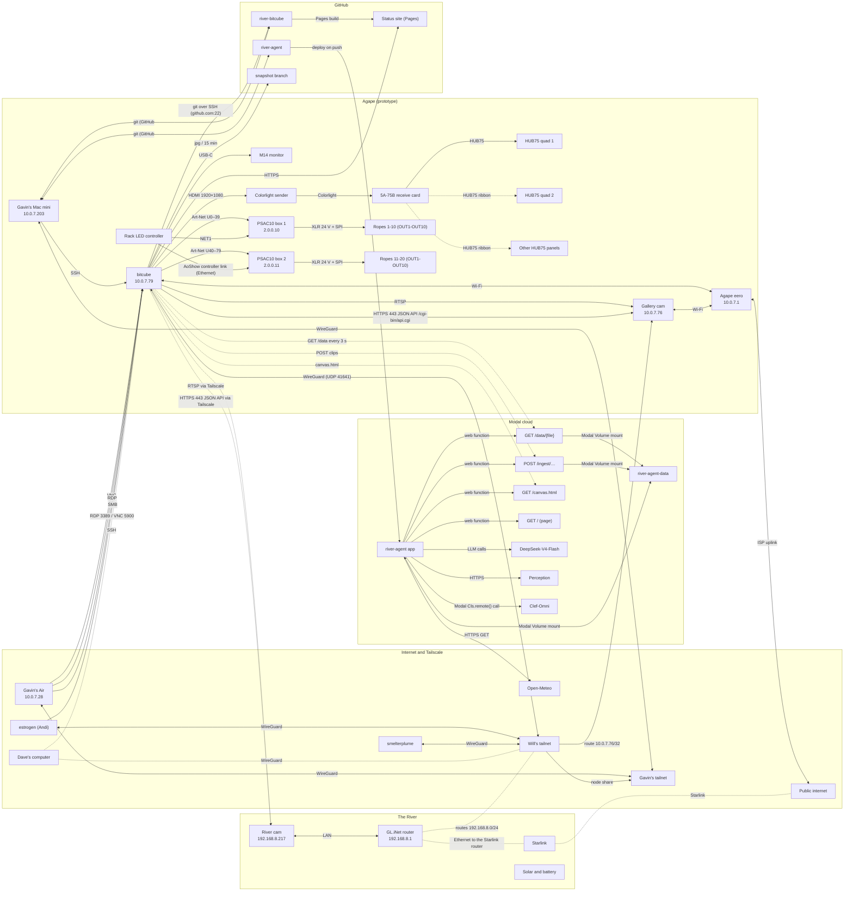
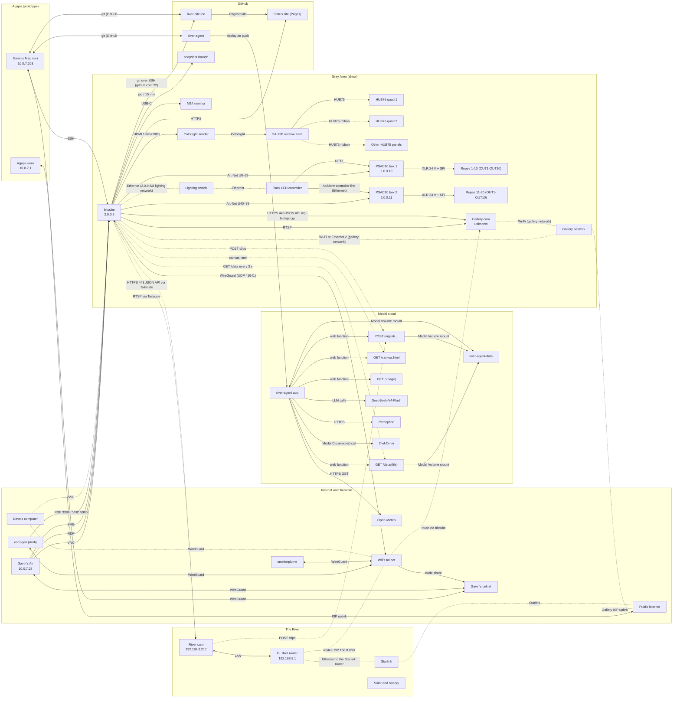

# A River Becoming: system map

> Generated from [system.json](https://gavaiken.github.io/river-bitcube/system/system.json) by `tools/system_docs.py`; don't edit by hand. Interactive version: https://gavaiken.github.io/river-bitcube/system/

Every machine, device, service and connection of A River Becoming, for people and agents. Source of truth for docs/system/index.html (interactive) and docs/system/system.md (generated by tools/system_docs.py). Validated by tools/tests/test_system_json.py. Optional display fields: node.short (diagram name) and link.label (text on the arrow).

Updated 2026-10-18T18:10:00-07:00.

**Rules**

- Everything except secrets: names, hostnames, LAN and Tailscale IPs, ports, usernames and account emails are in; passwords and token values never (Gavin, 18 Oct).
- Secrets appear only by name and where they live.
- The river site is given as an area only.
- Never advertise a site's own LAN as a Tailscale subnet from another device: it hijacks bitcube's local traffic (18 Oct, when the GL.iNet's 10.0.7.0/24 route took the gallery cam and the eero away from bitcube).
- verified: confirmed = checked on the device, in code, or by the team; unverified = believed but not checked; awaiting:<Name> = needs that person's answer.

## Scenarios

### Now: Agape (`now`, 18 Oct 2026)

Prototype at Agape. bitcube runs the local rain checkpoint on 18 of 20 ropes and HUB75 quad 1, with no Modal input yet. The gallery cam is on Agape WiFi, and bitcube shares it on Will's tailnet (10.0.7.76/32). The GL.iNet router and the river cam left for the river with Casper on the evening of 18 Oct. Modal's agent ticks every 5 minutes, but nothing on bitcube reads it yet.



### Show: Gray Area (`show`, install from Wed 22 Oct 2026, show to 27 Oct)

Planned and partly unsettled. bitcube and all lighting move to Gray Area: lighting NIC on a switch to the rack and PSAC10s, internet from the gallery network on the other NIC or Wi-Fi. The gallery cam joins the gallery Wi-Fi and bitcube advertises its address on Will's tailnet, as at Agape. bitcube mirrors Modal's scene (sync.py, :8770) and pushes gallery clips to /ingest. The river cam is at the river on Starlink.

Open questions: Gallery network: the dual-NIC plan. (Reaching the gallery cam over Tailscale: bitcube advertises its address as a /32, as at Agape since 18 Oct.); Give the gallery cam a fixed address? At Gray Area, gallery Wi-Fi or back on the GL.iNet?; At the river: is the GL.iNet on Starlink, and what runs the capture agent that pushes river clips to /ingest (bitcube over Tailscale via 192.168.8.0/24, or a device there)?; Which location/channel names and clip cadence should bitcube use for camera ingest? (Code: locations gallery/river, channel video, 10 s clips.); Can bitcube get an INGEST_TOKEN? (SITE_TOKEN: answered, it is not set.); OK to run gallery/sync.py on bitcube (port 8770)?; What should the gallery show if bitcube goes down? (Today: the rack controller's SD-card colour cycle.); Does the show need a TouchDesigner Commercial licence? (bitcube has Non-Commercial.)



Solid arrows are working; dotted arrows are planned, stopped, blocked or unknown. An arrow points away from the side that starts the connection.

## Places

| Place | Scenarios | Status | Summary |
|---|---|---|---|
| The River (`river`) | now, show | partial | The real river the agent watches. The GL.iNet router and the Reolink E1 Outdoor Pro went there with Casper on 18 Oct; Starlink and solar/battery power are expected there (unverified). Area: near Dobbins, California. |
| Agape (prototype) (`agape`) | now, show | working | Gavin's house in the Mission, SF, where everything is prototyped until the Gray Area install. Gavin's Mac mini stays here. Network: lan: 10.0.7.0/24; gateway: 10.0.7.1 (eero); wifi: Agape WiFi. |
| Gray Area (show) (`grayarea`) | show | planned | The gallery. Install Wed 22 to Mon 27 Oct 2026. Network plan not settled (open questions to Will). Address: Gray Area, 2665 Mission St, San Francisco. |
| Modal cloud (`modal`) | now, show | working | Dave's agent: one Modal app (tick, watch, web) plus model apps, in workspace to-be-a-river. |
| Internet and Tailscale (`internet`) | now, show | working | The public internet, the two tailnets, and team devices that aren't tied to a site. |
| GitHub (`github`) | now, show | working | The two repos, the public status site (GitHub Pages) and the camera snapshot branch. |

## Nodes

## In The River

### River cam (`cam-river`)

*camera · unknown · confirmed · owner Will Gardiner · now: The River · show: The River*

Reolink E1 Outdoor Pro behind the GL.iNet router. Left Agape for the river with Casper on the evening of 18 Oct (it used to sit on the rack controller here).

- **Specs:**
  - model: Reolink E1 Outdoor Pro
  - rtsp: rtsp://admin:<password>@192.168.8.217:554/Preview_01_main
  - ptz: https://192.168.8.217/cgi-bin/api.cgi (same API as the gallery cam)
  - serial: on its base
- **Interfaces:**
  - name: LAN; ip: 192.168.8.217; how: behind the GL.iNet (192.168.8.0/24); wired or Wi-Fi unverified
- **Accounts:**
  - service: Reolink; user: admin; auth: camera admin password (secrets.local.json -> cameras.river)
- **Ports:**
  - port: 554; proto: tcp; service: RTSP
  - port: 443; proto: tcp; service: HTTPS API (PTZ)
- **Notes:** Reachable only while the GL.iNet is online on Will's tailnet.
- **Open questions:** At the river: is the GL.iNet on Starlink, and what runs the capture agent that pushes river clips to /ingest (bitcube over Tailscale via 192.168.8.0/24, or a device there)? (ask Will Gardiner)
- **Sources:** docs/a-river-becoming-hardware.md (verified hardware); docs/a-river-becoming-log.md (session history); Session A notes, 18 Oct 17:50 and 17:55 (docs/sessions/A.md): GL.iNet to the river, route changes, gallery cam via bitcube, HUB75 gain

### GL.iNet router (`glinet`)

*router · unknown · confirmed · owner Will Gardiner · now: The River · show: The River*

GL.iNet GL-AXT1800 (Slate AX) travel router running Tailscale: puts the river cam's subnet 192.168.8.0/24 on Will's tailnet. Left Agape for the river with Casper and the river cam on the evening of 18 Oct; offline at 17:50.

- **Specs:**
  - model: GL.iNet GL-AXT1800 (Slate AX)
  - tailscale routes: 192.168.8.0/24 (approved)
  - os: OpenWrt-based (GL.iNet firmware)
  - route history: Also advertised 10.0.7.0/24 (the Agape LAN) until 18 Oct 17:47, when Gavin un-approved it: bitcube accepts routes, so once the router left, bitcube lost the gallery cam and the eero.
- **Interfaces:**
  - name: WAN; ip: none; how: at the river: unknown (Starlink?); was 10.0.7.150 on the Agape LAN until 18 Oct; verified: unverified
  - name: LAN; ip: 192.168.8.1/24; how: camera subnet
  - name: Tailscale; ip: 100.124.152.62; ipv6: fd7a:115c:a1e0::63b:983f; how: Will's tailnet, subnet router
- **Hostnames:** gl-axt1800; gl-axt1800.tail03bc1a.ts.net
- **Accounts:**
  - service: Tailscale; user: itsriverbox@outlook.com
  - service: GL.iNet admin; auth: router admin password (Will); verified: unverified
- **Notes:** Its uplink at the river (Starlink) and power are unverified.
- **Open questions:** At the river: is the GL.iNet on Starlink, and what runs the capture agent that pushes river clips to /ingest (bitcube over Tailscale via 192.168.8.0/24, or a device there)? (ask Will Gardiner)
- **Sources:** `tailscale status` and `tailscale status --json` on bitcube (Will's tailnet view); docs/a-river-becoming-hardware.md (verified hardware); Session A notes, 18 Oct 17:50 and 17:55 (docs/sessions/A.md): GL.iNet to the river, route changes, gallery cam via bitcube, HUB75 gain

### Starlink (`starlink`)

*router · planned · unverified · owner Will Gardiner · now: The River · show: The River*

Satellite uplink for the river kit. Outbound only (carrier-grade NAT), so devices there must push out, or be reached over Tailscale.

- **Notes:** Deployment date and whether it was picked up: unverified (planned for the 15-19 Oct river trip).
- **Open questions:** At the river: is the GL.iNet on Starlink, and what runs the capture agent that pushes river clips to /ingest (bitcube over Tailscale via 192.168.8.0/24, or a device there)? (ask Will Gardiner)
- **Sources:** The team's Signal thread (exported to 17 Oct on Gavin's mini; not public); drocamor/river-agent at a9cbd2c: modal_deploy/app.py, modal_deploy/agent.env, gallery/sync.py, capture/capture.py, tools/site.py, web/canvas.js, tools/visual_scene.py, tools/fast_perception.py, tools/midi_pad.py, .github/workflows

### Solar and battery (`river-power`)

*power · planned · unverified · owner Will Gardiner · now: The River · show: The River*

Off-grid power for the river kit (camera, router, Starlink).

- **Sources:** The team's Signal thread (exported to 17 Oct on Gavin's mini; not public)

## In Agape (prototype)

### bitcube (`bitcube`)

*computer · working · confirmed · owner Will Gardiner · now: Agape (prototype) · show: Gray Area (show)*

The show machine: a Windows mini PC that runs TouchDesigner, drives the ropes (Art-Net) and the HUB75 (HDMI), reads the cameras, and will mirror Modal's scene.

- **Specs:**
  - os: Windows 11 Pro 10.0.22621
  - cpu: Intel Core i7-1185G7 (11th gen)
  - ram: 15.8 GB
  - gpu: Intel Iris Xe (driver 32.0.101.7088)
  - bios: American Megatrends MU05P V0.14
  - computer name: BITCUBE
  - boot: Windows Boot Manager first (Ubuntu still installed); auto-login via Sysinternals Autologon; Tailscale unattended; no sleep or hibernate on AC; restart takes about 1 minute
  - tailscale routes: advertises 10.0.7.76/32 (gallery cam) on Will's tailnet; accepts other nodes' routes
- **Interfaces:**
  - name: Wi-Fi; hw: Intel Wi-Fi 6 AX200; mac: 70-D8-23-16-A1-5C; ip: 10.0.7.79/24; how: DHCP on Agape WiFi (5 GHz, profile Private); gateway: 10.0.7.1 (default route, metric 0); scenario: now
  - name: Ethernet; hw: Realtek PCIe GbE; mac: 00-E7-43-0E-5F-C3; ip: 2.0.0.8/8; how: static; the lighting (Art-Net) network; link: 100 Mbps
  - name: Ethernet (second address); ip: 192.168.1.99/24; how: static, gateway 192.168.1.1 (metric 256); probably left over from the 2023 BitCube setup; verified: unverified
  - name: Ethernet 2; hw: Realtek PCIe GbE #2; mac: 00-E7-43-0E-5F-C4; ip: none; how: disconnected; candidate for the gallery uplink (dual-NIC plan)
  - name: Tailscale; ip: 100.73.68.60; ipv6: fd7a:115c:a1e0::3c3b:443d; how: Will's tailnet tail03bc1a; also node-shared into Gavin's tailnet. Advertises 10.0.7.76/32 (the gallery cam, approved 18 Oct 17:55) and accepts routes (RouteAll).
- **Hostnames:** bitcube; bitcube.local; bitcube.tail03bc1a.ts.net
- **Access:**
  - method: SSH; address: 100.73.68.60 or bitcube.tail03bc1a.ts.net; port: 22; user: user; auth: SSH key in C:\ProgramData\ssh\administrators_authorized_keys (Gavin's mini, Dave); note: Full admin rights, no UAC. From the mini: `ssh bitcube`.
  - method: VNC; address: vnc://bitcube.tail03bc1a.ts.net (100.73.68.60); port: 5900; auth: TightVNC password; note: Shows the real console and HDMI output. Prefer this over RDP.
  - method: RDP; address: 100.73.68.60; port: 3389; user: user; auth: Windows password; note: Takes over the console: the HUB75 output disappears while connected. Hand back with `tscon <id> /dest:console`.
  - method: SMB; address: \\bitcube\River, smb://100.73.68.60/River, smb://bitcube.local/River; port: 445; user: user; auth: Windows password; note: Share River = C:\Users\user\River
  - method: TeamViewer; port: 5938; note: Service running (2023 leftover); account unverified
- **Accounts:**
  - service: Windows; user: user; note: Local administrator, auto-logs in. Password held by Will (never written down here).
  - service: GitHub; user: deploy key; note: Read-write deploy key for gavaiken/river-bitcube only; no personal GitHub login on bitcube
- **Ports:**
  - port: 22; proto: tcp; service: OpenSSH sshd; bind: 0.0.0.0
  - port: 3389; proto: tcp; service: Remote Desktop; bind: 0.0.0.0
  - port: 5900; proto: tcp; service: TightVNC server; bind: 0.0.0.0; note: Firewall rule allows all profiles (team's choice, 17 Oct)
  - port: 5800; proto: tcp; service: TightVNC HTTP viewer; bind: 0.0.0.0
  - port: 445; proto: tcp; service: SMB file share River
  - port: 139; proto: tcp; service: NetBIOS; bind: 100.73.68.60
  - port: 5938; proto: tcp; service: TeamViewer service; bind: 0.0.0.0
  - port: 9980; proto: tcp; service: Claude to TouchDesigner bridge (WebServer DAT); bind: 0.0.0.0; note: Answers localhost only (403 to anyone else)
  - port: 6454; proto: udp; service: Art-Net out (TouchDesigner); bind: 2.0.0.8
  - port: 8765; proto: tcp; service: RopeLights web UI (Will); bind: 100.73.68.60; note: Only while RopeLights runs (stopped now); firewall opens it on Tailscale only
  - port: 8770; proto: tcp; service: gallery/sync.py local mirror of Modal; bind: 127.0.0.1; status: planned
  - port: 41641; proto: udp; service: Tailscale (WireGuard)
- **Services:**
  - name: TouchDesigner 2025.33230; status: working; detail: Non-Commercial licence (TOPs max 1280x1280). Login autostart Start-River.cmd (10 s) opens river-local-oct-18.toe, the local rain checkpoint. river.toe is the general show file for Dave's visuals.
  - name: Art-Net sender; status: working; detail: td/ropes/artnet_out.py inside TD: 40 fps target (about 35 sent), brightness 0.4 cap, 600 W per box limiter. Byte-identical to Will's RopeLights. Keeps sending black to keep the ropes dark.
  - name: HUB75 window; status: working; detail: /project1/panels: a black 1920x1080 window on the LED display (found by EDID name), panel atlas pinned at its top-left (quad 1 at 0,0; quad 2 at 256,0). In river-local-oct-18.toe a gain stage brightens quad 1 (Panelgain 3.0, Panelgamma 0.7, panels Brightness 1.0; 18 Oct 17:55).
  - name: Claude bridge; status: working; detail: td/bridge: WebServer DAT on :9980, POST /exec, GET /errors, GET /screenshot. `tools\td.ps1` uses it.
  - name: RopeLights (Will); status: stopped; detail: Scheduled task RopeLights, no trigger. Never run it while TD sends Art-Net.
  - name: RiverSnapshot; status: working; detail: Scheduled task: every 15 min, 08:00 to 02:00, a 640x360 gallery-cam still force-pushed to branch snapshot.
  - name: Status page at login; status: working; detail: Start-Status.cmd (40 s): Chrome on the M14 with the public status page (local docs if offline).
  - name: Claude Code at login; status: working; detail: Start-Claude.cmd (20 s): Windows Terminal in C:\Users\user\River running Claude.
  - name: gallery/sync.py mirror; status: planned; detail: Session D: mirror Modal's /data files every 3 s, serve on 127.0.0.1:8770 for TD's Web Render TOP. Waiting on Dave.
  - name: capture/capture.py; status: planned; detail: Session E: push 10 s gallery-cam clips to Modal /ingest. Waiting on Dave (INGEST_TOKEN, names).
  - name: Tailscale; status: working; detail: Unattended (connects before login); node key expires 2027-04-11.
- **Paths:**
  - repo: C:\Users\user\River\river-bitcube
  - dave repo: C:\Users\user\River\river-agent (copy; no GitHub credentials for it on bitcube)
  - share: C:\Users\user\River
  - td: C:\Program Files\Derivative\TouchDesigner\bin\TouchDesigner.exe
  - ropelights: C:\Users\user\RopeLights
  - secrets: C:\Users\user\River\river-bitcube\secrets.local.json (untracked)
- **Displays:** M14 (USB-C, primary, desktop and status page); LED 1920X1080 (HDMI, the Colorlight sender)
- **Sources:** Read-only PowerShell over `ssh bitcube`: OS, NICs, IPs, routes, monitors, listening ports, services, scheduled tasks, SMB shares, firewall rules, ping of cameras and PSAC10s; `tailscale status` and `tailscale status --json` on bitcube (Will's tailnet view); docs/a-river-becoming-log.md (session history); CLAUDE.md (facts and gotchas for bitcube); Session A notes, 18 Oct 17:50 and 17:55 (docs/sessions/A.md): GL.iNet to the river, route changes, gallery cam via bitcube, HUB75 gain

### M14 monitor (`m14`)

*display · working · confirmed · owner Gavin Aiken · now: Agape (prototype) · show: Gray Area (show)*

Lenovo M14 portable monitor on USB-C: bitcube's primary display, so the desktop and taskbar stay off the panels.

- **Specs:**
  - edid: LEN61DD, name M14
  - mode: 1366x768 as Windows reports it (18 Oct)
  - role: Primary display; Chrome shows the status page here at login
- **Notes:** At Gray Area: unverified whether this monitor goes too.
- **Owner verified:** unverified
- **Sources:** Read-only PowerShell over `ssh bitcube`: OS, NICs, IPs, routes, monitors, listening ports, services, scheduled tasks, SMB shares, firewall rules, ping of cameras and PSAC10s; CLAUDE.md (facts and gotchas for bitcube)

### Colorlight sender (`colorlight-sender`)

*led-controller · working · confirmed · owner Andi Doud · now: Agape (prototype) · show: Gray Area (show)*

LED video sender. Looks like a 1920x1080 HDMI display to bitcube and samples its top-left region for the receive card.

- **Specs:**
  - edid name: LED 1920X1080
  - input: HDMI 1920x1080
  - used region: top-left 512x128 (two quads)
  - config: Andi's LEDVision/LEDSetting from their Windows PC
  - model: unverified
- **Sources:** docs/a-river-becoming-hardware.md (verified hardware); Read-only PowerShell over `ssh bitcube`: OS, NICs, IPs, routes, monitors, listening ports, services, scheduled tasks, SMB shares, firewall rules, ping of cameras and PSAC10s

### Colorlight 5A-75B receive card (`receive-card`)

*led-controller · working · confirmed · owner Andi Doud · now: Agape (prototype) · show: Gray Area (show)*

Receive card that drives the HUB75 panels from the sender's stream.

- **Specs:**
  - model: Colorlight 5A-75B
  - layout: Andi's receive-card config; quad 2 layout still open
- **Sources:** docs/a-river-becoming-hardware.md (verified hardware)

### HUB75 quad 1 (`hub75-quad1`)

*display · working · confirmed · owner Andi Doud · now: Agape (prototype) · show: Gray Area (show)*

Four 128x64 panels as a 2x2 quad (256x128). Verified by camera: red TL with the quad-1 marker, green TR, blue BL, yellow BR.

- **Specs:**
  - panels: 4 x 128x64
  - pixels: 256x128
  - hdmi region: x 0-255, y 0-127
  - now showing: the rain checkpoint (river-local-oct-18.toe), brightened 18 Oct 17:55 (Panelgain 3.0, Panelgamma 0.7)
- **Sources:** docs/a-river-becoming-log.md (session history); docs/plan.md (checklist, decisions, open questions)

### HUB75 quad 2 (`hub75-quad2`)

*display · blocked · awaiting:Andi · owner Andi Doud · now: Agape (prototype) · show: Gray Area (show)*

Second quad, reserved at HDMI x 256-511. Not connected yet: waiting on Andi's receive-card layout. Blanked in TD.

- **Specs:**
  - panels: 4 x 128x64
  - pixels: 256x128
  - hdmi region: x 256-511, y 0-127
- **Open questions:** Receive-card layout for quad 2? Thread size for the panel mounts? (ask Andi Doud)
- **Sources:** docs/plan.md (checklist, decisions, open questions)

### Other HUB75 panels (`hub75-more`)

*display · planned · unverified · owner Andi Doud · now: Agape (prototype) · show: Gray Area (show)*

About 30 HUB75 panels exist in total (the 'pools'); how many go into the show beyond quads 1 and 2 is not settled.

- **Specs:**
  - total panels: about 30 x 128x64
  - chromatik model: 8 pools (Gavin's 7 Oct model)
- **Sources:** docs/a-river-becoming-hardware.md (verified hardware); docs/a-river-becoming-log.md (session history)

### PSAC10 box 1 (`psac10-1`)

*led-controller · working · confirmed · owner Casper · now: Agape (prototype) · show: Gray Area (show)*

AoShow AS_PSAC10 Art-Net node and 1,750 W PSU. Ropes 1-10 on OUT1-OUT10.

- **Specs:**
  - model: AoShow AS_PSAC10 BOX_SPI_60U_1750W
  - oled: AS_832M-16P, ID:001
  - outputs: 10 x 4-pin XLR (24 V + SPI data), 175 W each
  - universes: 0-39 (4 per rope, 3 used)
  - mains: voltage selector set to 110 V
  - power note: 10 ropes full white = 1,500 W; TD caps at 600 W per box
- **Interfaces:**
  - name: NET1/NET2 (Ethercon); ip: 2.0.0.10/8; mac: 0E-FE-65-FF-02-00; how: fixed by the box
- **Notes:** When Art-Net stops, the box (or the rack's SD card) plays its own colour cycle. TD keeps sending black to keep it dark.
- **Owner verified:** unverified
- **Sources:** docs/a-river-becoming-hardware.md (verified hardware); Will's C:\Users\user\RopeLights\config.local.json on bitcube (contains no secrets); Read-only PowerShell over `ssh bitcube`: OS, NICs, IPs, routes, monitors, listening ports, services, scheduled tasks, SMB shares, firewall rules, ping of cameras and PSAC10s; docs/a-river-becoming-log.md (session history)

### PSAC10 box 2 (`psac10-2`)

*led-controller · working · confirmed · owner Casper · now: Agape (prototype) · show: Gray Area (show)*

Second AS_PSAC10. Ropes 11-20 on OUT1-OUT10.

- **Specs:**
  - model: AoShow AS_PSAC10 BOX_SPI_60U_1750W
  - oled: ID:002
  - outputs: 10 x 4-pin XLR (24 V + SPI data)
  - universes: 40-79
- **Interfaces:**
  - name: NET1/NET2 (Ethercon); ip: 2.0.0.11/8; mac: 0E-FE-65-E2-02-00; how: fixed by the box
- **Owner verified:** unverified
- **Sources:** docs/a-river-becoming-hardware.md (verified hardware); Will's C:\Users\user\RopeLights\config.local.json on bitcube (contains no secrets); Read-only PowerShell over `ssh bitcube`: OS, NICs, IPs, routes, monitors, listening ports, services, scheduled tasks, SMB shares, firewall rules, ping of cameras and PSAC10s

### Rack LED controller (`rack-controller`)

*led-controller · standby · confirmed · owner Casper · now: Agape (prototype) · show: Gray Area (show)*

AoShow 1U master player (AS_MSDMX). Plays its SD-card program (program 2 lights the ropes) only when no Art-Net arrives.

- **Specs:**
  - model: AoShow AS_MSDMX 1U LED Controller
  - lcd: P:002/005 S:07, IC:UCS1903_UCS1909_UCS1912
  - rear: NET1/NET2, DMX512 (XLR and RJ45), audio in, mic, wall pad RJ45, IEC 100-240 V
  - ip: unknown
- **Notes:** The river cam sits on top of it at Agape (18 Oct).
- **Owner verified:** unverified
- **Sources:** docs/a-river-becoming-hardware.md (verified hardware); docs/plan.md (checklist, decisions, open questions)

### Gallery cam (`cam-gallery`)

*camera · working · confirmed · owner Will Gardiner · now: Agape (prototype) · show: Gray Area (show)*

Reolink E1 Pro (indoor, pan/tilt, mic). At Agape on Agape WiFi, aimed at all coil piles, the HUB75 and the PSAC10s. Used for calibration, snapshots and (planned) the agent's gallery eye.

- **Specs:**
  - model: Reolink E1 Pro
  - rtsp: rtsp://admin:<password>@10.0.7.76:554/Preview_01_main (use -rtsp_transport tcp)
  - ptz: HTTPS JSON API https://10.0.7.76/cgi-bin/api.cgi (self-signed): Login -> token -> PtzCtrl (Left/Right/Up/Down/Stop) -> Logout. Always send Stop.
  - spotlight: motion spotlight off (Will, 16 Oct)
  - aim: 18 Oct 13:59; bumped once between 14:11 and 14:33
- **Interfaces:**
  - name: Wi-Fi; ip: 10.0.7.76; how: DHCP on Agape WiFi since 18 Oct 14:09 (was 192.168.8.103, then .189, on the GL.iNet); scenario: now
  - name: Wi-Fi; ip: unknown; how: Gray Area gallery network, reached by bitcube; exposed on bitcube's tailnet (planned); scenario: show
- **Accounts:**
  - service: Reolink; user: admin; auth: camera admin password (secrets.local.json -> cameras.gallery)
- **Ports:**
  - port: 554; proto: tcp; service: RTSP
  - port: 443; proto: tcp; service: HTTPS API (PTZ)
- **Open questions:** Give the gallery cam a fixed address? At Gray Area, gallery Wi-Fi or back on the GL.iNet? (ask Will Gardiner) Gallery network: the dual-NIC plan. (Reaching the gallery cam over Tailscale: bitcube advertises its address as a /32, as at Agape since 18 Oct.) (ask Will Gardiner)
- **Sources:** CLAUDE.md (facts and gotchas for bitcube); docs/a-river-becoming-hardware.md (verified hardware); docs/a-river-becoming-log.md (session history)

### Agape eero (`eero`)

*router · working · confirmed · owner Gavin Aiken · now: Agape (prototype) · show: Agape (prototype)*

The house router: gateway, DHCP and DNS for Agape WiFi (10.0.7.0/24).

- **Interfaces:**
  - name: LAN; ip: 10.0.7.1/24; how: gateway, DHCP, DNS
- **Notes:** Nothing on it is port-forwarded to the show machines.
- **Sources:** Read-only PowerShell over `ssh bitcube`: OS, NICs, IPs, routes, monitors, listening ports, services, scheduled tasks, SMB shares, firewall rules, ping of cameras and PSAC10s

### Gavin's Mac mini (`gavin-mini`)

*computer · working · confirmed · owner Gavin Aiken · now: Agape (prototype) · show: Agape (prototype)*

Always-on Mac mini at Agape: session A (the coordinator) and docs sessions like this one. Pulls the repo, can SSH into bitcube.

- **Specs:**
  - model: Mac mini (M1, 2020)
  - os: macOS Tahoe
- **Interfaces:**
  - name: LAN; ip: 10.0.7.203; how: Agape
  - name: Tailscale; ip: 100.126.113.14; how: Gavin's tailnet tailddc624 (subnet router for 10.0.7.0/24 there)
- **Hostnames:** gav-m1-mini; gav-m1-mini.local; gav-m1-mini.tailddc624.ts.net
- **Access:**
  - method: SSH alias; address: `ssh bitcube` -> user@100.73.68.60; auth: ~/.ssh/id_ed25519
- **Accounts:**
  - service: macOS; user: gav
  - service: GitHub; user: gavaiken
  - service: Tailscale; user: gav.aiken@gmail.com
- **Sources:** `tailscale status` on Gavin's Mac mini (Gavin's tailnet view)

### Ropes

Each rope: AoShow 360 LED Flex Neon, 10 m, 400 px RGB (UCS1903, 24 V), 3 universes used of 4 reserved. Rope n is box ⌈n/10⌉, OUT ((n−1) mod 10)+1, universes 4(n−1) to 4(n−1)+2 (Will's config.local.json).

| Rope | Box / OUT | Universes | Pile at Agape | Visible px (camera) | Status |
|---|---|---|---|---|---|
| Rope 1 (`rope-01`) | box 1 OUT1 | 0-2 | right | 99 | working |
| Rope 2 (`rope-02`) | box 1 OUT2 | 4-6 | centre | 118 | working |
| Rope 3 (`rope-03`) | box 1 OUT3 | 8-10 | centre | 141 | working |
| Rope 4 (`rope-04`) | box 1 OUT4 | 12-14 | right | 53 | working |
| Rope 5 (`rope-05`) | box 1 OUT5 | 16-18 | centre | 201 | working |
| Rope 6 (`rope-06`) | box 1 OUT6 | 20-22 | centre | 142 | working |
| Rope 7 (`rope-07`) | box 1 OUT7 | 24-26 | centre | 77 | working |
| Rope 8 (`rope-08`) | box 1 OUT8 | 28-30 | right | 117 | working |
| Rope 9 (`rope-09`) | box 1 OUT9 | 32-34 | not seen (dark) | none | broken: Never lights (box 1 OUT9); swap test deferred, carrying on with 18 ropes. |
| Rope 10 (`rope-10`) | box 1 OUT10 | 36-38 | right | 207 | working |
| Rope 11 (`rope-11`) | box 2 OUT1 | 40-42 | left-centre | 68 | working |
| Rope 12 (`rope-12`) | box 2 OUT2 | 44-46 | far left | 184 | working |
| Rope 13 (`rope-13`) | box 2 OUT3 | 48-50 | left-centre | 106 | working |
| Rope 14 (`rope-14`) | box 2 OUT4 | 52-54 | left-centre | 138 | working |
| Rope 15 (`rope-15`) | box 2 OUT5 | 56-58 | far left | 166 | working |
| Rope 16 (`rope-16`) | box 2 OUT6 | 60-62 | centre | 79 | working |
| Rope 17 (`rope-17`) | box 2 OUT7 | 64-66 | not seen (dark) | none | broken: Never lights (box 2 OUT7); swap test deferred, carrying on with 18 ropes. |
| Rope 18 (`rope-18`) | box 2 OUT8 | 68-70 | left-centre | 94 | working |
| Rope 19 (`rope-19`) | box 2 OUT9 | 72-74 | far left | 47 | working |
| Rope 20 (`rope-20`) | box 2 OUT10 | 76-78 | far left | 66 | working |

## In Gray Area (show)

### Gray Area gallery network (`gallery-net`)

*network · planned · unverified · owner Lilian (Lily) · now: absent · show: Gray Area (show)*

Gray Area's own Wi-Fi/internet. Planned: bitcube's internet uplink and the gallery cam's network.

- **Notes:** Who to ask for credentials and whether devices can talk to each other on it: open.
- **Owner verified:** unverified
- **Open questions:** Gallery network: the dual-NIC plan. (Reaching the gallery cam over Tailscale: bitcube advertises its address as a /32, as at Agape since 18 Oct.) (ask Will Gardiner)
- **Sources:** docs/plan.md (checklist, decisions, open questions)

### Lighting switch (`gallery-switch`)

*network · planned · unverified · owner Casper · now: absent · show: Gray Area (show)*

A dumb Ethernet switch on bitcube's lighting NIC (2.0.0.8) for the rack controller and both PSAC10s.

- **Notes:** Casper offered a switch (16 Oct). The 17 Oct notes also put the gallery cam on this switch; the current plan puts it on the gallery Wi-Fi.
- **Open questions:** Gallery network: the dual-NIC plan. (Reaching the gallery cam over Tailscale: bitcube advertises its address as a /32, as at Agape since 18 Oct.) (ask Will Gardiner)
- **Sources:** The team's Signal thread (exported to 17 Oct on Gavin's mini; not public); docs/a-river-becoming-log.md (session history)

## In Modal cloud

### river-agent app (`modal-app`)

*cloud-app · working · confirmed · owner Dave · now: Modal cloud · show: Modal cloud*

Dave's Modal app: a cron tick (one agent step every 5 min), a watch function (one per camera clip), and the web function serving the page, /data and /ingest.

- **Specs:**
  - workspace: to-be-a-river
  - app: river-agent
  - web label: river
  - base url: https://to-be-a-river--river.modal.run
  - tick: cron */5 9-23,0-1 * * * (America/Chicago), max 1 container, runs orchestrator.run_once()
  - watch: spawned by /ingest for each mp4 clip; asks Clef-Omni the agent's questions; writes reflex.json
  - web: FastAPI (ASGI), scales to zero, up to 50 concurrent requests
  - model: deepseek-ai/DeepSeek-V4-Flash
  - deploy: GitHub Actions on push to main of drocamor/river-agent
  - secrets by name: river-agent-web (INGEST_TOKEN, SITE_TOKEN); river-agent-api-key (VLLM_API_KEY); river-agent-proxy (MODAL_PROXY_KEY, MODAL_PROXY_SECRET)
  - live 18 oct: tick 3356, mood expansive, scene flow / dry-bones, lifetime errors 0
- **Sources:** drocamor/river-agent at a9cbd2c: modal_deploy/app.py, modal_deploy/agent.env, gallery/sync.py, capture/capture.py, tools/site.py, web/canvas.js, tools/visual_scene.py, tools/fast_perception.py, tools/midi_pad.py, .github/workflows; Unauthenticated GET of https://to-be-a-river--river.modal.run/healthz and /data/{status,state,reflex,pad}.json (all 200, so SITE_TOKEN is not set)

### GET /data/{file} (`ep-data`)

*endpoint · working · confirmed · owner Dave · now: Modal cloud · show: Modal cloud*

The live files: status.json, state.json, pad.json, journal_recent.json, reflex.json (+ scenes.jsonl, journal.jsonl). bitcube's mirror will pull these every 3 s.

- **Specs:**
  - url: https://to-be-a-river--river.modal.run/data/state.json
  - auth: none today (SITE_TOKEN not set); with SITE_TOKEN: cookie river_token
  - cache: no-store
- **Sources:** drocamor/river-agent at a9cbd2c: modal_deploy/app.py, modal_deploy/agent.env, gallery/sync.py, capture/capture.py, tools/site.py, web/canvas.js, tools/visual_scene.py, tools/fast_perception.py, tools/midi_pad.py, .github/workflows; Unauthenticated GET of https://to-be-a-river--river.modal.run/healthz and /data/{status,state,reflex,pad}.json (all 200, so SITE_TOKEN is not set)

### POST /ingest/{location}/{channel} (`ep-ingest`)

*endpoint · working · confirmed · owner Dave · now: Modal cloud · show: Modal cloud*

Where sensors push media: Authorization: Bearer <INGEST_TOKEN>. An mp4 to channel video starts the watch loop.

- **Specs:**
  - url: https://to-be-a-river--river.modal.run/ingest/gallery/video
  - auth: Authorization: Bearer <INGEST_TOKEN> (or x-ingest-token header)
  - max body: 25 MB
- **Sources:** drocamor/river-agent at a9cbd2c: modal_deploy/app.py, modal_deploy/agent.env, gallery/sync.py, capture/capture.py, tools/site.py, web/canvas.js, tools/visual_scene.py, tools/fast_perception.py, tools/midi_pad.py, .github/workflows

### GET /canvas.html (`ep-canvas`)

*endpoint · working · confirmed · owner Dave · now: Modal cloud · show: Modal cloud*

The sculpture alone, full window, for TouchDesigner's Web Render TOP. ?w=&h= sets the design area (default 480x270).

- **Specs:**
  - url: https://to-be-a-river--river.modal.run/canvas.html?w=480&h=270
  - polls: status.json every 3 s, state.json on change (or every 30 s), reflex.json every 2 s
- **Sources:** drocamor/river-agent at a9cbd2c: modal_deploy/app.py, modal_deploy/agent.env, gallery/sync.py, capture/capture.py, tools/site.py, web/canvas.js, tools/visual_scene.py, tools/fast_perception.py, tools/midi_pad.py, .github/workflows; Unauthenticated GET of https://to-be-a-river--river.modal.run/healthz and /data/{status,state,reflex,pad}.json (all 200, so SITE_TOKEN is not set)

### GET / (journal page) (`ep-page`)

*endpoint · working · confirmed · owner Dave · now: Modal cloud · show: Modal cloud*

The installation's page: the sculpture, a status strip and the agent's journal. Kiosk mode ?kiosk=1. /healthz answers {"ok": true}.

- **Specs:**
  - url: https://to-be-a-river--river.modal.run/
  - healthz: https://to-be-a-river--river.modal.run/healthz
- **Sources:** drocamor/river-agent at a9cbd2c: modal_deploy/app.py, modal_deploy/agent.env, gallery/sync.py, capture/capture.py, tools/site.py, web/canvas.js, tools/visual_scene.py, tools/fast_perception.py, tools/midi_pad.py, .github/workflows; Unauthenticated GET of https://to-be-a-river--river.modal.run/healthz and /data/{status,state,reflex,pad}.json (all 200, so SITE_TOKEN is not set)

### Volume river-agent-data (`modal-volume`)

*storage · working · confirmed · owner Dave · now: Modal cloud · show: Modal cloud*

The agent's state: journal.jsonl, status.json, state.json, scenes.jsonl, pad.json, journal_recent.json, reflex.json, media/<location>/<channel>/<time>.<ext>.

- **Specs:**
  - retention: media 72 h; video clips 1 h; gallery frames 1 h (visitors)
- **Sources:** drocamor/river-agent at a9cbd2c: modal_deploy/app.py, modal_deploy/agent.env, gallery/sync.py, capture/capture.py, tools/site.py, web/canvas.js, tools/visual_scene.py, tools/fast_perception.py, tools/midi_pad.py, .github/workflows

### DeepSeek-V4-Flash (vLLM) (`modal-vllm`)

*cloud-app · working · confirmed · owner Dave · now: Modal cloud · show: Modal cloud*

The agent's LLM: Modal app river-agent-vllm-deepseek-v4-flash, OpenAI-compatible, behind Modal proxy auth.

- **Specs:**
  - url: https://to-be-a-river--river-agent-vllm-deepseek-v4-flash-serve.modal.run
  - deploy: by hand (models.yml workflow)
- **Sources:** drocamor/river-agent at a9cbd2c: modal_deploy/app.py, modal_deploy/agent.env, gallery/sync.py, capture/capture.py, tools/site.py, web/canvas.js, tools/visual_scene.py, tools/fast_perception.py, tools/midi_pad.py, .github/workflows

### Perception (vision) (`modal-perception`)

*cloud-app · working · confirmed · owner Dave · now: Modal cloud · show: Modal cloud*

Modal app river-agent-perception: turns camera frames into text for the tick. Audio perception is off.

- **Specs:**
  - vision url: https://to-be-a-river--river-agent-perception-vision.modal.run
  - audio url: https://to-be-a-river--river-agent-perception-audio.modal.run (disabled)
- **Sources:** drocamor/river-agent at a9cbd2c: modal_deploy/app.py, modal_deploy/agent.env, gallery/sync.py, capture/capture.py, tools/site.py, web/canvas.js, tools/visual_scene.py, tools/fast_perception.py, tools/midi_pad.py, .github/workflows

### Clef-Omni (`modal-clef`)

*cloud-app · working · confirmed · owner Dave · now: Modal cloud · show: Modal cloud*

Modal app river-agent-clef: a decision model that answers the agent's typed questions about each 10 s clip (fast perception). Asleep until clips arrive.

- **Specs:**
  - app: river-agent-clef
  - class: ClefOmni
  - active hours: 9-2 (America/Chicago)
- **Sources:** drocamor/river-agent at a9cbd2c: modal_deploy/app.py, modal_deploy/agent.env, gallery/sync.py, capture/capture.py, tools/site.py, web/canvas.js, tools/visual_scene.py, tools/fast_perception.py, tools/midi_pad.py, .github/workflows

## In Internet and Tailscale

### Gavin's MacBook Air (`gavin-air`)

*computer · working · confirmed · owner Gavin Aiken · now: Internet and Tailscale · show: Internet and Tailscale*

Gavin's laptop: VNC, RDP (Windows App) and SMB into bitcube over Tailscale. Holds the 7 Oct Chromatik model and TD patch (probably).

- **Interfaces:**
  - name: Tailscale; ip: 100.92.63.88; how: Gavin's tailnet
  - name: LAN at Agape; ip: 10.0.7.28; how: seen 18 Oct
- **Hostnames:** gavins-macbook-air
- **Accounts:**
  - service: Tailscale; user: gav.aiken@gmail.com
- **Sources:** `tailscale status` on Gavin's Mac mini (Gavin's tailnet view); docs/a-river-becoming-log.md (session history)

### Andi's PC (estrogen) (`andi-pc`)

*computer · working · confirmed · owner Andi Doud · now: Internet and Tailscale · show: Internet and Tailscale*

Andi's Windows PC on Will's tailnet: Colorlight configuration and TouchDesigner; RDP/VNC into bitcube.

- **Interfaces:**
  - name: Tailscale; ip: 100.87.170.119; ipv6: fd7a:115c:a1e0::a23b:aa78; how: Will's tailnet
- **Hostnames:** estrogen; estrogen.tail03bc1a.ts.net
- **Accounts:**
  - service: Tailscale; user: andixdoud@gmail.com
- **Notes:** Offline when checked (last seen 21 h before 17:16, 18 Oct).
- **Sources:** `tailscale status` and `tailscale status --json` on bitcube (Will's tailnet view)

### smelterplume (Mac) (`smelterplume`)

*computer · unknown · unverified · owner Will Gardiner · now: Internet and Tailscale · show: Internet and Tailscale*

A macOS device on Will's tailnet, logged in with the project account. Probably Will's laptop (unverified).

- **Interfaces:**
  - name: Tailscale; ip: 100.75.114.92; ipv6: fd7a:115c:a1e0::383b:725d; how: Will's tailnet
- **Hostnames:** smelterplume; smelterplume.tail03bc1a.ts.net
- **Accounts:**
  - service: Tailscale; user: itsriverbox@outlook.com
- **Open questions:** Whose Mac is smelterplume? (ask Will Gardiner)
- **Sources:** `tailscale status` and `tailscale status --json` on bitcube (Will's tailnet view)

### Dave's computer (`dave-laptop`)

*computer · unknown · unverified · owner Dave · now: Internet and Tailscale · show: Internet and Tailscale*

Dave can SSH into bitcube with his key (added 18 Oct). No Dave device was visible on Will's tailnet on 18 Oct.

- **Access:**
  - method: SSH; address: user@bitcube.tail03bc1a.ts.net; port: 22; auth: Dave's SSH key (comment river, SHA256:aXW4LMdJXbPfPv8mRImLDWTjkVZ3f6Y818HEqin+/No)
- **Accounts:**
  - service: GitHub; user: drocamor
- **Open questions:** Are you on Will's tailnet? No device of yours was visible from bitcube on 18 Oct. (ask Dave)
- **Sources:** docs/a-river-becoming-log.md (session history); `tailscale status` and `tailscale status --json` on bitcube (Will's tailnet view)

### Public internet (`public-internet`)

*network · working · confirmed · owner the team · now: Internet and Tailscale · show: Internet and Tailscale*

Everything that leaves a site: Modal, GitHub, Open-Meteo, Tailscale's coordination servers.


### Open-Meteo (`open-meteo`)

*service · working · confirmed · owner the team · now: Internet and Tailscale · show: Internet and Tailscale*

Free weather API the tick reads for current conditions near the river (no key).

- **Specs:**
  - url: https://api.open-meteo.com/v1/forecast
  - place: near Dobbins, California
- **Sources:** drocamor/river-agent at a9cbd2c: modal_deploy/app.py, modal_deploy/agent.env, gallery/sync.py, capture/capture.py, tools/site.py, web/canvas.js, tools/visual_scene.py, tools/fast_perception.py, tools/midi_pad.py, .github/workflows; Unauthenticated GET of https://to-be-a-river--river.modal.run/healthz and /data/{status,state,reflex,pad}.json (all 200, so SITE_TOKEN is not set)

### Will's tailnet (tail03bc1a) (`tailnet-will`)

*tailnet · working · confirmed · owner Will Gardiner · now: Internet and Tailscale · show: Internet and Tailscale*

The project tailnet: bitcube, the GL.iNet (camera subnet router), Andi's PC, smelterplume. Free plan, max 6 users.

- **Specs:**
  - tailnet: itsriverbox@outlook.com
  - magicdns: tail03bc1a.ts.net
  - owner login: itsriverbox@outlook.com
  - members seen: itsriverbox@outlook.com; andixdoud@gmail.com; gav.aiken@gmail.com (Admin; his devices stay on his own tailnet)
  - subnet routes: 192.168.8.0/24 via gl-axt1800 (river cam); 10.0.7.76/32 via bitcube (gallery cam)
- **Notes:** Node sharing doesn't carry subnet routes: to reach either camera through a route, a device must be in this tailnet itself (on Gavin's devices, use the account switcher).
- **Sources:** `tailscale status` and `tailscale status --json` on bitcube (Will's tailnet view); docs/a-river-becoming-log.md (session history)

### Gavin's tailnet (tailddc624) (`tailnet-gavin`)

*tailnet · working · confirmed · owner Gavin Aiken · now: Internet and Tailscale · show: Internet and Tailscale*

Gavin's own tailnet: the Mac mini (subnet router for Agape 10.0.7.0/24) and the Air. bitcube is node-shared into it as 100.73.68.60.

- **Specs:**
  - magicdns: tailddc624.ts.net
  - owner login: gav.aiken@gmail.com
- **Notes:** Don't move the mini to Will's tailnet: it's Gavin's remote-access path.
- **Sources:** `tailscale status` on Gavin's Mac mini (Gavin's tailnet view); docs/a-river-becoming-log.md (session history)

## In GitHub

### gavaiken/river-bitcube (`repo-river-bitcube`)

*repo · working · confirmed · owner Gavin Aiken · now: GitHub · show: GitHub*

This repo (public): docs (source of truth), TouchDesigner files and build scripts, tools. Checked out on bitcube and on Gavin's mini.

- **Specs:**
  - url: https://github.com/gavaiken/river-bitcube
  - visibility: public
  - branches: main; snapshot (orphan, force-pushed)
  - checkouts: bitcube: C:\Users\user\River\river-bitcube; mini: ~/claude/Source/river-bitcube
- **Sources:** docs/a-river-becoming-log.md (session history)

### drocamor/river-agent (`repo-river-agent`)

*repo · working · confirmed · owner Dave · now: GitHub · show: GitHub*

Dave's repo (private): the agent, the page, the Modal app. Merges to main deploy to Modal. gavaiken has push access.

- **Specs:**
  - url: https://github.com/drocamor/river-agent
  - visibility: private
  - ci: deploy.yml (push to main deploys modal_deploy/app.py), models.yml (manual model deploys)
  - actions secrets by name: MODAL_TOKEN_ID; MODAL_TOKEN_SECRET
- **Sources:** drocamor/river-agent at a9cbd2c: modal_deploy/app.py, modal_deploy/agent.env, gallery/sync.py, capture/capture.py, tools/site.py, web/canvas.js, tools/visual_scene.py, tools/fast_perception.py, tools/midi_pad.py, .github/workflows; docs/a-river-becoming-log.md (session history)

### Status site (GitHub Pages) (`gh-pages`)

*website · working · confirmed · owner Gavin Aiken · now: GitHub · show: GitHub*

Public status page and these docs, built from main:/docs.

- **Specs:**
  - url: https://gavaiken.github.io/river-bitcube/
  - system docs: https://gavaiken.github.io/river-bitcube/system/
  - llms txt: https://gavaiken.github.io/river-bitcube/llms.txt
- **Sources:** docs/a-river-becoming-log.md (session history)

### snapshot branch (`gh-snapshot`)

*repo · working · confirmed · owner Gavin Aiken · now: GitHub · show: GitHub*

Orphan branch holding one gallery.jpg, replaced every 15 minutes (08:00-02:00) by bitcube. The status page shows it.

- **Specs:**
  - url: https://raw.githubusercontent.com/gavaiken/river-bitcube/snapshot/gallery.jpg
  - size: 640x360 JPEG, about 60 KB
- **Sources:** docs/a-river-becoming-log.md (session history)

## Links

Every connection. Auth names the secret, never its value. Medium colours on the interactive page: `artnet` Art-Net on the lighting Ethernet (2.0.0.0/8); `ethernet` other Ethernet between lighting devices; `xlr` 4-pin XLR, 24 V + SPI data to a rope; `video` HDMI, USB-C display, Colorlight and HUB75 video chain; `lan` a local network (Wi-Fi or Ethernet) at a site; `tailscale` over a tailnet (WireGuard); `https` HTTPS over the internet; `git` git pushes, Pages builds, GitHub Actions; `starlink` Starlink satellite uplink; `internal` inside Modal.

| Link | From → to | Medium | Protocol | Direction | Auth | Rate | Status | Scenarios | What |
|---|---|---|---|---|---|---|---|---|---|
| `artnet-box1` | bitcube → PSAC10 box 1 | artnet | Art-Net ArtDmx, UDP 6454 | one-way | none (isolated lighting network) | 40 fps target, about 35 sent | working (confirmed) | now, show | TouchDesigner sends ropes 1-10: universes 0-39 from 2.0.0.8 to 2.0.0.10. Payload: 80 universes in total (this box 0-39), 170 RGB px per universe, 4 per rope (3 used, 4th black). Path: bitcube Ethernet (2.0.0.8/8) -> rack/box cabling (exact cable path unverified). |
| `artnet-box2` | bitcube → PSAC10 box 2 | artnet | Art-Net ArtDmx, UDP 6454 | one-way | none (isolated lighting network) | 40 fps target, about 35 sent | working (confirmed) | now, show | TouchDesigner sends ropes 11-20: universes 40-79 from 2.0.0.8 to 2.0.0.11. Payload: universes 40-79. |
| `net-rack-box1` | Rack LED controller → PSAC10 box 1 | ethernet | AoShow controller link (Ethernet, NET1 to NET1) | one-way |  |  | working (confirmed) | now, show | Rack NET1 to box 1 NET1. The rack plays its SD-card program over this only when Art-Net stops. |
| `net-box2-feed` | Rack LED controller → PSAC10 box 2 | ethernet | AoShow controller link (Ethernet) | one-way |  |  | working (unverified) | now, show | Box 2 is fed from rack NET2, or chained from box 1 NET2: not checked. |
| `lighting-switch` | bitcube → Lighting switch | ethernet | Ethernet (2.0.0.8/8 lighting network) | two-way |  |  | planned (unverified) | show | bitcube's lighting NIC to a dumb switch that feeds the rack controller and both PSAC10s. |
| `switch-rack` | Lighting switch → Rack LED controller | ethernet | Ethernet | two-way |  |  | planned (unverified) | show | Switch to the rack controller (and on to the PSAC10s). |
| `xlr-rope-01` | PSAC10 box 1 → Rope 1 | xlr | 4-pin XLR: 24 V + SPI data (UCS1903) | one-way |  |  | working (confirmed) | now, show | Box 1 OUT1 to rope 1 (via the supplied XLR to round-plug adapter). Payload: 400 px RGB from universes 0-2. |
| `xlr-rope-02` | PSAC10 box 1 → Rope 2 | xlr | 4-pin XLR: 24 V + SPI data (UCS1903) | one-way |  |  | working (confirmed) | now, show | Box 1 OUT2 to rope 2 (via the supplied XLR to round-plug adapter). Payload: 400 px RGB from universes 4-6. |
| `xlr-rope-03` | PSAC10 box 1 → Rope 3 | xlr | 4-pin XLR: 24 V + SPI data (UCS1903) | one-way |  |  | working (confirmed) | now, show | Box 1 OUT3 to rope 3 (via the supplied XLR to round-plug adapter). Payload: 400 px RGB from universes 8-10. |
| `xlr-rope-04` | PSAC10 box 1 → Rope 4 | xlr | 4-pin XLR: 24 V + SPI data (UCS1903) | one-way |  |  | working (confirmed) | now, show | Box 1 OUT4 to rope 4 (via the supplied XLR to round-plug adapter). Payload: 400 px RGB from universes 12-14. |
| `xlr-rope-05` | PSAC10 box 1 → Rope 5 | xlr | 4-pin XLR: 24 V + SPI data (UCS1903) | one-way |  |  | working (confirmed) | now, show | Box 1 OUT5 to rope 5 (via the supplied XLR to round-plug adapter). Payload: 400 px RGB from universes 16-18. |
| `xlr-rope-06` | PSAC10 box 1 → Rope 6 | xlr | 4-pin XLR: 24 V + SPI data (UCS1903) | one-way |  |  | working (confirmed) | now, show | Box 1 OUT6 to rope 6 (via the supplied XLR to round-plug adapter). Payload: 400 px RGB from universes 20-22. |
| `xlr-rope-07` | PSAC10 box 1 → Rope 7 | xlr | 4-pin XLR: 24 V + SPI data (UCS1903) | one-way |  |  | working (confirmed) | now, show | Box 1 OUT7 to rope 7 (via the supplied XLR to round-plug adapter). Payload: 400 px RGB from universes 24-26. |
| `xlr-rope-08` | PSAC10 box 1 → Rope 8 | xlr | 4-pin XLR: 24 V + SPI data (UCS1903) | one-way |  |  | working (confirmed) | now, show | Box 1 OUT8 to rope 8 (via the supplied XLR to round-plug adapter). Payload: 400 px RGB from universes 28-30. |
| `xlr-rope-09` | PSAC10 box 1 → Rope 9 | xlr | 4-pin XLR: 24 V + SPI data (UCS1903) | one-way |  |  | broken (confirmed) | now, show | Box 1 OUT9 to rope 9 (via the supplied XLR to round-plug adapter). Payload: 400 px RGB from universes 32-34. |
| `xlr-rope-10` | PSAC10 box 1 → Rope 10 | xlr | 4-pin XLR: 24 V + SPI data (UCS1903) | one-way |  |  | working (confirmed) | now, show | Box 1 OUT10 to rope 10 (via the supplied XLR to round-plug adapter). Payload: 400 px RGB from universes 36-38. |
| `xlr-rope-11` | PSAC10 box 2 → Rope 11 | xlr | 4-pin XLR: 24 V + SPI data (UCS1903) | one-way |  |  | working (confirmed) | now, show | Box 2 OUT1 to rope 11 (via the supplied XLR to round-plug adapter). Payload: 400 px RGB from universes 40-42. |
| `xlr-rope-12` | PSAC10 box 2 → Rope 12 | xlr | 4-pin XLR: 24 V + SPI data (UCS1903) | one-way |  |  | working (confirmed) | now, show | Box 2 OUT2 to rope 12 (via the supplied XLR to round-plug adapter). Payload: 400 px RGB from universes 44-46. |
| `xlr-rope-13` | PSAC10 box 2 → Rope 13 | xlr | 4-pin XLR: 24 V + SPI data (UCS1903) | one-way |  |  | working (confirmed) | now, show | Box 2 OUT3 to rope 13 (via the supplied XLR to round-plug adapter). Payload: 400 px RGB from universes 48-50. |
| `xlr-rope-14` | PSAC10 box 2 → Rope 14 | xlr | 4-pin XLR: 24 V + SPI data (UCS1903) | one-way |  |  | working (confirmed) | now, show | Box 2 OUT4 to rope 14 (via the supplied XLR to round-plug adapter). Payload: 400 px RGB from universes 52-54. |
| `xlr-rope-15` | PSAC10 box 2 → Rope 15 | xlr | 4-pin XLR: 24 V + SPI data (UCS1903) | one-way |  |  | working (confirmed) | now, show | Box 2 OUT5 to rope 15 (via the supplied XLR to round-plug adapter). Payload: 400 px RGB from universes 56-58. |
| `xlr-rope-16` | PSAC10 box 2 → Rope 16 | xlr | 4-pin XLR: 24 V + SPI data (UCS1903) | one-way |  |  | working (confirmed) | now, show | Box 2 OUT6 to rope 16 (via the supplied XLR to round-plug adapter). Payload: 400 px RGB from universes 60-62. |
| `xlr-rope-17` | PSAC10 box 2 → Rope 17 | xlr | 4-pin XLR: 24 V + SPI data (UCS1903) | one-way |  |  | broken (confirmed) | now, show | Box 2 OUT7 to rope 17 (via the supplied XLR to round-plug adapter). Payload: 400 px RGB from universes 64-66. |
| `xlr-rope-18` | PSAC10 box 2 → Rope 18 | xlr | 4-pin XLR: 24 V + SPI data (UCS1903) | one-way |  |  | working (confirmed) | now, show | Box 2 OUT8 to rope 18 (via the supplied XLR to round-plug adapter). Payload: 400 px RGB from universes 68-70. |
| `xlr-rope-19` | PSAC10 box 2 → Rope 19 | xlr | 4-pin XLR: 24 V + SPI data (UCS1903) | one-way |  |  | working (confirmed) | now, show | Box 2 OUT9 to rope 19 (via the supplied XLR to round-plug adapter). Payload: 400 px RGB from universes 72-74. |
| `xlr-rope-20` | PSAC10 box 2 → Rope 20 | xlr | 4-pin XLR: 24 V + SPI data (UCS1903) | one-way |  |  | working (confirmed) | now, show | Box 2 OUT10 to rope 20 (via the supplied XLR to round-plug adapter). Payload: 400 px RGB from universes 76-78. |
| `hdmi-led` | bitcube → Colorlight sender | video | HDMI 1920x1080 (display LED 1920X1080) | one-way |  | 60 fps | working (confirmed) | now, show | TouchDesigner's black full-screen window on the LED display; the panel atlas sits at its top-left. Payload: atlas 512x128 at (0,0): quad 1 x 0-255, quad 2 x 256-511. |
| `colorlight-rx` | Colorlight sender → Colorlight 5A-75B receive card | video | Colorlight protocol over Ethernet cable | one-way |  |  | working (unverified) | now, show | Sender to the 5A-75B receive card. |
| `hub75-q1` | Colorlight 5A-75B receive card → HUB75 quad 1 | video | HUB75 ribbon | one-way |  |  | working (confirmed) | now, show | Receive card to quad 1 (four 128x64 panels). |
| `hub75-q2` | Colorlight 5A-75B receive card → HUB75 quad 2 | video | HUB75 ribbon | one-way |  |  | blocked (awaiting:Andi) | now, show | Receive card to quad 2: not connected yet. |
| `hub75-rest` | Colorlight 5A-75B receive card → Other HUB75 panels | video | HUB75 ribbon | one-way |  |  | planned (unverified) | now, show | The other panels, if they join the show. |
| `usbc-m14` | bitcube → M14 monitor | video | USB-C DisplayPort | one-way |  |  | working (confirmed) | now, show | Primary display: desktop, taskbar, the status page in Chrome. |
| `wifi-bitcube` | bitcube → Agape eero | lan | Wi-Fi (Agape WiFi, 5 GHz) | two-way |  |  | working (confirmed) | now | bitcube's internet and house LAN: 10.0.7.79, default route. |
| `uplink-bitcube-gallery` | bitcube → Gray Area gallery network | lan | Wi-Fi or Ethernet 2 (gallery network) | two-way |  |  | planned (unverified) | show | bitcube's internet at Gray Area (dual-NIC plan: lighting on one NIC, internet on the other). |
| `eero-internet` | Agape eero → Public internet | lan | ISP uplink | two-way |  |  | working (confirmed) | now, show | Agape's internet. |
| `gallery-internet` | Gray Area gallery network → Public internet | lan | Gallery ISP uplink | two-way |  |  | planned (unverified) | show | Gray Area's internet. |
| `glinet-starlink` | GL.iNet router → Starlink | starlink | Ethernet to the Starlink router | two-way |  |  | unknown (unverified) | now, show | The river kit's uplink: the GL.iNet behind Starlink at the river (unverified). |
| `starlink-internet` | Starlink → Public internet | starlink | Starlink satellite (CGNAT, outbound only) | two-way |  |  | planned (unverified) | now, show | The river's internet. |
| `cam-river-lan` | River cam → GL.iNet router | lan | LAN 192.168.8.0/24 | two-way |  |  | working (confirmed) | now, show | River cam at 192.168.8.217 behind the GL.iNet. |
| `cam-gallery-wifi` | Gallery cam → Agape eero | lan | Wi-Fi (Agape WiFi, DHCP 10.0.7.76) | two-way |  |  | working (confirmed) | now | Gallery cam on the house network. |
| `cam-gallery-galnet` | Gallery cam → Gray Area gallery network | lan | Wi-Fi (gallery network) | two-way |  |  | planned (unverified) | show | Gallery cam on Gray Area's network. |
| `rtsp-gallery` | bitcube → Gallery cam | lan | RTSP over TCP 554 (/Preview_01_main) | one-way (bitcube pulls) | camera admin password (secrets.local.json -> cameras.gallery) | on demand; RiverSnapshot every 15 min | working (confirmed) | now, show | Video from the gallery cam: snapshots, calibration (structured light), the status-page snapshot, and (planned) clips for the agent. Path: now: Agape WiFi, direct. Teammates on Will's tailnet reach it through bitcube's 10.0.7.76/32 route. show: gallery network (planned). |
| `ptz-gallery` | bitcube → Gallery cam | lan | HTTPS 443 JSON API /cgi-bin/api.cgi | one-way | camera admin password -> session token | by hand (about 2,600 px/s of pan; nudge 0.1-0.4 s) | working (confirmed) | now, show | Pan/tilt: Login -> token -> PtzCtrl -> Stop -> Logout (tools/cameras/ptz.py). |
| `rtsp-river` | bitcube → River cam | tailscale | RTSP over TCP 554, via Tailscale subnet route 192.168.8.0/24 | one-way (bitcube pulls) | camera admin password (secrets.local.json -> cameras.river) |  | unknown (confirmed) | now, show | Video from the river cam, through Will's tailnet and the GL.iNet. Path: bitcube -> Tailscale (Will's tailnet) -> GL.iNet subnet route 192.168.8.0/24 -> 192.168.8.217, now at the river over Starlink (unverified). |
| `ptz-river` | bitcube → River cam | tailscale | HTTPS 443 JSON API via Tailscale | one-way | camera admin password -> session token |  | unknown (confirmed) | now, show | Pan/tilt for the river cam. |
| `ts-bitcube` | bitcube → Will's tailnet (tail03bc1a) | tailscale | WireGuard (UDP 41641) | two-way |  |  | working (confirmed) | now, show | bitcube is a member of Will's tailnet (100.73.68.60), advertises the gallery cam (10.0.7.76/32) and accepts routes. |
| `ts-glinet` | GL.iNet router → Will's tailnet (tail03bc1a) | tailscale | WireGuard; subnet router | two-way |  |  | unknown (confirmed) | now, show | The GL.iNet advertises 192.168.8.0/24 (the river cam) into Will's tailnet. Its 10.0.7.0/24 route was un-approved on 18 Oct 17:47. |
| `ts-andi` | Andi's PC (estrogen) → Will's tailnet (tail03bc1a) | tailscale | WireGuard | two-way |  |  | working (confirmed) | now, show | Andi's PC on Will's tailnet. |
| `ts-smelterplume` | smelterplume (Mac) → Will's tailnet (tail03bc1a) | tailscale | WireGuard | two-way |  |  | working (confirmed) | now, show | smelterplume on Will's tailnet. |
| `ts-dave` | Dave's computer → Will's tailnet (tail03bc1a) | tailscale | WireGuard | two-way |  |  | unknown (unverified) | now, show | Dave's access to Will's tailnet (approved 16 Oct per Signal; no device seen 18 Oct). |
| `ts-mini` | Gavin's Mac mini → Gavin's tailnet (tailddc624) | tailscale | WireGuard | two-way |  |  | working (confirmed) | now, show | The mini on Gavin's tailnet (also its subnet router for 10.0.7.0/24). |
| `ts-air` | Gavin's MacBook Air → Gavin's tailnet (tailddc624) | tailscale | WireGuard | two-way |  |  | working (confirmed) | now, show | The Air on Gavin's tailnet. |
| `ts-share` | Will's tailnet (tail03bc1a) → Gavin's tailnet (tailddc624) | tailscale | Tailscale node share | one-way |  |  | working (confirmed) | now, show | bitcube is shared from Will's tailnet into Gavin's (accepted 17 Oct). Subnet routes are not shared. |
| `ssh-mini` | Gavin's Mac mini → bitcube | tailscale | SSH, TCP 22 | one-way | SSH key ~/.ssh/id_ed25519 (public half in administrators_authorized_keys) |  | working (confirmed) | now, show | `ssh bitcube` from the mini: docs sessions, reading state, running PowerShell. |
| `vnc-air` | Gavin's MacBook Air → bitcube | tailscale | VNC, TCP 5900 (macOS Screen Sharing) | one-way | TightVNC password |  | working (confirmed) | now, show | Shows the real console and HDMI output. |
| `rdp-air` | Gavin's MacBook Air → bitcube | tailscale | RDP, TCP 3389 (Windows App) | one-way | Windows password |  | working (confirmed) | now, show | Remote desktop. Blanks the HUB75 while connected; hand the session back afterwards. |
| `smb-air` | Gavin's MacBook Air → bitcube | tailscale | SMB, TCP 445 | one-way | Windows password |  | working (confirmed) | now, show | Finder -> smb://100.73.68.60/River. |
| `remote-andi` | Andi's PC (estrogen) → bitcube | tailscale | RDP 3389 / VNC 5900 | one-way | Windows or VNC password |  | working (unverified) | now, show | Andi's remote access to bitcube over Will's tailnet. |
| `ssh-dave` | Dave's computer → bitcube | tailscale | SSH, TCP 22 | one-way | Dave's SSH key (comment river) |  | unknown (unverified) | now, show | Dave's SSH access: user@bitcube.tail03bc1a.ts.net. |
| `git-bitcube` | bitcube → gavaiken/river-bitcube | git | git over SSH (github.com:22) | one-way | deploy key C:\Users\user\.ssh\river_bitcube_deploy (core.sshCommand) |  | working (confirmed) | now, show | Claude on bitcube commits and pushes to main. |
| `snapshot-push` | bitcube → snapshot branch | git | git over SSH (force-push, one parentless commit) | one-way | deploy key river_bitcube_deploy | every 15 min, 08:00-02:00 Pacific | working (confirmed) | now, show | RiverSnapshot pushes the latest gallery.jpg. |
| `git-mini-bitcube` | Gavin's Mac mini → gavaiken/river-bitcube | git | git (GitHub, gavaiken) | two-way |  |  | working (confirmed) | now, show | Coordinator and docs sessions pull and push. |
| `git-mini-agent` | Gavin's Mac mini → drocamor/river-agent | git | git (GitHub, gavaiken, push access) | two-way |  |  | working (confirmed) | now, show | Gavin's clone of Dave's repo; bitcube's copy is synced from here. |
| `pages-build` | gavaiken/river-bitcube → Status site (GitHub Pages) | git | GitHub Pages build (main:/docs, Jekyll) | one-way |  |  | working (confirmed) | now, show | Every push to main rebuilds the public site. |
| `status-page` | bitcube → Status site (GitHub Pages) | https | HTTPS | one-way (bitcube reads) |  |  | working (confirmed) | now, show | At login Chrome opens the status page on the M14 (local docs if offline). |
| `actions-deploy` | drocamor/river-agent → river-agent app | git | GitHub Actions -> modal deploy | one-way | MODAL_TOKEN_ID / MODAL_TOKEN_SECRET (GitHub Actions secrets) |  | working (confirmed) | now, show | A push to main deploys the app. |
| `sync-pull` | bitcube → GET /data/{file} | https | HTTPS GET, every 3 s | one-way (bitcube pulls) | none (SITE_TOKEN not set); with SITE_TOKEN: cookie river_token | 5 files every 3 s (backs off to 6 s after 10 failures) | planned (awaiting:Dave) | now, show | gallery/sync.py on bitcube mirrors status.json, state.json, pad.json, journal_recent.json and reflex.json into a local folder and serves them on 127.0.0.1:8770, so the show keeps its last scene when the internet drops. |
| `canvas-webrender` | bitcube → GET /canvas.html | https | HTTPS (TouchDesigner Web Render TOP) | one-way (bitcube pulls) |  |  | stopped (confirmed) | now, show | river.toe's Web Render TOP loads canvas.html straight from Modal (500x800). Off in the running rain file; planned to switch to the local mirror on :8770. |
| `ingest-gallery` | bitcube → POST /ingest/{location}/{channel} | https | HTTPS POST /ingest/gallery/video (video/mp4) | one-way (bitcube pushes) | Authorization: Bearer <INGEST_TOKEN> | one 10 s clip every 10 s | planned (awaiting:Dave) | now, show | capture.py on bitcube records 10 s gallery-cam clips (640 px, 10 fps, H.264 + AAC) back to back and posts each one. |
| `ingest-river` | River cam → POST /ingest/{location}/{channel} | https | HTTPS POST /ingest/river/video via a capture agent | one-way (push) | Authorization: Bearer <INGEST_TOKEN> |  | planned (unverified) | show | River clips reach Modal through a capture agent: bitcube pulling RTSP over Tailscale, or a device at the river. Not decided. |
| `web-volume` | GET /data/{file} → Volume river-agent-data | internal | Modal Volume mount | one-way |  |  | working (confirmed) | now, show | Served from the Volume (reloaded at most every 2 s). |
| `ingest-volume` | POST /ingest/{location}/{channel} → Volume river-agent-data | internal | Modal Volume mount | one-way |  |  | working (confirmed) | now, show | Stores media/<location>/<channel>/<time>.<ext>; an mp4 spawns watch(). |
| `app-canvas` | river-agent app → GET /canvas.html | internal | web function | one-way |  |  | working (confirmed) | now, show | Served by the web function from web/. |
| `app-page` | river-agent app → GET / (journal page) | internal | web function | one-way |  |  | working (confirmed) | now, show | Served by the web function. |
| `app-data` | river-agent app → GET /data/{file} | internal | web function | one-way |  |  | working (confirmed) | now, show | Served by the web function. |
| `app-ingest` | river-agent app → POST /ingest/{location}/{channel} | internal | web function | one-way |  |  | working (confirmed) | now, show | Handled by the web function. |
| `app-volume` | river-agent app → Volume river-agent-data | internal | Modal Volume mount | two-way |  |  | working (confirmed) | now, show | tick and watch read media and write the journal, state, status and reflexes. |
| `tick-llm` | river-agent app → DeepSeek-V4-Flash (vLLM) | https | HTTPS /chat/completions (OpenAI-compatible) | one-way | VLLM_API_KEY + Modal proxy auth (MODAL_PROXY_KEY / MODAL_PROXY_SECRET) | one tick every 5 min, 09:00-01:55 Central | working (confirmed) | now, show | Each tick's reasoning and tool calls. |
| `tick-perception` | river-agent app → Perception (vision) | https | HTTPS | one-way | VLLM_API_KEY + Modal proxy auth |  | working (confirmed) | now, show | Frames to text for the tick. |
| `watch-clef` | river-agent app → Clef-Omni | internal | Modal Cls.remote() call | one-way |  |  | working (confirmed) | now, show | watch() puts each clip to the agent's questions. |
| `tick-weather` | river-agent app → Open-Meteo | https | HTTPS GET | one-way | none |  | working (confirmed) | now, show | Current weather near the river, each tick. |
| `cam-via-bitcube` | Will's tailnet (tail03bc1a) → Gallery cam | tailscale | subnet route 10.0.7.76/32 via bitcube | one-way |  |  | working (confirmed) | now | Devices on Will's tailnet reach the gallery cam (RTSP 554, PTZ HTTPS 443) through bitcube, which advertises its address. Not visible from Gavin's tailnet: node sharing doesn't carry routes. |
| `cam-via-bitcube-show` | Will's tailnet (tail03bc1a) → Gallery cam | tailscale | subnet route <gallery cam address>/32 via bitcube | one-way |  |  | planned (unverified) | show | At Gray Area: bitcube advertises the gallery cam's new address the same way (and drops 10.0.7.76/32), so the team and Modal-side tools on the tailnet can reach it. |

## Modal ↔ bitcube API

Modal composes, bitcube renders. Every 5 minutes the agent's tick writes a scene (state.json) and status; between ticks, camera reflexes nudge the scene's knobs (reflex.json). bitcube never renders on Modal: it mirrors these small JSON files locally (gallery/sync.py on 127.0.0.1:8770) and draws the scene itself (canvas.html in TouchDesigner's Web Render TOP, sampled onto the ropes and HUB75), so the show keeps its last scene through an outage. In the other direction, bitcube pushes 10 s camera clips to /ingest with a bearer token. Nothing on Modal connects into bitcube or the tailnet.

Base URL `https://to-be-a-river--river.modal.run`. 2026-10-18 17:21 PT: /healthz and /data/* answer without a token (SITE_TOKEN is not set). Examples below are live from that check, trimmed.

### Contract

| Item | State | Note |
|---|---|---|
| bitcube pulls /data/state.json, reflex.json and status.json (plus pad.json and journal_recent.json) every 3 s through the gallery/sync.py mirror, served on 127.0.0.1:8770 (8765 is RopeLights). | awaiting:Dave | The code supports it (--port 8770 --every 3). Dave to OK running it on bitcube (open question). |
| File names, fields and meanings below. | confirmed | From river-agent a9cbd2c and the live site. |
| If Modal or the internet is down, the mirrored files stop changing: the last scene keeps playing; evolution resumes when the link returns. | confirmed |  |
| /data and the page need no token today. If Dave sets SITE_TOKEN, sync.py sends it as the river_token cookie (--token). | confirmed | Verified 18 Oct 17:21 PT. |
| bitcube pushes gallery-cam clips: POST /ingest/gallery/video, Content-Type video/mp4, Authorization: Bearer <INGEST_TOKEN>, 10 s each, back to back (capture.py --video). | awaiting:Dave | Needs INGEST_TOKEN, and Dave's confirmation of location/channel names and cadence. |
| River clips: POST /ingest/river/video from whichever capture agent reaches the river cam. | awaiting:Dave | Who runs it is open (Will/Dave). |
| TouchDesigner renders http://127.0.0.1:8770/canvas.html?w=<w>&h=<h> in a Web Render TOP and samples it onto the ropes and HUB75 with the camera pixel map. | awaiting:Dave | Design size (w x h) for 20x400 ropes + panels: open question. |

### `GET /data/{file}` (confirmed)

- **Auth:** None today. With SITE_TOKEN set: cookie river_token=<SITE_TOKEN> (set once by opening any page with ?token=...).
- **Files:** status.json; state.json; pad.json; journal_recent.json; reflex.json; scenes.jsonl; journal.jsonl
- **Used by:** gallery/sync.py (mirror), canvas.html and the page (polling)

| Status | Response |
|---|---|
| 200 | the file, Cache-Control: no-store |
| 401 | unauthorized (only if SITE_TOKEN is set) |
| 404 | not a served file, or not written yet (state.json is never 404: a placeholder scene is served) |

### `POST /ingest/{location}/{channel}` (confirmed)

- **Auth:** Authorization: Bearer <INGEST_TOKEN> (or header x-ingest-token: <INGEST_TOKEN>)
- **Params:** location: lowercase name matching ^[a-z0-9][a-z0-9_-]{0,31}$; questions are asked only for gallery and river; channel: same pattern; video for mp4 clips (fast perception); camera, microphone, hydrophone for frames and WAVs; any other name for JSON readings; ext: optional ?ext= when the content type is unknown
- **Body:** The file. Content-Type one of image/jpeg, image/png, audio/wav, audio/flac, audio/ogg, audio/mpeg, video/mp4, application/json. Max 25 MB. A JSON reading must be an object with a non-empty summary.
- **Stores:** media/<location>/<channel>/<YYYY-MM-DDTHH-MM-SS-mmmZ>.<ext> on the Volume; video kept 1 h, other media 72 h. An mp4 spawns watch() (one at a time, in order).

| Status | Response |
|---|---|
| 200 | {"ok": true, "stored": "media/gallery/video/2026-10-22T19-00-10-123Z.mp4", "bytes": 412345, "pruned": 3} |
| 400 | {"ok": false, "error": "location and channel must be short lowercase names"} |
| 401 | {"ok": false, "error": "bad token"} |
| 413 | {"ok": false, "error": "body larger than 26214400 bytes"} |
| 415 | {"ok": false, "error": "unknown content type 'text/plain'; send image/jpeg, audio/wav, application/json, or ?ext="} |
| 503 | {"ok": false, "error": "storage busy, retry: ...", "headers": "Retry-After: 30"} |

```sh
curl -X POST -H "Authorization: Bearer $INGEST_TOKEN" -H "Content-Type: video/mp4" --data-binary @clip.mp4 https://to-be-a-river--river.modal.run/ingest/gallery/video
```

Reference client:

```sh
river-agent capture/capture.py --site https://to-be-a-river--river.modal.run --token $INGEST_TOKEN --location gallery --video rtsp://admin:<password>@10.0.7.76:554/Preview_01_main
```

A JSON sensor reading:

```json
{
  "source_id": "river_temp_01",
  "source_type": "water_temperature",
  "location": "river",
  "timestamp": "2026-10-18T12:00:00-07:00",
  "summary": "Water is 11.2 C, down 0.3 since the morning.",
  "metrics": {
    "celsius": 11.2
  }
}
```

### `GET /canvas.html?w=&h=` (confirmed)

- **Auth:** none (SITE_TOKEN not set)
- **Params:** w: design width, default 480; h: design height, default 270 (w x h is an area; the design takes the window's shape)
- **Note:** Draws the scene client-side at the window's device pixels; polls status.json every 3 s, state.json on a new tick (or every 30 s), reflex.json every 2 s. Never blank: falls back to a default scene.

### `GET /` (confirmed)

- **Auth:** none (SITE_TOKEN not set)
- **Params:** kiosk: 1 = canvas only; w,h: render size; hud: 1 = overlay; token: SITE_TOKEN, once, becomes a cookie
- **Note:** /healthz returns {"ok": true, "app": "river-agent"}; /journal redirects to /#journal.

### Files under /data

#### `status.json`

Written by tick, at the start (in_progress) and end of every tick; read every 3 s.

| Field | Meaning |
|---|---|
| `tick` | int, tick number |
| `ok` | bool |
| `error` | string or null |
| `started_at / finished_at` | ISO time |
| `*_epoch` | Unix seconds |
| `duration_s` | float |
| `tick_interval_seconds` | 300 |
| `schedule` | the tick's cron |
| `next_tick_epoch` | when the next tick is due |
| `mood` | one word from the journal |
| `acted` | the tools the agent called this tick |
| `scene` | animation, palette_name, colors, placeholder |
| `pad` | chord and notes |
| `sensors` | per site_channel: present, file, age_s, fresh |
| `in_progress` | null, or set while a tick runs |

```json
{
  "tick": 3356,
  "mode": "once",
  "host": "modal",
  "model": "deepseek-ai/DeepSeek-V4-Flash",
  "ok": true,
  "error": null,
  "started_at": "2026-10-19T00:20:06+00:00",
  "finished_at": "2026-10-19T00:21:36+00:00",
  "started_at_epoch": 1792369206.6990602,
  "finished_at_epoch": 1792369296.1452744,
  "duration_s": 89.4,
  "llm_seconds": 87.9,
  "tick_interval_seconds": 300.0,
  "schedule": "*/5 9-23,0-1 * * *",
  "next_tick_epoch": 1792369500.0,
  "journal_entries": 3356,
  "mood": "expansive",
  "journal_written": true,
  "acted": [
    {
      "name": "set_visual_scene",
      "animation": "flow",
      "colors": [
        "#442222",
        "#553333",
        "#775544",
        "#997755",
        "#887766"
      ],
      "palette_name": "dry-bones",
      "speed": 0.31,
      "density": 0.5,
      "brightness": 0.44,
      "turbulence": 0.68,
      "transition_seconds": 90.0,
      "placeholder": false
    }
  ],
  "scene": {
    "animation": "flow",
    "palette_name": "dry-bones",
    "colors": [
      "#442222",
      "#553333",
      "#775544",
      "#997755",
      "#887766"
    ],
    "placeholder": false
  },
  "pad": {
    "chord": "IV (D)",
    "notes": [
      "F#3",
      "A3",
      "D4"
    ],
    "colour": "add9",
    "register": "middle",
    "voices": 3,
    "intensity": 0.46
  },
  "sensor_backend": "media",
  "sensors": {
    "river_camera": {
      "present": true,
      "file": "2026-10-15T22-22-51-715Z.jpg",
      "age_s": 266323,
      "fresh": false
    },
    "river_microphone": {
      "present": true,
      "file": "2026-10-15T22-22-51-715Z.wav",
      "age_s": 266323,
      "fresh": false
    },
    "river_hydrophone": {
      "present": false
    },
    "gallery_camera": {
      "present": true,
      "file": "2026-10-15T22-22-55-432Z.jpg",
      "age_s": 266320,
      "fresh": false
    },
    "gallery_microphone": {
      "present": true,
      "file": "2026-10-15T22-22-55-432Z.wav",
      "age_s": 266320,
      "fresh": false
    },
    "river_weather": {
      "present": true,
      "fresh": true,
      "age_s": 0
    }
  },
  "in_progress": null
}
```

#### `state.json`

Written by tick, when the agent calls set_visual_scene; read every on a new tick (or every 30 s).

| Field | Meaning |
|---|---|
| `seq` | int, +1 per change (apply only when it changes) |
| `set_at / set_at_epoch` | when it was set (used to ease) |
| `tick` | int |
| `scene.animation` | drift \| flow \| ripples \| aurora \| embers \| waves \| blooms \| pulse |
| `scene.colors` | 2-6 lowercase #rrggbb |
| `scene.palette_name` | string (<= 60) or null |
| `scene.speed / density / turbulence` | 0-1 |
| `scene.brightness` | 0.3-1 |
| `scene.transition_seconds` | 5-300 (default 60) |
| `scene.placeholder` | bool |
| `animations` | the allowed animation names |

```json
{
  "seq": 1542,
  "set_at": "2026-10-18T17:21:35-07:00",
  "set_at_epoch": 1792369295.5599794,
  "tick": 3356,
  "scene": {
    "animation": "flow",
    "colors": [
      "#442222",
      "#553333",
      "#775544",
      "#997755",
      "#887766"
    ],
    "palette_name": "dry-bones",
    "speed": 0.31,
    "density": 0.5,
    "brightness": 0.44,
    "turbulence": 0.68,
    "transition_seconds": 90.0,
    "placeholder": false
  },
  "animations": [
    "drift",
    "flow",
    "ripples",
    "aurora",
    "embers",
    "waves",
    "blooms",
    "pulse"
  ]
}
```

#### `reflex.json`

Written by watch, every few seconds while a camera is answering; read every 2 s.

| Field | Meaning |
|---|---|
| `updated_epoch` | Unix seconds |
| `ttl_seconds` | ignore the file once older than this (default 90) |
| `offsets` | brightness, speed, density, turbulence; each clamped to +-0.25, added to the scene's knobs |
| `active` | which reflexes contributed |
| `sites` | last reading per site (epoch or null) |
| `reflexes_set_by` | agent or default |

```json
{
  "updated_epoch": 1792103017.19985,
  "updated_at": "2026-10-15T22:23:37+00:00",
  "ttl_seconds": 90.0,
  "offsets": {
    "brightness": 0.0,
    "speed": 0.0,
    "density": 0.0,
    "turbulence": 0.0
  },
  "active": [],
  "sites": {
    "river": 1792103014.1969469,
    "gallery": 1792103017.19985
  },
  "reflexes_set_by": "agent"
}
```

#### `pad.json`

Written by tick (play_pad); read every 3 s. The installation will probably have no sound.

| Field | Meaning |
|---|---|
| `seq` | int |
| `key` | e.g. A major |
| `state` | chord, notes (MIDI), colour (plain\|seventh\|suspended\|open\|add9), register (low\|middle\|high), voices, intensity |
| `events` | timed voice moves: expression / on / off at absolute epochs |

```json
{
  "seq": 1112,
  "set_at": "2026-10-18T17:21:36-07:00",
  "set_at_epoch": 1792369296.0530698,
  "tick": 3356,
  "key": "A major",
  "channel": 10,
  "backend": "schedule",
  "state": {
    "colour": "add9",
    "register": "middle",
    "voices": 3,
    "intensity": 0.46,
    "transition_seconds": 150.0,
    "notes": [
      54,
      57,
      62
    ],
    "degree": 3,
    "chord": "IV (D)",
    "note_names": [
      "F#3",
      "A3",
      "D4"
    ]
  },
  "from_notes": [
    56,
    62
  ],
  "velocity": 71,
  "expression": 69,
  "events": [
    {
      "at": 1792369296.053,
      "type": "expression",
      "value": 69
    },
    {
      "at": 1792369346.053,
      "type": "off",
      "note": 56
    },
    {
      "at": 1792369346.453,
      "type": "on",
      "note": 54,
      "velocity": 71
    }
  ]
}
```

#### `journal_recent.json`

Written by tick; read every 3 s.

| Field | Meaning |
|---|---|
| `count` | total journal entries |
| `shown` | entries here (up to 50) |
| `entries` | oldest first: tick, timestamp, reflection, mood_word, auto_generated, context |

```json
{
  "count": 3356,
  "shown": 50,
  "generated_at_epoch": 1792369296.2,
  "entries": [
    {
      "tick": 3356,
      "timestamp": "2026-10-18T17:21:35-07:00",
      "reflection": "(the agent's journal text)",
      "mood_word": "expansive",
      "auto_generated": false
    }
  ]
}
```

### The local mirror on bitcube

- **Script:** river-agent gallery/sync.py
- **Command:** python gallery/sync.py --site https://to-be-a-river--river.modal.run --port 8770 --every 3 --dir gallery_state
- **Serves:** http://127.0.0.1:8770/ (page), /canvas.html, /data/<file>
- **Writes:** atomic (tmp + rename), only when a file changed
- **On failure:** keeps the last files; logs the 1st, 10th and every 100th failure; backs off
- **Status:** planned (session D)

## Secrets (names and places only)

No values, ever. Ask the holder.

| Secret | Unlocks | Lives in | Holder | Note |
|---|---|---|---|---|
| Reolink admin password | Both cameras: RTSP video and the PTZ API (user admin) | bitcube: river-bitcube\secrets.local.json (untracked) -> cameras.gallery and cameras.river, inside the RTSP URLs; the Reolink app | Will Gardiner |  |
| bitcube Windows password (user `user`) | Console, RDP, SMB | Will; bitcube: LSA secret (Sysinternals Autologon) for auto-login | Will Gardiner | SSH uses keys, not this password. |
| TightVNC password | VNC on bitcube :5900 | TightVNC server settings on bitcube | unverified (set 17 Oct by Gavin/Andi) |  |
| INGEST_TOKEN | POST /ingest on Modal | Modal secret river-agent-web; bitcube: secrets.local.json once Dave shares it (session E) | Dave |  |
| SITE_TOKEN | The page and /data when set | Modal secret river-agent-web (optional) | Dave | Not set (verified 18 Oct 17:21 PT). |
| VLLM_API_KEY | The model endpoints | Modal secret river-agent-api-key | Dave |  |
| MODAL_PROXY_KEY / MODAL_PROXY_SECRET | Modal proxy auth in front of the model endpoints | Modal secret river-agent-proxy | Dave |  |
| MODAL_TOKEN_ID / MODAL_TOKEN_SECRET | Deploying to the Modal workspace | GitHub Actions secrets on drocamor/river-agent | Dave |  |
| river-bitcube deploy key | Push to gavaiken/river-bitcube only | bitcube: C:\Users\user\.ssh\river_bitcube_deploy (private half); GitHub repo Settings -> Deploy keys (public half) | Gavin Aiken | Revoke under the repo's Deploy keys. |
| SSH keys into bitcube | SSH as `user` (admin) | Gavin's mini ~/.ssh/id_ed25519; Dave's computer (key comment river); public halves: C:\ProgramData\ssh\administrators_authorized_keys | gavin, dave |  |
| Project Tailscale account itsriverbox@outlook.com | Will's tailnet admin console | Will | Will Gardiner | bitcube's node key expires 2027-04-11. |
| GL.iNet admin password | The camera router's admin UI | Will | Will Gardiner | unverified |
| TeamViewer credentials | TeamViewer remote access to bitcube | unknown (2023 BitCube setup) | unverified |  |

## Open questions

**Ask Dave**

- Can bitcube get an INGEST_TOKEN? (SITE_TOKEN: answered, it is not set.) (`q-site-token`, in plan.md)
- Which location/channel names and clip cadence should bitcube use for camera ingest? (Code: locations gallery/river, channel video, 10 s clips.) (`q-ingest-names`, in plan.md)
- OK to run gallery/sync.py on bitcube (port 8770)? (`q-sync-ok`, in plan.md)
- Preferred canvas design size (?w=&h=) for 20x400 ropes + panels? (`q-canvas-size`, in plan.md)
- What posted gallery and river camera/mic files to /ingest until 15 Oct 22:22 UTC? Is anything meant to be pushing now? (`q-oct15-ingest`)
- Are you on Will's tailnet? No device of yours was visible from bitcube on 18 Oct. (`q-dave-tailnet`)

**Ask Andi Doud**

- Receive-card layout for quad 2? Thread size for the panel mounts? (`q-quad2`, in plan.md)

**Ask Will Gardiner**

- Retire RopeLights or keep it as a backup? OK for Claude to edit config.local.json? (`q-ropelights`, in plan.md)
- Gallery network: the dual-NIC plan. (Reaching the gallery cam over Tailscale: bitcube advertises its address as a /32, as at Agape since 18 Oct.) (`q-gallery-network`, in plan.md)
- Give the gallery cam a fixed address? At Gray Area, gallery Wi-Fi or back on the GL.iNet? (`q-gallery-cam-ip`, in plan.md)
- At the river: is the GL.iNet on Starlink, and what runs the capture agent that pushes river clips to /ingest (bitcube over Tailscale via 192.168.8.0/24, or a device there)? (`q-river-capture`)
- Is PSAC10 box 2 fed from rack NET2 or chained from box 1 NET2? (`q-box2-feed`)
- Whose Mac is smelterplume? (`q-smelterplume`)

**Ask the team**

- What should the gallery show if bitcube goes down? (Today: the rack controller's SD-card colour cycle.) (`q-fallback`, in plan.md)

**Ask Gavin Aiken**

- Does the show need a TouchDesigner Commercial licence? (bitcube has Non-Commercial.) (`q-td-licence`, in plan.md)

## People

| Who | Role | Accounts |
|---|---|---|
| Casper | Lead and organiser, ordering |  |
| Justine Sun Dela Cruz | Meeting notes, visual references, coordination |  |
| Will Gardiner | Networking, cameras, Tailscale (runs the project tailnet), Windows box, RopeLights app | Tailscale: itsriverbox@outlook.com (Project account Will created; owns tailnet tail03bc1a (shows as "River B")) |
| Dave | The agent and its generated visuals on Modal; owns river-agent | GitHub: drocamor; Modal: workspace to-be-a-river (Workspace owner unverified) |
| Andi Doud | HUB75 panels, Colorlight config, TouchDesigner | Tailscale: andixdoud@gmail.com (Member of Will's tailnet) |
| Lilian (Lily) | Rigging; Gray Area liaison |  |
| Colin | Advisor (per-rope sample paths, TD as single renderer) |  |
| Gavin Aiken | Pixel mapping, TouchDesigner harness, this repo and its Claude sessions | GitHub: gavaiken; Tailscale: gav.aiken@gmail.com (Own tailnet tailddc624; Admin on Will's tailnet; bitcube is shared into his tailnet) |

## Sources

- `ssh-bitcube`: Read-only PowerShell over `ssh bitcube`: OS, NICs, IPs, routes, monitors, listening ports, services, scheduled tasks, SMB shares, firewall rules, ping of cameras and PSAC10s (2026-10-18 17:15 PT)
- `tailscale-bitcube`: `tailscale status` and `tailscale status --json` on bitcube (Will's tailnet view) (2026-10-18 17:16 PT)
- `tailscale-mini`: `tailscale status` on Gavin's Mac mini (Gavin's tailnet view) (2026-10-18 17:17 PT)
- `rope-config`: Will's C:\Users\user\RopeLights\config.local.json on bitcube (contains no secrets) (2026-10-18 17:16 PT)
- `modal-live`: Unauthenticated GET of https://to-be-a-river--river.modal.run/healthz and /data/{status,state,reflex,pad}.json (all 200, so SITE_TOKEN is not set) (2026-10-18 17:21 PT)
- `river-agent`: drocamor/river-agent at a9cbd2c: modal_deploy/app.py, modal_deploy/agent.env, gallery/sync.py, capture/capture.py, tools/site.py, web/canvas.js, tools/visual_scene.py, tools/fast_perception.py, tools/midi_pad.py, .github/workflows (2026-10-18)
- `log`: docs/a-river-becoming-log.md (session history) https://gavaiken.github.io/river-bitcube/a-river-becoming-log.html
- `hardware-doc`: docs/a-river-becoming-hardware.md (verified hardware) https://gavaiken.github.io/river-bitcube/a-river-becoming-hardware.html
- `claude-md`: CLAUDE.md (facts and gotchas for bitcube) https://github.com/gavaiken/river-bitcube/blob/main/CLAUDE.md
- `plan`: docs/plan.md (checklist, decisions, open questions) https://gavaiken.github.io/river-bitcube/plan.html
- `rope-map`: Camera rope identification, 18 Oct 14:11 (docs/img/rope-map-2026-10-18.png) https://gavaiken.github.io/river-bitcube/img/rope-map-2026-10-18.png
- `pixelmap`: tools/pixelmap/pixelmap-2026-10-18.json (structured-light map, session B)
- `signal`: The team's Signal thread (exported to 17 Oct on Gavin's mini; not public)
- `session-a`: Session A notes, 18 Oct 17:50 and 17:55 (docs/sessions/A.md): GL.iNet to the river, route changes, gallery cam via bitcube, HUB75 gain https://gavaiken.github.io/river-bitcube/sessions/A.html

## Changing a fact

1. Edit `docs/system/system.json`.
2. Run `python3 tools/system_docs.py` to regenerate this file.
3. Run `.venv/bin/pytest tools/tests` (structure, secret scan, real secrets from bitcube, this file in sync).
4. Commit and push to main.
